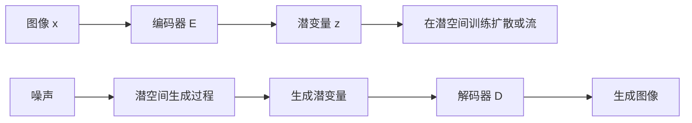

# 04 · 从二维实验走向图像与视频生成

**先修与依赖：** [02 扩散](02-diffusion.md)、[03 Flow matching](03-flow-matching.md)；建议先读 [05 评价与诊断](05-evaluation.md)，并完成 [06 视频时序反例](06-video-temporal-lab.md)，再设计研究实验。**目标：** 解释从 toy 分布到图像/视频增加了哪些问题；辨别模型、训练方法和采样器；为一个可验证的研究问题设计实验。

**当前范围：** 这是一份以 **2015—2024 年代表工作**为锚点的研究入门路线，非截至今日的完整前沿综述。本文所列大模型和权重**尚未在本仓库云环境中复现**；实际运行应另行记录 GPU、权重版本、许可和测量。二维实验成功只验证共享机制的一小部分。另有 [06 章](06-video-temporal-lab.md) 提供无需权重、无需训练的 CPU 视频时序诊断；它检验的是合成光点序列上的评价反例，不是视频生成模型。

## 1. 高维生成多了什么

一张 $H\times W$、三通道图像有 $3HW$ 个标量。数据具有局部相关性、长程结构、对象语义和多尺度变化。视频还需要建模跨帧联合分布。对同一文本独立生成每帧，只是在采样 $\prod_f p(x_f\mid c)$；它通常无法表达目标的 $p(x_1,\ldots,x_F\mid c)$ 中的身份、运动与遮挡依赖。

两个重要后果：首先，网络架构与表示的归纳偏置很重要；其次，训练损失和人类评价之间的差距更明显。“去噪误差下降”不能自动推断手部解剖、物体持久性或物理运动正确。

## 2. 潜空间：先压缩，再生成

Latent Diffusion Models（LDM）先学习图像编码器 $E$ 与解码器 $D$，再在 $z=E(x)$ 的表示中训练生成模型。推理时先生成 $z$，再解码为图像。



训练和生成是两条流程；生成阶段没有一张待编码的目标图像。压缩可以降低后续生成模型的空间成本，却可能损失细节。即使潜空间生成完美，也无法自动修复表示阶段已经丢掉的信息。

**要核对的三个假设：** 潜变量是否缩放、使用何种编码输出（均值或采样）、训练与推理是否用相同的自编码器。模型文件名相近不保证潜空间兼容；随意替换 VAE 可能改变尺度或解码质量。

LDM 的具体自编码器训练不是“任意 VAE 加 MSE”的同义词。论文使用感知和对抗等重建训练设计，并研究不同潜空间正则化方式。应按原始配置复现，不能只从 “VAE” 这个名称推断完整损失。

## 3. 条件控制与引导

文本到图像系统通常包含文本表示模型和带条件的生成网络。交叉注意力是一种传递条件的方式，但条件编码器、tokenization、训练数据和损失同样影响文本遵循。

Classifier-free guidance（CFG）常把无条件与有条件噪声预测组合为

$$
\hat\epsilon=\epsilon_{\mathrm{uncond}}
+s(\epsilon_{\mathrm{cond}}-\epsilon_{\mathrm{uncond}}).
$$

这里 $s=1$ 得到有条件预测，$s=0$ 得到无条件预测。某些文献使用 $(1+w)\epsilon_{\mathrm{cond}}-w\epsilon_{\mathrm{uncond}}$，与本式对应 $s=1+w$；报告 guidance 值必须说明约定。实际系统的“无条件”分支可能使用空文本或负向提示，后者不再等同于严格的无条件分布。

引导增强条件方向，但更大的 $s$ 并不保证更好：可能牺牲多样性、引起过饱和或产生伪影。它也通常意味着每一步要计算两种条件的预测（可以组成 batch），成本要实测。不能把同样参数直接复制给另一种预测参数化或指导方法而不核对实现。

## 4. 从 U-Net 到 Diffusion Transformer

U-Net 利用多尺度特征与跳连，Transformer 可以把图像或潜变量划分为 token 后建模交互。DiT 的关键对象是在潜空间工作的扩散 Transformer；“Transformer”描述网络，“扩散”描述生成建模框架。换成 Transformer 不会自动改变为自回归生成。

对密集自注意力，忽略常数时注意力矩阵随 token 数 $L$ 为 $O(L^2)$；这不是整个模型所有实现的精确时间/显存公式。Patch 大小、局部/稀疏注意力、算子融合、激活重计算都会改变实际成本。分辨率提高导致 token 数增加时，须重新测量，不能线性外推二维小模型的耗时。

## 5. 视频：表示、时间与条件一起改变

视频模型需要处理 $F$ 帧、空间尺寸、帧率和持续时长。相同帧数在不同 fps 下表示不同时间跨度；慢动作与正常速度也不应混为一谈。报告输出至少写明：帧数、fps、宽高、采样步数、种子、条件类型和权重版本。

常见设计包括：时空注意力、空间/时间分解、视频潜空间压缩、图像模型向视频扩展，以及对时间条件的显式编码。这些设计可能共存，不是一条所有方法必经的历史顺序。

- **Video Diffusion Models（2022）**：建立联合图像/视频扩散建模的代表性出发点，适合理解时间维如何进入去噪网络。
- **Stable Video Diffusion（2023 预印本）**：阅读数据筛选与分阶段训练。公开 SVD/SVD-XT 权重主要面向**图像到视频**；不能拿一条文本提示假定它是现成的文本到视频接口。
- **CogVideoX（2024 首发）**：阅读 3D 视频压缩与 Transformer 设计，核对具体模型版本支持的条件、分辨率和时长。后续仓库版本可能扩展能力，不应回写成 2024 首发论文的结论。

**研究反例。** 每帧都很清晰，但角色服装不断变化；单帧图像质量指标可能很好，视频整体仍失败。平均帧级指标不能代替时间一致性检查。先用 [06 视频时序实验](06-video-temporal-lab.md) 检验更简单、可精确控制的情形：保持一组光点帧完全相同，只打乱顺序，即可改变运动。静止对照进一步说明“相邻帧变化越小越好”可能奖励不动的输出。

## 6. 评价协议先于排行榜

| 要回答的问题 | 可采用的证据 | 不能据此自动推出的结论 |
| --- | --- | --- |
| 图像特征分布是否接近参考集 | 固定实现、样本数与预处理的 FID 等指标 | 文本遵循、训练数据未泄漏、所有细粒度模式均被覆盖 |
| 条件是否被表达 | 明确提示集合、人工规则或可信评价器，逐项统计属性/关系 | 评价器无偏或复杂组合全部正确 |
| 时间是否一致 | 跨帧身份、运动、遮挡测试；视频特征指标与人工评价 | 物理规律普遍正确 |
| 生成是否更快 | 同硬件、同精度、同分辨率/帧数、明确 warm-up 的延迟与内存测量 | 质量相同，或更换硬件后仍相同排序 |
| 是否改善多样性 | 多种子结果、覆盖率与近邻检查 | 没有记忆或未授权内容问题 |

FID 的常用形式是在固定特征空间中，用均值和协方差拟合两个高斯，再计算它们之间的**平方二阶 Wasserstein 距离**（通常称 FID）：

$$
\|\mu_r-\mu_g\|_2^2+
\operatorname{Tr}\!\left(\Sigma_r+\Sigma_g
-2(\Sigma_r^{1/2}\Sigma_g\Sigma_r^{1/2})^{1/2}\right).
$$

这是对特征高斯近似的比较，不是对任意真实图像分布的精确 Wasserstein 距离。这里使用的是 $W_2^2$ 而非 $W_2$：若所有特征一起缩放为原来的 $a$ 倍，FID 会乘以 $a^2$，因此特征定义和尺度必须固定。有限样本估计存在偏差；实现的 resize、特征权重和数值处理也会影响结果。视频特征指标同样依赖编码器、采样与裁剪策略。不要以随意选取的几张图估算 FID，然后与论文大样本数值比较。

## 7. 从阅读到一个可复现实验

### 已提供：无需模型的视频评价反例

完成 README 的安装后，在仓库根目录运行：

```bash
python -m genai_study.video_diagnostics --output artifacts/video-counterexample
```

查看 `contact_sheet.png` 中移动、乱序、静止三组光点序列，并按 [06 章](06-video-temporal-lab.md) 解释 `metrics.json` 的指标定义与单位。原始帧同时保存在 `frames.npz`。预先预测哪些统计对帧顺序不敏感、哪些诊断会变化，再与本次输出核对。该实验没有学习参数，不能用来宣称某个视频生成模型具有时间一致性，也不替代 FVD 或人工评价。

### 待实现：预训练生成模型的受控实验

以下是**待实现的实践任务**，不是已运行指南。选择一个官方支持且许可可接受的预训练图像模型，先做单变量 CFG 实验：

1. 固定代码提交、权重 revision、依赖、硬件、精度、提示集合、种子集合和基础采样器。
2. 先完成一个最低配置的样本，记录实际时间和峰值内存；据此设置总成本上限。
3. 只改变 guidance 系数，保持其它配置一致。保存完整样本集合，不挑选最佳图。
4. 为属性遵循、伪影、多样性定义人工评分规则，明确样本量与评估者局限。
5. 报告各组分布、失败案例和成本；若结果不足以判定，就写“证据不足”。

再把实验迁移到图像到视频时，增加参考图像版本、帧率、时长和时间一致性规则，并重新测量成本。不要仅因为方法名称相近就假定推理参数可互换。

### 可深入的五条研究线

| 方向 | 可起步的问题 | 第一项必须控制的变量 |
| --- | --- | --- |
| 表示学习 | 压缩率如何影响生成细节与成本？ | 编解码器重建上限与潜变量尺度 |
| 采样与求解器 | 更少网络评估次数能否保持质量？ | 同模型、相同条件与质量口径 |
| 条件与可控生成 | 组合属性和空间关系为何失败？ | 提示分布、条件编码及评价器偏差 |
| 视频时空建模 | 哪些机制改善身份与运动一致性？ | 帧率、时长、参考帧与数据筛选 |
| 评价与数据 | 指标改善能否被人工偏好复核？ | 样本量、特征实现与训练数据重叠 |

## 8. 练习与提示

**A · CFG 约定。** 一篇论文使用 $w=4$ 的 $(1+w)\epsilon_c-w\epsilon_u$，代码使用本章公式。应该填多少 $s$？

<details><summary>答案</summary>

$s=5$。不应因为两个参数都叫 guidance scale 就直接填 4。

</details>

**B · 压缩成本。** 图像的高和宽各压缩 8 倍，潜变量通道数为 4，而原图通道为 3。标量数减少多少倍？是否等于端到端加速？

<details><summary>答案</summary>

原图 $3HW$，潜变量 $4HW/64$，标量数减少 48 倍。它不等于端到端加速：网络宽度、注意力、解码器、数据类型与硬件效率均影响实测成本。

</details>

**C · 独立帧反例。** 构造两个视频分布，使它们每帧的边缘分布相同，但跨帧联合分布不同。

<details><summary>答案</summary>

两帧都只取黑或白。分布 A 以相同概率生成“黑黑”或“白白”；分布 B 以相同概率生成“黑白”或“白黑”。每帧均为黑白各半，时间关系却完全相反。只看单帧边缘分布无法区分。

</details>

**D · 设计反证。** 模型 A 的平均帧级图像指标优于 B，但你怀疑其运动更不一致。给出一个小规模验证方案。

<details><summary>提示</summary>

固定参考图像、条件、时长、fps 与种子；预先规定身份变化、物体消失和运动跳变的判定标准，保存整段视频并盲评。报告计数与不确定性，不能只挑一个失败例子就断言总体排序。

</details>

## 原始论文、实现与版本边界

| 主题 | 原始来源 | 阅读定位 / 版本 |
| --- | --- | --- |
| U-Net | Ronneberger et al., [U-Net](https://arxiv.org/abs/1505.04597) | MICCAI 2015；原任务是医学分割，不能直接等同于现代扩散 U-Net |
| 潜扩散 | Rombach et al., [High-Resolution Image Synthesis with Latent Diffusion Models](https://arxiv.org/abs/2112.10752)；[作者实现](https://github.com/CompVis/latent-diffusion) | CVPR 2022；§3 的自编码器、潜扩散及条件化 |
| CFG | Ho & Salimans, [Classifier-Free Diffusion Guidance](https://arxiv.org/abs/2207.12598) | 2022 预印本；核对引导系数定义 |
| DiT | Peebles & Xie, [Scalable Diffusion Models with Transformers](https://arxiv.org/abs/2212.09748)；[作者实现](https://github.com/facebookresearch/DiT) | ICCV 2023；网络结构、规模实验与潜空间设置 |
| 视频扩散 | Ho et al., [Video Diffusion Models](https://arxiv.org/abs/2204.03458) | NeurIPS 2022；联合图像/视频训练与时空架构 |
| SVD | Blattmann et al., [Stable Video Diffusion](https://arxiv.org/abs/2311.15127)；[官方实现](https://github.com/Stability-AI/generative-models) | 2023 首发预印本；区分论文训练研究与公开图像到视频权重 |
| CogVideoX | Yang et al., [CogVideoX](https://arxiv.org/abs/2408.06072)；[官方实现](https://github.com/THUDM/CogVideo) | 2024 首发预印本；后续仓库包含更新版本，运行时需固定 revision |
| FID | Heusel et al., [GANs Trained by a Two Time-Scale Update Rule Converge to a Local Nash Equilibrium](https://arxiv.org/abs/1706.08500) | NeurIPS 2017；FID 定义与评价实验 |
| FID 实现敏感性 | Parmar et al., [On Aliased Resizing and Surprising Subtleties in GAN Evaluation](https://arxiv.org/abs/2104.11222)；[作者实现](https://github.com/GaParmar/clean-fid) | CVPR 2022；resize、压缩与实现差异 |
| 视频特征评价 | Unterthiner et al., [Towards Accurate Generative Models of Video: A New Metric & Challenges](https://arxiv.org/abs/1812.01717) | 2018 首发预印本；FVD，不代表覆盖所有视频质量维度 |

本章为原创教学解释，不包含第三方图片、权重或数据。论文版本是知识定位，仓库链接是获取实现的入口；**链接存在不等于在本项目复现通过**。关键来源的可访问性与实际验证范围应以执行记录为准。

### 本轮可访问原始实现核对（2026-11-10）

以下固定提交的 README 已实际读取，核对的是方法定位与公开接口范围，不是大模型性能：

- [LDM · `a506df5`](https://github.com/CompVis/latent-diffusion/blob/a506df5756472e2ebaf9078affdde2c4f1502cd4/README.md)：作者项目定位与原论文链接。
- [DiT · `ed81ce2`](https://github.com/facebookresearch/DiT/blob/ed81ce2229091fd4ecc9a223645f95cf379d582b/README.md)：Transformer 作用于 latent patches；README 的默认结果也附采样配置，不能脱离配置比较。
- [SVD · `e8cd657`](https://github.com/Stability-AI/generative-models/blob/e8cd657656fa5d61688191730d0e03242bf4ed44/README.md)：公开 SVD 标为 image-to-video，区分它与仓库后续其它模型。
- [CogVideoX · `7a1af71`](https://github.com/THUDM/CogVideo/blob/7a1af7154511e0ce4e4be8d62faa8c5e5a3532d2/README.md)：3D Causal VAE，以及图像到视频功能是后续单独发布的模型变体。

当前云网络对 arXiv 的直接请求返回 403，故本轮没有重新逐篇阅读全文；数学关系采用章内推导与可访问实现交叉核对。引用的论文结论与本项目已验证的运行能力保持区分。
