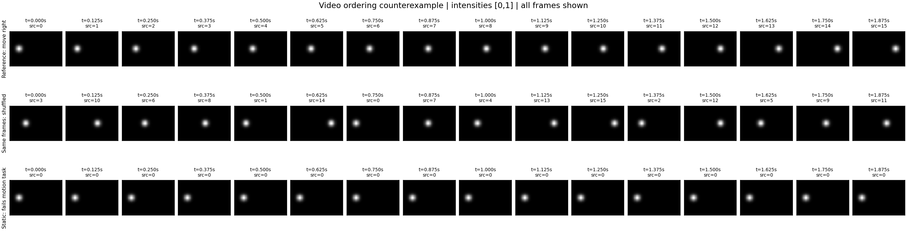

# 06 · CPU 视频实验：图像看起来相同，时间关系却错了

**先修**：[00 概率与实验基础](00-foundations.md)、[05 评价与实验诊断](05-evaluation.md)；会操作 PyTorch 张量的维度和均值。无需先训练生成模型。

**完成后应能**：构造空间统计相同但时间顺序不同的视频，正确报告帧率与时长，解释静态视频为什么能“骗过”某些平滑性指标，并为已知运动任务选择互补诊断。

**实践范围**：在 CPU 上生成确定性合成数据并评价，没有训练/下载视频生成模型，不需要 GPU、网络数据集或模型权重。这验证评价逻辑，不能证明真实视频模型的效果。

## 1. 一个可以严格控制的问题

任务是让单个高斯亮点从画面左侧匀速移到右侧，背景始终为黑色。构造三种序列：

| 序列名 | 构造方式 | 是否完成指定运动 |
| --- | --- | --- |
| `reference` | 按正确时间顺序排列所有帧 | 是：这是定义任务的参考轨迹 |
| `shuffled` | 对同一组帧做随机置换 | 一般不能：每帧依旧合法，时间关系被破坏 |
| `static_first_frame` | 将参考第一帧重复全部次数 | 不能：亮点没有从左到右运动 |

这里的“正确”由已知任务规定。静态画面不是所有视频任务中的错误；它只是不满足本实验“左到右匀速运动”的条件。一般随机置换有可能恰好保持原顺序；本实现检测到恒等排列时会循环移动一位，确保得到非恒等的时序反例。实际排列保存到输出中，可直接核对。

默认设置为 $F=16$ 帧、$H=32$、$W=48$、单通道，帧率 $r=8$ fps。本文张量轴记为 `F,H,W`；JSON 的 `layout` 字段使用 `T,H,W` 表示同一个帧轴（这里的 `T` 不是扩散步数）。它不是图像模型常用的 `B,C,H,W`。像素强度在 $[0,1]$，位置坐标以像素为单位。

第 $k$ 帧（$k=0,\ldots,F-1$）的时刻为 $t_k=k/r$。亮点中心按

$$
c_{x,k}=8+\frac{31k}{F-1},\qquad c_{y,k}=15.5
$$

移动，亮度场为

$$
I_k(i,j)=\exp\left(-\frac{(j-c_{x,k})^2+(i-c_{y,k})^2}{2\sigma^2}\right),
\qquad\sigma=2\ \text{pixels}.
$$

这里 $i$ 是行坐标、$j$ 是列坐标；圆形高斯的强度不是归一化概率密度。像素网格离散化和有限边界会令亮度质心与解析中心存在微小差异。

### 帧数、帧率和时长不等价

按每帧显示 $1/r$ 秒的约定，名义播放时长是 $F/r$；首末采样时刻之差是 $(F-1)/r$。默认设置对应 **2 秒播放时长**和 **1.875 秒首末样本跨度**。若只报告“16 帧视频”，仍然不知道运动速度。

解析中心每步移动 $31/(F-1)$ 像素，因此给定路径的速度为 $31r/(F-1)$ pixels/second。固定同一帧序列、将 fps 翻倍，观察到的速度也翻倍，逐帧像素内容完全不变。改变本 CLI 的 `--frames` 则会重新采样完整的左右轨迹，不是简单截断原视频。

## 2. 为什么时间均值会丢掉顺序

时间平均图定义为

$$
\bar I=\frac1F\sum_{k=0}^{F-1}I_k.
$$

对任何帧置换 $\pi$，

$$
\frac1F\sum_k I_{\pi(k)}=\frac1F\sum_k I_k.
$$

这是求和的置换不变性。它不依赖亮点形状、模型质量或随机种子。浮点加法顺序可能带来很小的舍入差异，但不改变数学结论。

时间均值能描述“哪些位置曾亮过、总体亮度如何”，却丢失“何时亮、先后如何”。先左后右、先右后左、随机跳跃可以拥有同一张平均图。类似地，将每帧当独立图像后做集合比较，也可能遗漏时间关系。这是评价设计的反例，不是在断言所有视频特征指标都必然忽略顺序。

另一个陷阱是只奖励小运动或相邻帧接近：重复静态帧的相邻变化为零，可以比正确移动更“平滑”，但没有完成任务。评价必须同时检查动作和一致性，不能把少动等同于正确运动。

## 3. 直接运行与检查输出

完成 [README](../../README.md) 的依赖安装，在仓库根目录执行：

```bash
python -m genai_study.video_diagnostics --output artifacts/video-counterexample
```

可显式指定本章默认设置：

```bash
python -m genai_study.video_diagnostics --frames 16 --fps 8 --seed 7 --output artifacts/video-counterexample-seed7
```

输出目录已有文件时，选择一个新目录；只有确实要替换已有实验产物时才使用 `--overwrite`。`--frames` 限制在 2–32，`--fps` 必须是正有限值；这一限制用于保持全帧拼图与诊断计算的小规模。本实验只生成小数组和诊断图，软件版本以结果为准；CLI 不记录耗时，需要成本比较时另行测量。

| 文件 | 用途 |
| --- | --- |
| `metrics.json` | 配置、各序列诊断与适用范围；具体实测以此为准 |
| `contact_sheet.png` | 按时序展示所有帧与时间标注；比较轨迹是否连贯 |
| `frames.npz` | 保存各序列数组，支持独立复核 |

先查看完整帧拼图，再检查 JSON。拼图提供时序索引，但不是实时视频播放器；如果需要感知实际速度，应按声明的 fps 播放，不能仅靠拼图列间距离猜测速度。当前练习不依赖视频编码器或 ffmpeg。

## 4. 指标分别看见了什么

令 $I_k$ 为待评序列，$R_k$ 为同一时刻的参考帧。所有公式使用相同空间坐标、帧数和已知时间对应；以下指标不是通用视频生成质量分数。

### 逐时刻像素 MSE

$$
E_{\mathrm{ordered}}=\frac1{FHW}\sum_{k,i,j}(I_k(i,j)-R_k(i,j))^2.
$$

对应字段 `ordered_mse_to_reference`，单位为强度平方。它会惩罚错误的时间位置，在这个唯一参考轨迹任务中有意义。对存在多种合理结果的自由生成任务，另一个有效运动也可能得到高 MSE，所以不能把像素 MSE 普遍等同于视频质量。

### 时间平均图 MSE

$$
E_{\mathrm{mean}}=\frac1{HW}\|\bar I-\bar R\|_2^2.
$$

对应 `time_mean_image_mse`。随机置换与原序列具有相同时间均值，因此该误差在数值容差内为零；这不能证明顺序正确。静态第一帧一般不具有相同平均图。

### 忽略顺序的双向最近帧误差

令 $d(A,B)=\|A-B\|_2^2/(HW)$，定义

$$
E_{\mathrm{set}}=\frac12\left[
\frac1F\sum_k\min_\ell d(I_k,R_\ell)
+\frac1F\sum_\ell\min_k d(R_\ell,I_k)\right].
$$

对应 `symmetric_frame_set_mse`。当两序列包含同一组帧时，它为零；它不要求找到一个一致的时间配对，且最近邻匹配可以多对一。即使双方帧种类相同但重复次数不同，也可能为零。因此它不仅遗漏顺序，还不能完整刻画帧的重数，不是严格的序列距离或通用最优传输距离。

### 质心与运动诊断

对非负且总强度非零的帧定义亮度质心

$$
\hat c_k=\frac{\sum_{i,j}(j,i)I_k(i,j)}{\sum_{i,j}I_k(i,j)}.
$$

在单亮点黑背景中，质心接近目标位置；它不是通用目标检测器。在多目标、背景亮度变化、遮挡或两个对称亮点中，质心可能落在没有物体的位置。

| JSON 字段 | 定义与单位 | 检查内容 |
| --- | --- | --- |
| `centroid_rmse_px` | $\sqrt{F^{-1}\sum_k\|\hat c_k-\hat c_k^{\mathrm{ref}}\|^2}$，pixels | 已知每一时刻的位置是否正确 |
| `mean_centroid_speed_px_per_second` | $r(F-1)^{-1}\sum_{k=0}^{F-2}\|\hat c_{k+1}-\hat c_k\|$，pixels/second | 采样帧间的平均位移速度；不是连续真实路径的精确弧长速度 |
| `wrong_direction_steps` | $\hat c_{x,k+1}-\hat c_{x,k}<-10^{-10}$ 的步数，阈值单位 pixels | 本任务要求向右，负方向步数提供局部错误证据 |
| `endpoint_displacement_px` | $\|\hat c_{F-1}-\hat c_0\|$，pixels | 是否有预期的净位移；无法检查中间怎么走 |

方向计数的 $10^{-10}$ 容差用于抑制浮点噪声，不是物理意义上的速度阈值。静态序列速度为零、负方向步数也为零，仍然错误；它的终点位移和逐时刻位置误差可以暴露缺失的动作。乱序序列可能偶然具有正确起终点，但中间持续跳跃，因此只看端点也不充分。

没有一个字段单独定义所有“好视频”。这里的优势是参考轨迹已知，可以构造可证伪的明确任务，而不把一个黑箱分数当作结论。

## 5. 理论预期、测量与局限分开报告

以下是**可独立检查的数学性质**，不是预先编造的实测表：

1. `reference` 与自身的逐时刻 MSE、平均图 MSE 和质心 RMSE 为零或浮点容差内的零。
2. `shuffled` 与 `reference` 的帧多重集相同，平均图相同，双向最近帧误差为零；非恒等置换在不同帧上会产生正的逐时刻误差。
3. `static_first_frame` 的质心速度与终点位移为零，但除第 0 帧外不能沿参考轨迹移动。
4. 固定数组只改变 fps，所有像素误差不变，以 pixels/second 表示的速度按 fps 成比例缩放。

**实际测量**保存在 CLI 生成的 `metrics.json`；应保留 seed、置换与配置。参考速度可与 $31r/(F-1)$ 比较，但因为从有限网格估计质心，不应强求与解析中心速度逐 bit 相等。

### 已记录的一次默认运行

下面是仓库在 Python 3.12.14、NumPy 2.1.3、Matplotlib 3.9.3 下执行默认命令的**实际测量**。全部原始值、seed 7 的置换和配置见 [测量 JSON](../../records/measurements/video-counterexample.json)。这是确定性合成反例的一次运行，不是生成模型 benchmark。

| 序列 | 逐时刻像素 MSE | 时间平均图 MSE | 质心位置 RMSE（px） | 平均质心速度（px/s） | 向左步数 |
| --- | ---: | ---: | ---: | ---: | ---: |
| 原序列 | 0 | 0 | 0 | 16.53325 | 0 |
| 同帧乱序 | 0.014071 | $3.94\times10^{-35}$ | 11.55300 | 114.63094 | 6 |
| 静态第一帧 | 0.014097 | 0.007556 | 18.19363 | 0 | 0 |

乱序的双向最近帧误差恰为 0。它与原序列几乎相同的平均图，同时伴随明显的时刻位置错误；静态序列虽然没有逆向步和运动，却拥有更大的轨迹位置误差。



**尚未验证的范围**：真实纹理、相机运动、复杂物体、遮挡、三维几何、长视频、物理规律、生成模型训练或 FVD/FID。亮点时序实验只能说明这些指标的逻辑边界；它不是视频模型能力基准。

## 6. 练习与参考答案

### A. 均值不变，但顺序改变

把参考帧倒序而不是随机置换，哪些指标必须不变？哪些应显示任务失败？

**答案**：时间平均图和帧集合相同，因此对应误差为零；逐时刻 MSE 与质心 RMSE 应为正。端点位移的**长度**与原序列相同，不能检测方向；`wrong_direction_steps` 会发现向左的运动。本实验用的是位移范数，而非有符号水平位移，读定义比读名称重要。

### B. 帧率单位

16 帧从 8 fps 改为 16 fps，不改变任何像素。播放时长、首末样本跨度和速度如何改变？

**答案**：播放时长从 2 秒变为 1 秒；首末跨度从 1.875 秒变为 0.9375 秒；相同位移的 pixels/second 速度翻倍。像素 MSE 和质心位置误差不变。这说明仅比较帧数不足以对齐视频任务。

### C. 静态反例

有人提出“平均速度越小越好，说明视频更稳定”。给出本实验中的反例，并设计一个修正协议。

**答案**：`static_first_frame` 达到零速度，却不完成运动。应同时检查动作完成度/参考轨迹、身份或外观连续性、异常跳跃，并明确任务。对于要求静态的任务，零速度可能正是正确结果，不能反过来将小速度普遍作为缺陷。

### D. 质心不等于跟踪

在一张图上让两个等亮度点对称运动，中心保持不变。质心速度为零意味着物体没动吗？

**答案**：不意味着；亮度质心只保留一阶空间矩，两个点的位移可能互相抵消。需要实例对应、轨迹或更丰富表示，不能把单点实验的诊断直接复制到多主体真实视频。

### E. 一个低成本的受控扩展

在同一参考数组上比较原序列、倒序、随机置换、静态第一帧。如何隔离“顺序”这个变量？

**答案**：原序列/倒序/置换共享完全相同的帧多重集、尺寸、fps 和强度，只有顺序不同；静态序列是额外退化对照，其帧多重集改变，应单独解释。保留所有完整序列和数值，不只截取一帧。此扩展无需更换生成模型；确切比较对象是评价指标对时序变换的响应。

## 7. 来源与下一步

- 本章合成亮点、置换反例与指标由仓库代码直接定义；均值置换不变性、单位换算和质心公式在正文完整给出，可通过 NumPy/PyTorch 数组独立核对。实践不使用第三方训练数据或预训练模型。
- Unterthiner et al., [Towards Accurate Generative Models of Video: A New Metric & Challenges](https://arxiv.org/abs/1812.01717)，2018 预印本、ICLR 2019 workshop：用于理解为什么视频评价需要时空信息。本章没有实现 FVD，也没有借用论文性能数字；本轮未在线逐页核验论文全文。
- 回到 [05 评价章](05-evaluation.md) 设计多个互补指标，再用 [研究模板](../reading-paper-template.md) 明确任务、数据、单位、对照和统计范围。具备实际模型与预算后，沿 [04 研究路线](04-image-video-roadmap.md) 扩展到图像到视频研究。
