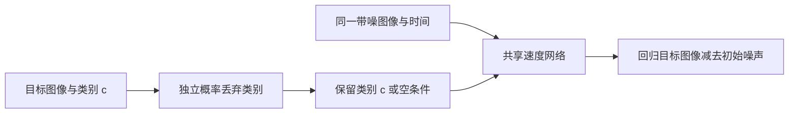

# 08 · 条件丢弃与小图像 CFG 实验

**先修与依赖：** [03 Flow matching](03-flow-matching.md)、[07 CPU 图像生成](07-image-flow-lab.md)；评价结果时结合 [05 评价与诊断](05-evaluation.md)。**学习目标：** 解释空条件分支如何学到边缘速度；完成一次条件丢弃训练；冻结模型、噪声和采样预算，分析引导系数对类别响应、几何、多样性与裁剪的影响。

本章沿用16×16圆盘/方形数据和条件卷积网络。训练时随机隐藏类别，采样时组合有条件与空条件的**速度预测**。原始 classifier-free guidance（CFG）论文在扩散模型中组合噪声预测；本章把相同的双分支结构用于07章的flow速度场，作为可在CPU上检验的教学实验。两种预测量的来源与约定见第8节。

## 1. 从类别条件到空条件

07章用两个空间常量通道表示类别：圆盘为`[1,0]`，方形为`[0,1]`。本章增加全零向量`[0,0]`作为空条件，内部标签记为`-1`。类别0仍表示圆盘；空条件的含义由两个通道共同确定。

网络输入继续包含6个通道：带噪图像、时间、两个条件通道和两个空间坐标。空条件与类别条件共享全部网络参数。训练时以固定概率 $p_{\mathrm{drop}}$ 替换整个类别标识，图像、噪声、时间和速度监督目标保持原定义。



这个训练过程让网络同时回答两个问题：给定类别时图像状态应如何变化；仅凭当前带噪状态与时间时，混合数据分布的图像状态应如何变化。

## 2. 为什么随机丢弃条件能训练边缘速度

记目标图像为 $Y$，类别为 $C$，独立标准高斯噪声为 $Z$，训练时间 $T\sim\mathcal U(0,1)$。沿用本仓库的时间方向：$t=0$是噪声，$t=1$是数据，路径与目标速度为

$$
X_t=(1-t)Z+tY,\qquad U=Y-Z.
$$

令 $D\sim\operatorname{Bernoulli}(p_{\mathrm{drop}})$ 独立于数据、类别、噪声与时间。网络实际接收

$$
\widetilde C=
\begin{cases}
\varnothing,&D=1,\\
C,&D=0.
\end{cases}
$$

记单张图像的标量数 $d_{\mathrm{img}}=1\times16\times16=256$。训练目标是在batch和图像全部像素上取均值的平方误差：

$$
\mathcal L(\theta)=
\mathbb E\!\left[\frac1{d_{\mathrm{img}}}
\left\|v_\theta(X_T,T,\widetilde C)-U\right\|_2^2\right].
$$

有界图像与高斯噪声保证 $\mathbb E\|U\|^2<\infty$，平方误差回归的总体最优预测器是给定输入后的条件期望。因此，在 $0<p_{\mathrm{drop}}<1$ 时，理想预测器在相应输入分布下几乎处处满足

$$
v_c^*(x,t,c)=\mathbb E[U\mid X_T=x,T=t,C=c],
\qquad
v_u^*(x,t)=\mathbb E[U\mid X_T=x,T=t].
$$

第二个等式来自丢弃事件的独立性：观察到 $D=1$ 不改变原来的图像与类别混合分布。它仍按当前状态 $X_t=x$ 推断可能的数据端点；在每个状态处，把两个类别速度简单各取一半通常得不到这个条件期望。

这组等式描述总体平方误差最优解。实际网络共享有限参数，通过有限更新逼近两种预测器；条件与空条件留出损失分别记录其回归表现。终点与低维数据支撑的假设沿用07章，第03章给出了条件速度与边缘速度的进一步推导。

本仓库按类别均衡采样，默认保留07章的`--condition-dropout 0`行为。本章显式设置`0.2`，含义是每个训练样本有20%的概率隐藏类别。丢弃掩码使用独立随机流；实测丢弃比例会围绕指定概率波动，训练记录保存两类分支实际接收的样本数。

## 3. 在同一状态上组合两次速度预测

冻结训练后的网络，在**同一个** $x,t$ 上分别计算

$$
v_c=v_\theta(x,t,c),\qquad
v_u=v_\theta(x,t,\varnothing),\qquad
v_s=v_u+s(v_c-v_u).
$$

两次预测具有相同形状和单位：像素强度/归一化时间。由此得到三个可直接检查的情形：

| 系数 | 速度 | 实验中的含义 |
| --- | --- | --- |
| $s=0$ | $v_u$ | 根据混合图形分布生成，忽略请求类别 |
| $s=1$ | $v_c$ | 恢复该模型的条件速度场 |
| $s>1$ | $v_c+(s-1)(v_c-v_u)$ | 沿条件与空条件预测的差向量继续外推 |

本章固定 $s\ge0$，默认比较0、1、2、4。若采用原CFG论文的 $(1+w)v_c-wv_u$系数写法，则 $s=1+w$。系数换算是代数关系，网络预测对象仍需按具体模型确认。

显式Euler每步更新为

$$
x_{k+1}=x_k+\frac1K v_s(x_k,k/K,c),\qquad k=0,\ldots,K-1.
$$

本实现每一步显式执行两个完整batch的网络调用，即每张生成图像 $\mathrm{NFE}=2K$。即使 $s=0$或1，也保留两次调用，使本次强度扫描的调用预算一致，再直接选取对应分支输出。实际应用可为这些特殊系数省略不使用的分支；比较成本时应另行记录这一优化。

较大系数放大两个预测器之间的差，也会放大其中的回归误差。新的速度场定义新的ODE演化；要描述其终点密度，需要研究整条概率路径与连续性方程。仅凭速度组合式，尚无法把终点写成某个精确的温度化条件密度。这里通过完整生成数组、几何与值域诊断研究其采样行为。

## 4. 训练一次，再做固定模型的强度扫描

完成 [README](../../README.md) 的安装并激活环境，从仓库根目录运行。首次执行按两条命令的顺序；已有本章训练checkpoint时可直接采样，已有采样结果时直接进入第5节。重做时为对应的`--output`选择新目录，并相应修改checkpoint路径。

```bash
python -m genai_study.image_flow \
  --condition-dropout 0.2 --steps 1500 --seed 7 \
  --output artifacts/image-cfg

python -m genai_study.image_guidance_study \
  --checkpoint artifacts/image-cfg/checkpoint.pt \
  --scales 0 1 2 4 --sampling-steps 40 --samples 128 --seed 123 \
  --output artifacts/image-guidance
```

`image_flow --steps`是训练更新数；`image_guidance_study --sampling-steps`是每组Euler步数。后一个命令要求强度列表包含1，以便所有方案都有同一条件基准；系数必须有限、非负，列表会排序去重。

训练命令记录条件丢弃概率、空条件编码和两种分支实际接收的样本数。独立引导命令只接受元数据中`condition_dropout`位于`(0,1)`、`null_condition_encoding`为`zero-vector`，且两种分支都实际训练过的图像checkpoint。普通07章模型的丢弃概率为0，空条件分支缺少训练样本；应按本节命令在新目录重新训练。

先检查操作路径时可使用以下较短命令；已有对应结果时直接复用，重做时换目录：

```bash
python -m genai_study.image_flow \
  --condition-dropout 0.2 --steps 20 --batch-size 16 \
  --samples 16 --sampling-steps 4 --seed 7 \
  --output artifacts/image-cfg-smoke

python -m genai_study.image_guidance_study \
  --checkpoint artifacts/image-cfg-smoke/checkpoint.pt \
  --scales 0 1 2 4 --sampling-steps 4 --samples 16 --seed 123 \
  --output artifacts/image-guidance-smoke
```

短运行检查输入输出；分析引导行为时使用完整训练预算。默认seed与这组20更新配置已验证两种分支均收到训练样本；极小预算或其它随机配置可能因某分支从未被采样而无法通过checkpoint检查。

实验在CPU、单线程上运行，沿用07章的依赖和网络。训练和每组采样的实际耗时写入JSON；成本解释需注明计时阶段、样本数与NFE。完整训练与强度扫描的测量、固定索引图和结果分析见 [小图像引导实测报告](../image-guidance-report.md)。更强引导的几何表现由测量决定，系数列表本身只是预先选定的对照设计。

## 5. 如何控制噪声、类别和参考数据

本次默认128张输出使用64份独立高斯噪声，每份复制为两个相邻样本：第一个请求圆盘，第二个请求方形。数组布局为

```text
index:    0  1  2  3  4  5 ...
noise:   z0 z0 z1 z1 z2 z2 ...
label:    0  1  0  1  0  1 ...
```

因此可以沿两个方向比较：同一强度下，成对改变类别；同一类别与初始噪声下，改变引导强度。每组还固定同一checkpoint、Euler步数、精度、参考图形与独立目标基线。

在 $s=0$ 时，类别请求不进入实际使用的速度，初始噪声相同的圆盘/方形两项应逐元素相同。其他系数下，两项可以分离，体现条件输入对同一起点的作用。真实参考图像独立抽样，按类别提供几何与多样性参照；它们与生成图像按分布比较。

128张输出中只有64个独立噪声组。按标签分别看每类64张图像是清楚的描述方式；若需要重采样区间，应以噪声对为单位保留配对关系。把两个类别或不同强度下的同源图像当作独立重复，会低估相关性。

## 6. 输出与诊断怎样读

独立采样生成`metrics.json`、`arrays.npz`和`samples.png`。图像按生成索引固定展示前4个噪声对，共8列，类别交替为圆盘/方形；第一行为独立目标图形，随后各行为一组强度。显示图裁剪到`[0,1]`，数组保存原始生成值。

| 位置 | 主要内容 |
| --- | --- |
| JSON的`checkpoint` | 权重SHA、架构及训练元数据，包括条件丢弃与分支计数 |
| JSON的`runs` | 每组`scale`、`steps`、`nfe`、`elapsed_seconds`、分类别诊断和配对RMS |
| NPZ的`initial`、`labels` | 重复成对的初始噪声及交替类别标签 |
| NPZ的`reference`、`independent_target` | 固定的两组真实图形参照 |
| NPZ中由`run["array_key"]`指定的数组 | 对应强度的原始生成终点；默认键包括`scale_0`、`scale_1`、`scale_2`、`scale_4` |

训练JSON另有`initial_unconditional_heldout_loss`和`final_unconditional_heldout_loss`，使用同一留出图像/噪声/时间、改为空条件后计算；`all`汇总全部样本，`circle`与`square`按真实数据类别分组。它们帮助检查空条件回归的拟合情况。对比07章独立训练的模型时，需同时记录丢弃配置与训练seed的变化。

先定位三类变化：

1. **条件响应。** 检查相同噪声的圆盘/方形是否分离，结合最近模板类别与请求类别匹配比例。$s=0$的两张请求共享同一输出，提供条件被忽略的可检验基准。
2. **几何与类别内变化。** 检查粗模板通过率、前景质量、质心与其标准差，并与独立真实图形对照。固定原型也能获得高模板通过率，因此保留位置/尺寸变化的检查。
3. **原始数值与裁剪。** 检查越界比例、平均绝对裁剪幅度以及原始/裁剪RMS。速度外推可能使形状和原始像素同时变化；显示图仅展示裁剪后的结果。

以条件基准 $s=1$ 为参照，配对像素RMS定义为

$$
\Delta_s=\sqrt{\operatorname{mean}_{B,C,H,W}
\left(x^{(s)}-x^{(1)}\right)^2}.
$$

两个数组按同一噪声、标签和索引配对，单位为像素强度。裁剪版本先分别裁剪两个终点再使用同一归约。它们量化引导强度带来的变化，方向为“更小”本身没有质量排序意义：$s=1$按定义差为0，其他方案是否更合适要由任务诊断决定。

同一强度下的类别配对RMS把偶数索引与相邻奇数索引比较。它描述条件造成的变化幅度；$s=0$应为0，高值还需结合输出几何解释。类别响应、目标分布拟合和数值值域是互相补充的检查。

## 7. 练习与参考答案

### A. 类别相关丢弃会怎样改变空条件分布

圆盘和方形原本各占一半。若圆盘以0.8概率丢弃条件，方形以0.2概率丢弃，空条件训练样本的类别比例是多少？这个分支在学习哪个混合分布？

<details><summary>答案</summary>

由Bayes公式，空条件样本中圆盘概率为`0.5×0.8 / (0.5×0.8+0.5×0.2)=0.8`，方形为0.2。空条件分支因而学习被丢弃策略重加权的混合路径。在给定当前状态后，各类别权重还要再结合该状态的似然。类别无关的固定丢弃概率保留原始混合比例。

</details>

### B. 系数与成本

设某像素上 $v_u=-0.3$、$v_c=0.2$，分别求 $s=0,1,2$的速度。采用40步Euler时，每组每张图像的NFE为多少？

<details><summary>答案</summary>

速度分别为`-0.3`、`0.2`、`0.7`，本实现每组NFE为80。这里的值是速度，下一步位移还需除以40。原CFG的 $w=1$ 对应本章 $s=2$；比较论文参数时先展开公式核对。

</details>

### C. 从输出检查条件作用与裁剪

完成训练和引导对照后，核验 $s=0$ 的相邻类别图像相同、$s=1$的参照RMS为0，再比较四组的几何、值域与类别内变化。用原始数组独立复算一项RMS，确认索引与单位。

以下命令直接读取本章的完整实验输出；若验证smoke结果，将`folder`改为`artifacts/image-guidance-smoke`。字段`array_key`记录实际数组名，读取时直接使用该映射。

```bash
python - <<'PYCODE'
import json
from pathlib import Path
import numpy as np
import torch
from genai_study.image_checkpoint import load_image_checkpoint
from genai_study.image_flow import integrate_images

folder = Path("artifacts/image-guidance")
report = json.loads((folder / "metrics.json").read_text())
runs = {run["scale"]: run for run in report["runs"]}
torch.set_num_threads(report["config"]["threads"])
model, _ = load_image_checkpoint(Path(report["checkpoint"]["path"]))
with np.load(folder / "arrays.npz") as arrays:
    initial, labels = arrays["initial"], arrays["labels"]
    np.testing.assert_array_equal(initial[0::2], initial[1::2])
    zero = arrays[runs[0]["array_key"]]
    np.testing.assert_array_equal(zero[0::2], zero[1::2])
    conditional = arrays[runs[1]["array_key"]]
    replay = integrate_images(model, torch.from_numpy(initial),
                              torch.from_numpy(labels), report["config"]["sampling_steps"])
    np.testing.assert_array_equal(conditional, replay.numpy())
    for run in report["runs"]:
        generated = arrays[run["array_key"]].astype(np.float64)
        baseline = conditional.astype(np.float64)
        raw = np.sqrt(np.mean((generated - baseline) ** 2))
        clipped = np.sqrt(np.mean((generated.clip(0, 1) - baseline.clip(0, 1)) ** 2))
        assert abs(raw - run["paired_pixel_rms_difference_from_scale1"]) < 1e-7
        assert abs(clipped - run["paired_clipped_pixel_rms_difference_from_scale1"]) < 1e-7
        assert clipped <= raw + 1e-12
        assert run["nfe"] == 2 * report["config"]["sampling_steps"]
        print("scale", run["scale"], "raw/clipped RMS", raw, clipped)
        for label in ("circle", "square"):
            d = run["diagnostics"][label]
            print(label, "template pass", d["coarse_recognizable_fraction"],
                  "out of range", d["raw_out_of_range_fraction"],
                  "mean clip change", d["mean_absolute_clip_change"])
PYCODE
```

<details><summary>参考分析</summary>

同初始噪声与空条件速度使 $s=0$ 的两类轨迹完全相同；这是控制变量带来的解析预期。$s=1$的参照差为0来自指标定义。几何通过率、越界幅度和类别内变化则由实际训练与采样结果决定，解释时保留这些独立证据。

裁剪是逐像素的非扩张映射，同一配对下裁剪RMS应不超过原始RMS。若引导后几何通过率提高，同时裁剪幅度增加，应分别报告形状变化和像素范围拟合。下一步可固定系数、增加Euler步数检查数值敏感性，再更换训练seed检查训练随机性。

</details>

### D. 线性速度组合是否给出了精确终点密度

有人直接把 $v_s=v_u+s(v_c-v_u)$ 解释为终点密度正比于 $p(y\mid c)^s p(y)^{1-s}$。这个推断还缺什么依据？

<details><summary>提示与答案</summary>

速度控制概率随时间的输运，密度与速度需共同满足 $\partial_t p_t+\nabla\cdot(p_tv_t)=0$。线性组合速度只定义了采样ODE；还需要证明所提出的整条密度路径满足这条方程、初值和归一化条件，才能推出终点形式。原CFG论文中的噪声/score推导具有自己的参数化与假设；本章用可观测的采样结果研究速度外推。

可进一步核对一个**独立的一维解析反例**。令无条件数据 $p_u=\mathcal N(0,4)$，某类条件数据 $p_c=\mathcal N(0,1)$，噪声为标准正态；独立耦合的直线路径方差分别是

$$
q_u(t)=(1-t)^2+4t^2,\qquad q_c(t)=(1-t)^2+t^2.
$$

它们的精确速度为 $v_i(x,t)=q_i'(t)x/[2q_i(t)]$。取 $s=2$，积分这个线性ODE得到生成方差 $q_c(t)^2/q_u(t)$，终点为 $1/4$。而归一化 $p_c(y)^2/p_u(y)$ 的方差为 $(2-1/4)^{-1}=4/7$，两者不同。

这两条路径可以来自同一个联合模型：令该类的先验概率为 $1/4$，另一类密度取 $(p_u-p_c/4)/(3/4)$。因为 $p_u(y)/p_c(y)=\tfrac12 e^{3y^2/8}\ge\tfrac12$，另一类密度非负且积分为1。上述例子使用精确速度，差异由概率路径与速度组合本身造成。

</details>

## 8. 来源与下一步

- Ho & Salimans, *Classifier-Free Diffusion Guidance*，[arXiv:2207.12598v1](https://arxiv.org/abs/2207.12598v1)，Algorithm1–2、式(6)：随机丢弃条件、共享网络和两种预测的组合。固定PDF哈希、页码与原始实验条件见 [图像路线来源核验](../image-video-source-audit.md)。原文预测噪声，本章明确预测直线路径速度。
- Lipman et al., *Flow Matching for Generative Modeling*，[arXiv:2210.02747v2](https://arxiv.org/abs/2210.02747v2)：条件与边缘速度、平方误差目标；固定原文与适用条件见 [核心公式审计](../source-audit.md) 和 [03章](03-flow-matching.md)。条件丢弃后两种回归目标的条件期望等式在本章独立展开。
- 本章图形、采样代码与对照设计为项目原创教学内容。继续阅读 [04图像与视频研究路线](04-image-video-roadmap.md) 时，可用本实验的问题清单核对真实系统的条件编码、无条件训练方式、预测参数化、NFE与评价协议。

进一步阅读 [FLUX.1 Kontext图像编辑](../readings/flux-kontext-2025.md)，将本章的类别通道与参考图token对照，并核对蒸馏guidance接口、相反的时间方向及每步网络调用数。
