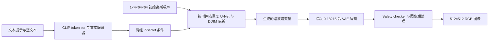

# 09 · 用固定权重完成一次预训练图像生成

**先修与依赖：** [02 扩散](02-diffusion.md)、[04 潜空间与条件接口](04-image-video-roadmap.md)、[05 评价](05-evaluation.md)及[08 条件丢弃与引导](08-image-guidance-lab.md)。**学习目标：** 把噪声预测、文本条件、潜空间解码连接成完整推理流程；固定权重、软件、初始噪声和调度；解释一次生成的计算与存储成本，并完成一个控制变量的条件实验。

本章选用2022年的 **Stable Diffusion v1.4**。它提供结构清楚、来源可追溯的自然图像基线，适合把前面的小实验连接到预训练系统。更近期的图像编辑系统可接着读 [FLUX.1 Kontext](../readings/flux-kontext-2025.md)。本章覆盖CPU推理、接口核对与小规模观察；训练、微调和系统性质量评价留给后续研究。

阅读与练习可预留2–3小时，这是**未测量的学习预算建议**。下载量由固定文件清单确定；程序耗时与内存以[实际运行报告](../pretrained-image-report.md)为准。

完成首张生成后，可沿[四请求提示/seed探索](../sd14-prompt-pilot.md)练习事前声明、配对噪声、逐项观察与完整结果保存。该扩展在本实例总耗时17.90分钟，固定两种提示和两个新种子，并保留全部原图。

## 1. 先固定模型、版本与许可

我们直接使用作者组织的`CompVis/stable-diffusion-v1-4`，固定revision为

```text
133a221b8aa7292a167afc5127cb63fb5005638b
```

[模型文件清单](../../examples/pretrained-sd14/manifest.json)记录所需16个文件的路径、字节数、SHA-256与来源，包括四组float32 safetensors权重、配置、tokenizer、图像预处理器与模型卡。2026-11-10核对时，该revision可匿名读取；后续运行的访问状态还取决于模型托管方。

| 组件 | 固定权重文件字节数 | 推理中的作用 |
| --- | ---: | --- |
| U-Net | 3,438,167,534 | 在潜空间预测噪声，接收时间和文本条件 |
| 文本编码器 | 492,265,879 | 把token序列映射成条件表示 |
| VAE | 334,643,276 | 本次文本生成使用其解码器，把潜变量转成图像 |
| Safety checker | 1,215,981,830 | 对解码图像执行模型自带检查 |

四组权重合计5,481,058,519字节；包含清单中的配置、tokenizer与模型卡后为 **5,482,669,095字节，即5.4827 GB / 5.1061 GiB**。这里GB按$`10^9`$字节、GiB按$`2^{30}`$字节换算。环境依赖、下载缓存及输出还会占用磁盘；运行时还需容纳中间张量和软件开销。规划资源时对照实测报告中的进程RSS高水位、查询范围与运行条件。

模型采用 **CreativeML Open RAIL-M，2022-08-22版**，完整许可的固定副本见[LICENSE-model.txt](../../examples/pretrained-sd14/LICENSE-model.txt)。第4–5条规定模型及衍生模型分发时的许可、通知和用途限制；第6条说明作者对生成输出的权利主张及使用者责任。仓库原创代码和教材的Apache-2.0许可分别适用，外部模型按其自身条款使用。保留模型卡、原始许可和revision，可以让后续复现实验准确追溯这组资产。

## 2. 从文本与噪声到图像

下面按一次512×512、单张图像的请求列出张量路径。形状均采用本章固定版本的接口。



VAE在高和宽两个方向各压缩8倍，潜通道数为4。因此512×512图像对应`1×4×64×64`的潜变量；潜空间有16,384个标量，RGB图像有786,432个标量，数量比为48。这个比值描述表示维数，实际计算还取决于网络层、注意力、精度及算子实现。

该VAE配置的缩放系数为0.18215。若编码得到$`z_{\mathrm{VAE}}`$，扩散模型使用的坐标是$`z=0.18215z_{\mathrm{VAE}}`$；生成结束后，pipeline用$`D(z/0.18215)`$解码。文本到图像生成从随机潜噪声开始，目标图像通过解码器获得。

文本编码器是CLIP ViT-L/14对应的文本分支，输出每个token的768维表示。tokenizer最多使用77个位置，其中包括起止特殊token和padding；一个英文单词可能拆成多个BPE token。程序记录提示词的实际token数及截断状态。先使用给定短提示；后续改写提示时同时检查是否触及长度上限。

去噪器用各空间位置的特征作为查询，77个文本位置提供键和值。CLIP的序列隐藏态、全局投影向量与归一化分别对应具体接口；完整张量推导和位置置换练习见[条件注意力专题](../readings/conditioning-attention.md)。

模型卡说明v1.4在v1.2基础上以512×512继续训练225,000步，并以10%的概率丢弃文本条件。这里使用已发布权重，推理期间冻结网络参数。

## 3. 文本条件引导：对齐两分支及调用计数

这组权重预测的是潜空间扩散所加的噪声。对同一个$`z_j`$和噪声级别$`j`$，计算

```math
\epsilon_c=\epsilon_\theta(z_j,j,c),\qquad
\epsilon_u=\epsilon_\theta(z_j,j,c_{\varnothing}),\qquad
\widehat\epsilon=\epsilon_u+s(\epsilon_c-\epsilon_u).
```

本章把`negative_prompt`固定为空字符串。空文本仍经过tokenizer和文本编码器，其条件$`c_{\varnothing}`$包含特殊token与位置表示。第08章的小图像网络则用全零类别向量标记空条件；两个系统各自遵循训练时的输入约定。

固定Diffusers实现将空文本分支和提示词分支拼成batch：同一份`1×4×64×64`潜变量复制后成为`2×4×64×64`，U-Net返回两个噪声预测，再沿batch轴拆分并组合。对于本章的$`K`$个DDIM时间点：

- U-Net的Python `forward`调用数为$`K`$；
- 每次调用处理两个样本分支，单张输出累计有$`2K`$次样本分支求值；
- 文本编码、VAE解码和Safety checker另有计算，计入完整推理耗时。

记录成本时同时报告调用数和batch大小。第08章每步执行两个独立网络调用，这里把它们合并进同一个batch；实际延迟由硬件和实现决定。

本章CLI仅接受有限的`s > 1`，默认7.5。在所固定的pipeline中，双分支计算由`guidance_scale > 1`开启；使用该入口可以确保比较实验保持同一双分支计算协议。研究`s=0/1`的代数性质与空条件生成时，可继续使用第08章已明确实现并检验的入口。

## 4. DDIM的步数、噪声级别与确定性

模型发布配置选择PNDM采样器，本章显式换为 **DDIMScheduler**，从固定配置继承训练噪声表，设置`eta=0`。实验记录保存换用后的完整配置与实际时间点，方便核对这一选择。

为对应库的数组，用$`j\in\{0,\ldots,999\}`$表示本节的零基噪声索引，记

```math
a_j=\prod_{i=0}^{j}(1-\beta_i),\qquad
\beta_i=\left[\mathop{\mathrm{linspace}}\nolimits
(\sqrt{0.00085},\sqrt{0.012},1000)_i\right]^2.
```

第02章的数学索引从1开始，所以这里$`a_j`$对应其$`\bar\alpha_{j+1}`$。时间索引从大到小推进；第03、07、08章的flow则从噪声端0走向数据端1。

对epsilon参数化，`eta=0`、无预测样本裁剪时的一步为

```math
\widehat z_{\mathrm{clean}}
=\frac{z_j-\sqrt{1-a_j}\widehat\epsilon}{\sqrt{a_j}},
\qquad
z_{\mathrm{prev}}
=\sqrt{a_{\mathrm{prev}}}\widehat z_{\mathrm{clean}}
+\sqrt{1-a_{\mathrm{prev}}}\widehat\epsilon.
```

这里`clip_sample=False`；末步越过数组起点时，`set_alpha_to_one=False`使$`a_{\mathrm{prev}}`$取$`a_0=0.99915`$。DDIM原论文v4第5页式(12)给出带$`\sigma_t`$噪声的一步，并在式后定义干净端点$`\alpha_0:=1`$；第6页式(16)的$`\eta=0`$令$`\sigma_t=0`$，得到上面的确定更新。论文的$`\alpha_t`$对应DDPM累计量$`\bar\alpha_t`$，而本节$`a_0`$已累计一次beta。这个固定库配置的末步仍保留$`\sqrt{0.00085}\widehat\epsilon`$方向项，边界与论文的干净端点分别记录。练习C直接检查实际计算结果。

默认`leading`时间网格取整数间隔$`\lfloor1000/K\rfloor`$，反序后加`steps_offset=1`。20步的索引为`951, 901, …, 1`；2步则是`501, 1`。因此，改变默认步数会同时改变时间网格和起始噪声级别。若要单独研究积分离散化误差，需要另外设计共享端点的实验，并核对调度器如何使用时间点。

`eta=0`使DDIM更新不再额外采样噪声，随机性由初始潜噪声保留。程序使用CPU生成器、固定seed和线程数，并开启PyTorch确定性算法检查。重复实验仍应记录操作系统、软件版本和执行设备；跨版本、跨平台的逐位一致性需要实际验证。

## 5. 安装、准备权重并生成第一张图

这是可选的预训练实验环境。以下命令从仓库根目录执行，目标平台为Linux x86_64、Python 3.12、CPU PyTorch 2.6.0。先查看实测报告中的资源条件，再安装独立环境：

```bash
python3.12 -m venv .venv-pretrained
source .venv-pretrained/bin/activate
python -m pip install --require-hashes -r requirements-pretrained-lock.txt
python -m pip install --no-build-isolation --no-deps -e .
```

若此前已创建该环境，直接激活并使用。固定依赖包含Diffusers 0.35.2、Transformers 4.57.6、Accelerate 1.11.0和safetensors 0.6.2，完整的传递依赖和包hash见[可选环境锁文件](../../requirements-pretrained-lock.txt)。没有系统Python 3.12时，可用`uv venv --python 3.12 --seed .venv-pretrained`创建带pip的环境；云环境的uv缓存权限设置见README。

阅读模型许可后准备固定文件：

```bash
python -m genai_study.pretrained_image prepare \
  --manifest examples/pretrained-sd14/manifest.json \
  --model-dir artifacts/models/sd14
```

准备步骤下载清单中的文件并核对字节数与SHA-256。下载进度和退出结果可用于确认是否完成；保留该目录供后续推理复用。网络恢复后可重跑`prepare`，利用下载器保留的文件与元数据继续处理。托管服务重定向后的HTTP ETag可能采用不同对象哈希，本仓库以清单中的文件SHA-256校验内容。

首次完整生成使用固定提示、512×512和20步，通过[运行记录器](../run-records.md)保存外层耗时、日志和退出状态。本例给子命令900秒预算，实际资源需求先参照实测报告：

```bash
python -m genai_study.run_record --timeout 900 \
  --output artifacts/run-records/sd14-first -- \
  python -u -m genai_study.pretrained_image run \
  --manifest examples/pretrained-sd14/manifest.json \
  --model-dir artifacts/models/sd14 \
  --output artifacts/pretrained-sd14 \
  --prompt 'a watercolor painting of a small cabin beside a lake, pine trees, daytime' \
  --seed 7 --steps 20 --guidance-scale 7.5 \
  --height 512 --width 512 --threads 1
```

运行时再次核对所有清单文件，从本地加载safetensors，使用CPU float32。成功结束后输出`image.png`、`initial_noise.npy`和`metrics.json`。生成图经过pipeline的Safety checker及图像后处理；检查结果也保存在JSON中。检测为需过滤的样本按pipeline规则处理，解释输出时一并查看该字段。

CPU采样可能持续数分钟；程序在开始和若干中间步骤输出`DDIM step ... started`，这些信息写入记录目录的`command.log`。完成后先检查`run.json`的状态与退出码，再核对实验的`metrics.json`；超时或报错时仍可读取本次记录。

已有`artifacts/pretrained-sd14`时直接阅读结果；重做请把记录器目录改为`artifacts/run-records/sd14-repeat`，实验目录改为`artifacts/pretrained-sd14-repeat`。两者均保护已有记录。

需要先确认加载与保存路径时，可把记录目录改为`artifacts/run-records/sd14-smoke`、实验目录改为`artifacts/pretrained-sd14-smoke`，并使用`--steps 2 --height 256 --width 256`。这个短运行减少计算，覆盖文本编码、去噪、解码和输出检查。它同时改变了分辨率与时间网格；质量观察以声明了完整采样设置的实验为依据。

## 6. 先核对记录，再评价结果

可选的[潜空间往返实验](../vae-reconstruction-report.md)复用本章VAE文件，直接编码一张固定图像再解码六种latent，分别检查后验随机性和缩放。单次CPU实测约94秒、峰值1.64GiB；报告另保留完整重复与原始/裁剪RGB指标，适合在生成实验之后理解表示阶段。

先检查[实测报告](../pretrained-image-report.md)和你自己的`metrics.json`：

| 字段组 | 需要回答的问题 |
| --- | --- |
| `model`、`versions` | 权重revision、清单hash及软件版本是否相同？全部文件是否通过校验？ |
| `config`、`scheduler` | 提示、空文本、seed、尺寸、强度、步数、eta和时间网格分别是什么？ |
| `representation` | 初始噪声形状/hash是否符合512→64的映射？文本是否被截断？VAE缩放是多少？ |
| `network_evaluations` | 实际U-Net调用数和每次batch大小是否对应$`K`$与$`2K`$？ |
| `timing_seconds`、`timing_scope` | 下载、hash校验、加载和推理分别如何计时？是否有预热？ |
| `memory` | 报告的是哪个进程、何种单位、何段生命周期的峰值？ |
| `safety`、`outputs` | 输出经过何种处理？是否触发检查？保存图像的hash是什么？ |

一次512×512结果可以支持接口、成本与具体样本的观察。对给定提示，可以事先列出“小屋、湖、松树、白天、水彩风格”五个检查项，再逐项记录成立、模糊或缺失。学习阶段先保存全部请求和输出，再增加提示集合与随机种子；方法质量比较按第05章设计样本量、统计与评价协议。

`process_peak_rss_kib`是Linux进程启动至查询点的RSS高水位，包含导入和模型加载；查询位于图片与初噪声保存之后、输出PNG hash与metrics写入之前。换算GiB时除以$`1024^2`$。完整推理计时包含文本编码、去噪、VAE解码、Safety checker与PIL后处理。下载在`prepare`阶段计时。比较两个配置时先确保测量范围相同。

## 7. 练习与参考答案

### A. 把表示与计算写成可检查的量

在512×512、单图、20步和双分支引导下，写出初始潜变量、实际U-Net输入、文本条件的形状，以及网络调用数。把高度、宽度都改为256后，哪些数可以直接重新计算？

<details>
<summary>参考答案</summary>

初始潜变量`1×4×64×64`；U-Net输入`2×4×64×64`；两组文本条件拼接为`2×77×768`。20次U-Net调用累计40次单样本分支求值。256×256时潜空间变为`1×4×32×32`，潜标量数降至四分之一；文本长度和20次调用保持该协议。运行耗时与峰值内存需重新测量。

</details>

### B. 固定噪声比较条件引导

完成默认运行后，复用同一模型目录，将`--guidance-scale`改为3.0、实验输出改为`artifacts/pretrained-sd14-guidance3`，记录目录改为`artifacts/run-records/sd14-guidance3`，其余参数保持。比较两份`initial_noise.npy`是否逐元素相同，再比较预先列出的五个提示检查项与构图、颜色。记录本次结果后，说明还需要哪些实验才能支持更普遍的判断。

<details>
<summary>提示与解释范围</summary>

相同软件、线程、尺寸和seed应产生相同初始噪声，可用`numpy.array_equal`检查，并对照JSON中的原始字节hash。两次实验仅改变引导强度，模型权重与时间点固定。该配对能描述一个提示和一个噪声样本对强度的响应。扩展结论需要更多预先声明的提示及独立seed，保存所有结果，并分别评价条件遵循、画面质量和多样性。

</details>

### C. 独立复算一次DDIM更新

激活`.venv-pretrained`后运行下面的代码。它只读取已经下载的调度配置并构造小张量，无需再次加载图像模型。NumPy根据beta定义独立计算累计alpha，再与固定Diffusers实现的一步对照。

```python
import json
from pathlib import Path

import numpy as np
import torch
from diffusers import DDIMScheduler

config = json.loads(Path(
    "artifacts/models/sd14/scheduler/scheduler_config.json"
).read_text())
scheduler = DDIMScheduler.from_config(config)
scheduler.set_timesteps(20)
assert scheduler.timesteps.tolist() == list(range(951, 0, -50))
assert scheduler.config.prediction_type == "epsilon"
assert not scheduler.config.clip_sample
assert not scheduler.config.set_alpha_to_one

beta = np.linspace(np.sqrt(0.00085), np.sqrt(0.012), 1000) ** 2
a = np.cumprod(1.0 - beta)
state = np.array([-0.7, 0.2, 1.0, 0.5], dtype=np.float64)
prediction = np.array([0.1, -0.3, 0.4, 0.2], dtype=np.float64)
for j in (951, 1):
    previous = j - 50
    a_previous = a[previous] if previous >= 0 else a[0]
    clean = (state - np.sqrt(1.0 - a[j]) * prediction) / np.sqrt(a[j])
    expected = np.sqrt(a_previous) * clean + np.sqrt(1.0 - a_previous) * prediction
    actual = scheduler.step(
        torch.tensor(prediction, dtype=torch.float32), j,
        torch.tensor(state, dtype=torch.float32), eta=0.0,
    ).prev_sample.numpy()
    np.testing.assert_allclose(actual, expected, rtol=2e-5, atol=2e-6)
    print(j, "max_abs_error", float(np.max(np.abs(actual - expected))))
```

<details>
<summary>结果解释</summary>

断言同时核对首个时间点和末步边界的DDIM更新，允许float32累计alpha与NumPy float64的舍入差异。`eta=0`时更新由当前状态和预测确定。这里把预测作为给定向量，验证的是调度公式；预训练网络的预测质量由完整生成实验和评价协议研究。

</details>

## 8. 固定来源与下一步

- Song, Meng & Ermon，[DDIM 2010.02502v4](https://arxiv.org/pdf/2010.02502v4)，ICLR2021，所读修订为2022-10-05：第5页式(12)及干净端点、第6页式(16)、附录C.2的累计alpha约定与D.3的子序列更新。22页、10,857,218字节；PDF SHA-256 `07cb8796d7c100bf7c02bc575f16aab72c32630a8f85abd54ad45dc4f63e80fb`。
- [CompVis v1.4模型卡](https://huggingface.co/CompVis/stable-diffusion-v1-4/blob/133a221b8aa7292a167afc5127cb63fb5005638b/README.md)：训练阶段、潜压缩、文本编码、条件丢弃、用途与局限。模型卡SHA-256：`4eb72f9e6bdbfcf359ad66cdd7e26984449f47692069f81205f2217c9a821ba2`。
- [同revision的VAE配置](https://huggingface.co/CompVis/stable-diffusion-v1-4/blob/133a221b8aa7292a167afc5127cb63fb5005638b/vae/config.json)、[U-Net配置](https://huggingface.co/CompVis/stable-diffusion-v1-4/blob/133a221b8aa7292a167afc5127cb63fb5005638b/unet/config.json)、[调度配置](https://huggingface.co/CompVis/stable-diffusion-v1-4/blob/133a221b8aa7292a167afc5127cb63fb5005638b/scheduler/scheduler_config.json)：张量接口、缩放与训练噪声表。
- [Diffusers 0.35.2 pipeline](https://github.com/huggingface/diffusers/blob/b71269675ec1b85193107a691dd35c308e46f0a5/src/diffusers/pipelines/stable_diffusion/pipeline_stable_diffusion.py)：`encode_prompt`、`do_classifier_free_guidance`、`__call__`中的双分支batch、潜变量解码与输出检查；[同commit的DDIM实现](https://github.com/huggingface/diffusers/blob/b71269675ec1b85193107a691dd35c308e46f0a5/src/diffusers/schedulers/scheduling_ddim.py)给出`set_timesteps`和`step`。
- [Transformers 4.57.6 CLIP实现](https://github.com/huggingface/transformers/blob/753d61104116eefc8ffc977327b441ee0c8d599f/src/transformers/models/clip/modeling_clip.py)及[固定模型的文本配置](https://huggingface.co/CompVis/stable-diffusion-v1-4/blob/133a221b8aa7292a167afc5127cb63fb5005638b/text_encoder/config.json)：文本隐藏维数与序列接口。
- [原始许可固定版本](https://huggingface.co/spaces/CompVis/stable-diffusion-license/blob/14d42d09bffd871b1666a084fc954a50cff72ac0/license.txt)：SHA-256 `be351ebe7ac01bcdbb018639aadcfd38f136b7dc3f2a3d4d3a24db51d1b210ef`。

完成本章后，把一次“图片已生成”扩展成可核对的实验说明：记录权重与许可、配置、初始噪声、调用预算、耗时与内存，然后按预先定义的观察项评价输出。接着可在[04研究路线](04-image-video-roadmap.md)中选择条件控制、求解器或评价专题，或对照Kontext阅读卡研究生成与图像编辑之间的条件接口变化。

## 下一步：参考图条件的视频生成

完成本章后，可进入[10章SVD视频运行与失败分析](10-pretrained-video-lab.md)，复用独立环境，单独准备视频权重。沿两条图像条件路径追踪未缩放参考latent、生成latent、帧轴引导和两随机流，并结合实际失败检查资源与评价协议。

理论延伸：DDIM的无噪声更新为何在重标定坐标中呈现Euler形式，见[扩散与Flow Matching的桥梁](../readings/diffusion-flow-bridge.md#5-三种常见接口如何接入)。
