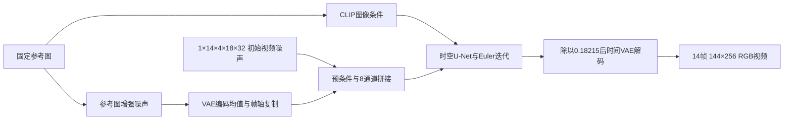

# 10 · 固定SVD：图像到视频的CPU运行与失败分析

**先修与依赖：** [04潜空间与视频路线](04-image-video-roadmap.md)、[06视频时序诊断](06-video-temporal-lab.md)、[09预训练图像实践](09-pretrained-image-lab.md)，以及[SVD训练与条件接口阅读卡](../readings/video-training-svd-cogvideox.md)。**学习目标：** 运行图像条件视频生成（image-to-video，I2V）；追踪参考图、视频潜变量和时间条件；分别固定视频噪声与参考图增强随机性；记录完整帧序列、实际调用量、成本及运动观察。

本章选择原作者2023年发布的 **Stable Video Diffusion（SVD）14帧模型**，以CPU float32、144×256输出连接前面的自然图像实践与视频时序评价。完整实验保持14帧、25步，空间分辨率缩至模型发布配置576×1024的四分之一宽高。4帧/2步用于先检查接口和资源，低分辨率下的具体结果需要结合本章条件解读。

**Powered by Stability AI**

**实际结果：** 14帧/25步完整命令耗时16.79分钟、峰值11.21GiB，输出存在明显过饱和、闪变与主体形变。4帧smoke重复及直接官方API对照均逐元素复现。先阅读[完整实测与失败分析](../pretrained-video-report.md)，再按本章学习接口、成本和诊断；实际生成前根据自己的资源决定运行阶段。

## 1. 固定版本、许可与输入图像

模型为`stabilityai/stable-video-diffusion-img2vid`，固定revision：

```text
9cf024d5bfa8f56622af86c884f26a52f6676f2e
```

[manifest](../../examples/pretrained-svd/manifest.json)固定11个文件的大小与SHA-256：三组float32 safetensors、六份配置、模型卡及许可。2026-11-10核验时，API标记公开且无访问门槛，三个权重文件的匿名HEAD请求均返回200。复现前仍需按文件清单重新校验实际下载内容。

| 组件 | 固定权重字节数 | 作用 |
| --- | ---: | --- |
| CLIP图像编码器 | 2,528,371,296 | 提供整张参考图的交叉注意力条件 |
| 时空U-Net | 6,098,682,464 | 联合预测全部视频帧的去噪目标 |
| 带时间解码器的VAE | 391,017,740 | 编码参考图，解码生成的视频潜变量 |

三组权重合计9,018,071,500字节；11文件总计 **9,018,094,887字节，即9.0181 GB / 8.3988 GiB**。这是文件总大小；实际内存还包括导入、加载和中间激活，需按下述试跑测量。运行环境复用09的独立可选依赖锁，准备权重时还要为环境、缓存和结果预留空间。

权重采用 **Stability AI Community License，2024-07-05版**，完整原文见[LICENSE-model.txt](../../examples/pretrained-svd/LICENSE-model.txt)，指定归属见[NOTICE](../../examples/pretrained-svd/NOTICE)。第2条授权研究和非商业用途；第3条规定商业注册及年度收入超过100万美元时的另行许可要求；第4条包含分发归属、用途及输出相关约定。模型卡保留研究定位并列出教育工具用途。本章保留许可、NOTICE及上面的品牌归属；仓库原创教材与代码继续按自身Apache-2.0许可提供。

本轮在任何SVD生成前固定输入为[上一轮SD1.4水彩湖岸图](../assets/sd14-pilot-scene-seed43.png)。其提示、seed43、原图hash和模型许可来自[四请求报告](../sd14-prompt-pilot.md)。湖岸、树木和右侧小屋为观察参考图一致性与运动提供具体对象；水彩图的输入域也记录在实验条件中。

入口先按EXIF方向转正，再转换RGB，居中裁出16:9，最后用Lanczos缩放为256×144，保存`input.png`及裁剪/哈希信息。裁剪可能改变可见边缘；分析生成结果时同时检查原图和实际送入管线的参考图。此步骤在所有配对请求中保持一致。

## 2. 参考图走两条条件路径

下面的形状对应单视频、14帧、144×256及双分支引导。维度顺序为`B,F,C,H,W`，其中`F`为视频帧轴。



第一路把参考图缩放、归一化后交给CLIP图像编码器，产生`B,1,1024`的条件向量。第二路将144×256参考图归一化到`[-1,1]`，加入标准差0.02的独立高斯噪声，经VAE编码器取`latent_dist.mode()`，得到`B,4,18,32`。**参考latent保持未乘0.18215的坐标**，复制为`B,F,4,18,32`。

生成分支的带噪潜变量先按当前sigma进行预条件，再与参考latent沿通道轴拼接。启用引导后，单个U-Net调用的实际输入为`2,14,8,18,32`：前一视频分支的CLIP条件和参考latent置零，后一分支保留图像条件。帧率、运动分桶和增强强度仍提供给两分支。

生成完成后，视频latent按`z / 0.18215`送入VAE时间解码器，得到全部RGB帧。每条路径的缩放由训练与发布实现约定；记录时分别列出参考编码、视频输入预条件和生成解码三个位置。

CLIP支路传入一个全局图像token。单个有效条件token在注意力汇聚中权重恒为1，值向量仍可改变各层条件信息；空间参考latent提供另一条显式网格路径。解析反例、后续残差的作用与小张量检查见[条件注意力专题](../readings/conditioning-attention.md#3-一个条件token时注意力会做什么)。

## 3. 沿sigma积分：VP预测量、去噪器与Euler

本节用$z_0$表示干净视频latent，$\sigma$表示加性噪声标准差：

$$z_\sigma=z_0+\sigma\epsilon,\qquad
a_\sigma=(1+\sigma^2)^{-1/2},\quad b_\sigma=\sigma a_\sigma.$$

因此归一化输入为$a_\sigma z_\sigma=a_\sigma z_0+b_\sigma\epsilon$。网络的VP目标可以写为

$$v_{\mathrm{VP}}=a_\sigma\epsilon-b_\sigma z_0.$$

这与[03章](03-flow-matching.md)直线路径中“数据减初始噪声”的flow速度有不同定义。固定SVD去噪器将网络输出$v_\theta$还原为干净样本预测：

$$D_\theta(z_\sigma;\sigma,c)
=\frac{z_\sigma}{1+\sigma^2}
-\frac{\sigma}{\sqrt{1+\sigma^2}}\,
v_\theta(a_\sigma z_\sigma,\tau_\sigma,c),
\qquad \tau_\sigma=\tfrac14\log\sigma.$$

这里$c$合并参考latent、CLIP向量及附加条件；实现中参考latent在预条件之后沿通道拼接。网络接收的$\tau_\sigma$是连续时间嵌入，可为负数。

在每个非零$\sigma_j$，定义导数并执行Euler更新：

$$d_j=\frac{z_j-D_\theta(z_j;\sigma_j,c)}{\sigma_j},\qquad
z_{j+1}=z_j+(\sigma_{j+1}-\sigma_j)d_j.$$

本入口沿用scheduler的`s_churn=0`，积分期间不额外注入随机噪声。

固定scheduler使用`v_prediction`、连续网络时间、Karras网格，$\sigma_{\max}=700$、$\sigma_{\min}=0.002$、$\rho=7$。对$K\ge2$，先构造$K$个正sigma，随后追加干净端点0：

$$\sigma_j=\left[\sigma_{\max}^{1/\rho}
+\frac{j}{K-1}\left(\sigma_{\min}^{1/\rho}-\sigma_{\max}^{1/\rho}\right)\right]^\rho,
\quad j=0,\ldots,K-1,\qquad\sigma_K=0.$$

于是25步对应25次预测与更新，最后从0.002走向0。固定库的`leading`配置把初始单位高斯噪声乘以`init_noise_sigma`；在本版本中，实际float32值为 **700.000732421875**，对应$\sqrt{700^2+1}$。入口保存乘系数前的单位噪声，metrics另存实际sigma和时间网格。

**独立核验。** 在两个解析端点构造已知$z_0,\epsilon$及正确$v_{\mathrm{VP}}$，用NumPy重建预条件、$D_\theta$和Euler，再比较固定Diffusers的`scale_model_input`与`step`。25步网格首步$700\to545.729248$的更新最大绝对差为$1.84\times10^{-5}$，末步$0.002\to0$为$9.31\times10^{-8}$。该检查使用小数组，覆盖公式与库接口；模型预测误差由实际生成观察和后续实验研究。

<details><summary>完成权重准备后，独立复算首末步</summary>

以下代码只读取已校验的scheduler配置，并计算小数组；从仓库根目录执行：

```bash
.venv-pretrained/bin/python - <<'PY'
from pathlib import Path
import json
import numpy as np
import torch
from diffusers import EulerDiscreteScheduler

config = json.loads(Path('artifacts/models/svd/scheduler/scheduler_config.json').read_text())
rng = np.random.default_rng(19)
clean = rng.normal(size=(2, 4)).astype(np.float32)
epsilon = rng.normal(size=clean.shape).astype(np.float32)
for index in (0, 24):
    scheduler = EulerDiscreteScheduler.from_config(config)
    scheduler.set_timesteps(25, device='cpu')
    scheduler.set_begin_index(index)
    sigma, next_sigma = map(float, scheduler.sigmas[index:index + 2])
    a = 1.0 / np.sqrt(1.0 + sigma**2)
    b = sigma * a
    sample = (clean + sigma * epsilon).astype(np.float32)
    prediction = (a * epsilon - b * clean).astype(np.float32)
    denoised = sample.astype(np.float64) / (1.0 + sigma**2) - b * prediction.astype(np.float64)
    expected = sample + (next_sigma - sigma) * (sample - denoised) / sigma
    scaled = scheduler.scale_model_input(torch.from_numpy(sample), scheduler.timesteps[index])
    actual = scheduler.step(torch.from_numpy(prediction), scheduler.timesteps[index], torch.from_numpy(sample))
    np.testing.assert_allclose(scaled.numpy(), a * sample, atol=2e-6, rtol=2e-6)
    np.testing.assert_allclose(actual.pred_original_sample.numpy(), denoised, atol=2e-6, rtol=2e-6)
    np.testing.assert_allclose(actual.prev_sample.numpy(), expected, atol=1e-4, rtol=2e-6)
    np.testing.assert_allclose(denoised, clean, atol=2e-6, rtol=2e-6)
    np.testing.assert_allclose(actual.prev_sample.numpy(), clean + next_sigma * epsilon, atol=1e-4, rtol=2e-6)
    print(index, sigma, next_sigma, np.max(np.abs(actual.prev_sample.numpy() - expected)))
PY
```

</details>

## 4. 扩散时间、视频帧索引和播放帧率

三个时间坐标在管线中各有用途：

| 坐标 | 本实验取值与作用 |
| --- | --- |
| 扩散sigma / 网络时间 | 25个正sigma递减，$\tau=\frac14\log\sigma$送入U-Net |
| 帧索引$f$ | 0到13，同次去噪中联合处理，决定帧轴引导系数 |
| 播放时间 | 显式导出为7 fps；首尾采样时刻跨度13/7秒，14帧播放时长2秒 |

CLI的`--fps 7`经过固定pipeline后成为条件值6，与运动分桶127和增强强度0.02一起编码。输出视频的播放fps由导出工具单独指定，并用媒体元数据复查。改变播放速度会改变每秒位移等物理量，潜变量和已生成帧可以保持相同。

引导沿帧轴从1线性增至2.5，每个扩散步骤重复同一组系数：

$$s_f=1+\frac{f}{F-1}(2.5-1),\qquad
\widehat v_f=v_{u,f}+s_f(v_{c,f}-v_{u,f}).$$

一个视频的两分支合并进batch2，整段$F$帧在每次调用中联合预测。$K$步对应 **K次U-Net调用、2K次视频分支求值**；内部空间层可能把batch与帧展开，帧之间仍通过时间层相互作用。CLIP、参考图编码和视频解码另计成本。

时间VAE的`decode_chunk_size`固定为整段帧数。缩小chunk会改变解码时的时间上下文，可能改变帧间连续性；研究这一内存取舍时，需固定生成latent并把chunk大小列为实验变量。

## 5. 两个随机流与分阶段运行

每条请求保存两个随机性来源：视频初始单位噪声使用`seed=7`；参考图增强使用独立`augmentation_seed=8`。即使显式传入视频latents，pipeline仍会生成参考图增强噪声。配对实验同时固定参考图预处理、两份随机输入及全部采样配置。

复用[09章](09-pretrained-image-lab.md#5-安装准备权重并生成第一张图)的环境安装命令准备`.venv-pretrained`；本章直接使用仓库内的参考图，再单独准备SVD文件。在仓库根目录运行：

```bash
.venv-pretrained/bin/python -m genai_study.pretrained_video prepare \
  --model-dir artifacts/models/svd

timeout 600 .venv-pretrained/bin/python -m genai_study.pretrained_video run \
  --model-dir artifacts/models/svd \
  --input docs/assets/sd14-pilot-scene-seed43.png \
  --height 144 --width 256 --frames 4 --steps 2 \
  --seed 7 --augmentation-seed 8 \
  --min-guidance-scale 1 --max-guidance-scale 2.5 \
  --fps 7 --motion-bucket-id 127 --noise-aug-strength 0.02 --threads 1 \
  --output artifacts/svd-smoke
```

检查smoke退出状态、完整帧和指标后，保持条件，使用`--frames 14 --steps 4 --output artifacts/svd-calibration`运行校准，外层超时900秒。下一步以校准命令完整耗时乘$25/4$作保守预算外推；外推不超过1500秒、进程峰值不超过24GiB时，再执行14帧/25步，硬超时1800秒，输出到新目录`artifacts/svd-full`。这些数值是本轮预设预算和进入条件；实际耗时与内存需从每次运行记录读取。

校准与完整请求分别为以下命令；完整请求在核对上述资源条件后执行。省略的尺寸、引导、fps、增强强度和线程参数采用本章已列出的固定默认值，运行记录会保存实际值。

```bash
timeout 900 .venv-pretrained/bin/python -m genai_study.pretrained_video run \
  --model-dir artifacts/models/svd --input docs/assets/sd14-pilot-scene-seed43.png \
  --frames 14 --steps 4 --seed 7 --augmentation-seed 8 \
  --output artifacts/svd-calibration

timeout 1800 .venv-pretrained/bin/python -m genai_study.pretrained_video run \
  --model-dir artifacts/models/svd --input docs/assets/sd14-pilot-scene-seed43.png \
  --frames 14 --steps 25 --seed 7 --augmentation-seed 8 \
  --output artifacts/svd-full
```

增加步数时，加载和编解码等固定成本也被上述比值放大。实际去噪步的耗时会随计算、缓存和系统负载变化，外推只用于决定本轮资源安排。每次保留退出码与完整日志；使用新输出目录保护已有实验。下一次修改模型、精度、尺寸或解码策略后，应重新校准。

## 6. 输出与观察协议

每个成功运行目录保存：

| 文件 | 复查内容 |
| --- | --- |
| `input.png` | 实际使用的RGB裁剪/缩放参考图 |
| `initial_noise.npy` | 乘scheduler初始系数前的视频单位高斯噪声 |
| `augmentation_input.npy` | VAE参考编码器实际接收的增强后图像 |
| `frames.npy` | 全部后处理float32 RGB帧，轴顺序`F,H,W,C` |
| `frame_000.png`起的全部PNG | 按索引保存的完整帧序列 |
| `metrics.json` | 模型/软件/文件身份、输入裁剪、随机性、scheduler、实际调用量、分段时间和峰值内存 |

计时应分开解释文件校验、模型加载、输入准备、完整推理及其编码/去噪/解码段。RSS采用Linux进程生命周期高水位，包含导入和权重加载。数组与PNG分别保留：浮点后处理结果到8位PNG存在量化，比较时应固定所用表示。

把所有帧按时间顺序查看，再观察反向播放或[06章](06-video-temporal-lab.md)的乱序对照，可以区分对象外观与运动轨迹。针对固定输入，记录小屋、树木和水岸是否保持可辨，变化像镜头运动、物体运动、形变还是闪烁；检查首帧与参考图、相邻帧及首尾帧。静止或缓慢平移也是应保留的输出情况。

MP4等播放文件另由导出步骤生成，显式设为7 fps并记录工具版本和实际帧数/时长；原始PNG/数组继续承担数值复核。GIF以百分之一秒为时间单位，等时长帧无法精确表达7 fps，使用时应记录实际播放时序。后续质量评价先声明输入集合、运动任务和观察规则，再增加条件与种子。

本次导出使用系统FFmpeg7.1.5，独立于Python依赖锁。先用`ffmpeg -version`确认工具可用；需要安装时使用所在系统的软件包管理器。对完成的14帧结果运行：

```bash
ffmpeg -nostdin -v error -n -framerate 7 -start_number 0 \
  -i artifacts/svd-full/frame_%03d.png -frames:v 14 \
  -c:v libx264 -crf 18 -pix_fmt yuv420p -movflags +faststart \
  artifacts/svd-full/video.mp4
ffprobe -v error -select_streams v:0 \
  -show_entries stream=width,height,avg_frame_rate,nb_frames,duration \
  -of json artifacts/svd-full/video.mp4
```

应核对256×144、`7/1` fps、14帧和2秒播放时长。`-n`保护已有播放文件；重复导出时选择新文件名。H.264的颜色转换和压缩会改变像素值，原始PNG与float32数组用于后续数值比较。

## 7. 练习与参考答案

**A · 两条latent路径。** 如果把参考VAE latent也乘0.18215，同时保持权重和生成解码不变，改动了什么？

<details><summary>提示与答案</summary>

参考图在通道拼接中的数值尺度改变，而网络训练时使用未缩放参考编码。生成latent的缩放协议与参考条件各有位置；检查固定实现中的`_encode_vae_image`与`decode_latents`可以定位差别。用新实验比较时需记录这一人为修改，并保留原协议作基线。

</details>

**B · Euler干净端点。** 在最后一步$\sigma_{j+1}=0$时，代入更新式能得到什么？为什么仍需$\sigma_j>0$？

<details><summary>提示与答案</summary>

$z_{j+1}=z_j-\sigma_j(z_j-D_j)/\sigma_j=D_j$，最后状态等于该步去噪预测。导数定义含除以当前sigma，所以管线在正sigma处预测，再走到0；追加的0作为终点使用。理想$v_{\mathrm{VP}}$使$D_j=z_0$，实际网络保留预测误差。

</details>

**C · 控制两个随机来源。** 两次请求使用相同视频单位噪声，但参考图增强seed不同。它们能否单独比较积分步数？

<details><summary>提示与答案</summary>

参考图VAE条件也发生变化，输出差异同时包含条件与采样配置的影响。单独比较积分步数时，应保持输入图像、预处理、`augmentation_input.npy`、视频噪声、权重和其余条件一致，记录两个随机输入的hash与逐元素比较。

</details>

**D · 联合帧与播放时间。** 14帧、25步、双分支引导共调用U-Net多少次？把同一帧序列从7 fps改为14 fps，哪些量改变？

<details><summary>提示与答案</summary>

25次U-Net调用，每次batch2处理两段14帧视频，合计50次视频分支求值。播放率加倍后时长由2秒变为1秒，首尾采样时刻跨度由13/7秒变为13/14秒；相同像素位移对应的每秒速度加倍。原有网络调用、模型fps条件和生成帧数组保持。

</details>

## 原始来源与核验范围

- SVD论文：[2311.15127v1](https://arxiv.org/abs/2311.15127v1)，训练、连续噪声预条件及图像条件位置见[SVD阅读卡](../readings/video-training-svd-cogvideox.md#2-svd先学图像再学运动与任务条件)及其固定PDF哈希。
- 原作者代码固定`e8cd657656fa5d61688191730d0e03242bf4ed44`：[SVD配置](https://github.com/Stability-AI/generative-models/blob/e8cd657656fa5d61688191730d0e03242bf4ed44/scripts/sampling/configs/svd.yaml)、[预条件](https://github.com/Stability-AI/generative-models/blob/e8cd657656fa5d61688191730d0e03242bf4ed44/sgm/modules/diffusionmodules/denoiser_scaling.py)、[帧轴引导](https://github.com/Stability-AI/generative-models/blob/e8cd657656fa5d61688191730d0e03242bf4ed44/sgm/modules/diffusionmodules/guiders.py)。
- 模型的固定[模型卡](https://huggingface.co/stabilityai/stable-video-diffusion-img2vid/blob/9cf024d5bfa8f56622af86c884f26a52f6676f2e/README.md)、[scheduler配置](https://huggingface.co/stabilityai/stable-video-diffusion-img2vid/blob/9cf024d5bfa8f56622af86c884f26a52f6676f2e/scheduler/scheduler_config.json)与[许可证](https://huggingface.co/stabilityai/stable-video-diffusion-img2vid/blob/9cf024d5bfa8f56622af86c884f26a52f6676f2e/LICENSE.md)，逐文件身份以manifest为准。
- 固定Diffusers实现`b71269675ec1b85193107a691dd35c308e46f0a5`：[SVD管线](https://github.com/huggingface/diffusers/blob/b71269675ec1b85193107a691dd35c308e46f0a5/src/diffusers/pipelines/stable_video_diffusion/pipeline_stable_video_diffusion.py)、[Euler scheduler](https://github.com/huggingface/diffusers/blob/b71269675ec1b85193107a691dd35c308e46f0a5/src/diffusers/schedulers/scheduling_euler_discrete.py)。本章核验输入预处理、双条件路径、随机抽样顺序、时间网格、调用结构和时间解码接口。

理论延伸：SVD的去噪器为何对应沿sigma积分的速度，见[扩散与Flow Matching的桥梁](../readings/diffusion-flow-bridge.md#5-三种常见接口如何接入)。
