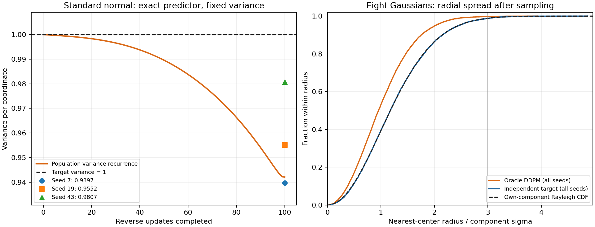

# DDPM解析对照：最优噪声预测之后，还剩哪些误差？

**先修：** [02扩散](chapters/02-diffusion.md)、条件期望和方差。**学习目标：** 用已知分布的最优预测器隔离网络拟合误差，推导固定反向方差的影响，并同时检查模式位置与模式内部离散程度。

本实验沿用二维实践的100步噪声表与`sample_ddpm`，将网络替换为可直接计算的条件最优噪声预测器（analytic oracle）。它无需训练、checkpoint或下载。标准正态案例有精确的端点方差递推；八高斯案例与已有训练报告使用同一目标分布，帮助解释邻域率的局限。

本轮在初步解析探索后确定选题，再保存[完整运行计划](../records/measurements/oracle-study/plan.json)。计划固定三个基础seed、每例4096点、独立参考随机流和120秒上限；下文解释这些具体条件下的结果。

## 1. 最优预测器知道什么？

令$`A_t=\bar\alpha_t`$。给定当前状态$`x_t`$，噪声MSE的总体最优预测为

```math
\epsilon^*(x_t,t)=\mathbb E[\epsilon\mid x_t]
=-\sqrt{1-A_t}\,\nabla_{x_t}\log q_t(x_t).
```

预测器只读取当前带噪状态和时间。它对可能的干净样本与噪声取后验平均；02章练习B将某次正向构造的真实噪声直接代入，承担的是另一种公式检查。

把最优预测器代入DDPM均值，能得到真实的$`\mathbb E[X_{t-1}\mid X_t]`$。但完整条件分布还包含方差和更高阶结构，需要一起核对。

## 2. 固定反向方差省去了哪一项？

02章已知$`X_0`$时的后验可以写为

```math
X_{t-1}\mid X_t,X_0\sim
\mathcal N(c_tX_0+d_tX_t,\tilde\beta_tI),\qquad
c_t=\frac{\sqrt{A_{t-1}}\beta_t}{1-A_t}.
```

对未知$`X_0`$应用全协方差公式：

```math
\operatorname{Cov}(X_{t-1}\mid X_t)
=\tilde\beta_t I+c_t^2\operatorname{Cov}(X_0\mid X_t).
```

第二项来自干净数据的后验不确定性，是半正定矩阵。现有教学采样器使用第一项作为固定方差；即使均值已经精确，也会漏掉第二项。对于混合数据，真实反向条件一般还具有混合结构，补足协方差本身也未必恢复整个条件分布。

在最后一步$`t=1`$，$`c_1=1`$、$`\tilde\beta_1=0`$。现有采样器输出$`\mathbb E[X_0\mid X_1]`$；真实$`X_0\mid X_1`$仍可能有非零方差。这里解释的是这份连续二维实验的固定方差选择，具体图像模型还需核对其decoder、方差参数化和后处理。

### 用平稳标准正态得到可计算的结果

若数据为$`\mathcal N(0,I)`$，所有正向边缘都严格为标准正态，采样起点也完全匹配。此时

```math
\epsilon^*(x_t,t)=\sqrt{1-A_t}\,x_t,\qquad
\mu^*(x_t,t)=\sqrt{\alpha_t}\,x_t.
```

真实反向条件的方差是$`\beta_tI`$。使用现有$`\tilde\beta_t`$时，设每坐标生成方差为$`V_t`$，则

```math
V_T=1,\qquad V_{t-1}=\alpha_tV_t+\tilde\beta_t.
```

因此生成分布仍为零均值高斯，方差可用100次标量运算算出。当前噪声表的理论递推终点约为 **0.942097**，目标为1。这个例子同时固定了精确预测器、精确起点和指定采样器，直接揭示该反向方差方案的有限步偏差。

## 3. 八高斯的解析score

目标为8个等权二维高斯，中心$`\mu_j`$位于半径2的圆上，各分量标准差$`s_0=0.08`$。加噪后，第$`j`$个分量的均值与共同方差为

```math
m_{tj}=\sqrt{A_t}\mu_j,\qquad r_t=A_ts_0^2+1-A_t.
```

状态$`x`$对各分量的后验权重为

```math
w_{tj}(x)=\operatorname{softmax}_j
\left(-\frac{\|x-m_{tj}\|^2}{2r_t}\right),
```

由混合密度直接求导得到

```math
\nabla_x\log q_t(x)=\frac{\sum_jw_{tj}(x)m_{tj}-x}{r_t}.
```

实现用稳定softmax计算权重，再按第一节转换为最优噪声。独立验证可从混合密度做有限差分，也可先用各分量的高斯条件均值求$`\mathbb E[X_0\mid X_t]`$，再检查噪声/去噪器恒等式。

本例仍从$`\mathcal N(0,I)`$启动，真实$`q_T`$的每坐标方差约为 **1.00565472**，并具有混合结构。其偏差分析需同时保留起点近似和有限步反向条件近似；单一实验不能分配二者各自的影响量。标准正态案例已经单独控制了起点问题。

## 4. 运行与输出

按README安装基础环境，在仓库根目录运行：

```bash
python -m genai_study.oracle_study --samples 4096 --seeds 7 19 43 \
  --threads 1 --output artifacts/oracle-study
```

使用新的输出目录保存复跑。每个基础seed派生独立随机流：`8*seed+0`用于标准正态采样，`+1`用于八高斯采样，`+2`用于标准正态参考，`+3`用于八高斯参考，`+4`用于独立八高斯目标基线。完整数组与metrics一起保存，便于独立复算；这里的基础seed和历史训练报告中的角色偏移分别记录。入口接受`0..2^29-1`的互异基础seed，使全部派生值保持在当前CPU生成器的有效32位范围内。

2026-11-10在Linux x86_64、Python3.12.14、PyTorch2.6.0+cpu、NumPy2.1.3、单PyTorch线程上实际完成计划：完整命令 **1.423秒**，导入结束至metrics写入前 **0.484秒**。每次正态采样约0.007–0.008秒，混合采样约0.130–0.156秒；图形导出另计。每例每seed保留4096点，所有计划请求成功，21份数组及配置身份见[证据索引](../records/measurements/oracle-study/README.md)。

## 5. 指标应该怎样解释？

在每个分量内，真实二维高斯有

```math
\mathbb P(\|X-\mu_j\|<3s_0)=1-e^{-9/2}\approx98.8891\%,\qquad
\mathbb E\|X-\mu_j\|^2=2s_0^2.
```

邻域率升高既可能来自清除模态间错误点，也可能来自把分量压缩得过窄。增加径向二阶矩诊断

```math
R_2=\frac{1}{N}\sum_i\frac{\min_j\|x_i-\mu_j\|^2}{2s_0^2}
```

后，可以同时查看位置与离散程度。理论值1对应样本自身的生成中心；代码选择最近中心，本例中心间距远大于$`s_0`$，两个统计量的差别只涉及极小概率的跨中心尾部。$`R_2`$仍是一项矩统计，需与模式频率、邻域率及完整样本共同判断。

实际标准正态结果如下。经验方差先按每坐标减去样本均值、以$`N`$为分母计算，再取两个坐标的平均；理论总体方差为0.942097。各seed具有有限样本波动，所有结果均保留。

| 基础seed | oracle采样经验方差 | 独立标准正态参考经验方差 |
| --- | ---: | ---: |
| 7 | 0.939718 | 1.024112 |
| 19 | 0.955174 | 0.998408 |
| 43 | 0.980694 | 1.027576 |

八高斯对照同时观察邻域和离散程度：

| 基础seed | oracle邻域率 | oracle $`R_2`$ | 独立目标邻域率 | 独立目标 $`R_2`$ |
| --- | ---: | ---: | ---: | ---: |
| 7 | 99.7803% | 0.663947 | 98.8281% | 1.007910 |
| 19 | 99.8047% | 0.668508 | 98.7549% | 1.007632 |
| 43 | 99.7559% | 0.677479 | 98.8770% | 0.994246 |

六组coverage均为8。oracle的邻域率约99.8%，径向二阶矩却只有目标参照的约66%–68%，表明分量内分布更窄。原始energy V统计量也完整保存：oracle为0.00474–0.01460，独立目标对共同参考为0.00260–0.00809；各512点的估计受有限样本波动影响。本例的解析结构与径向分布提供更直接的诊断。



右图每条经验曲线使用三个seed的全部12,288个点，横轴覆盖最远样本；理论曲线采用自身分量中心。图片数值与完整表格共同构成文字/图形阅读路径。复现图片时，在完成上面的实验后运行：

```bash
python scripts/plot_oracle_study.py --input artifacts/oracle-study \
  --output artifacts/oracle-study/diagnostics.png
```

脚本先核对数组archive的SHA，保存PNG与同名JSON来源记录，保护已有文件。云环境若默认Matplotlib缓存目录不可写，可在命令前设置`MPLCONFIGDIR=/workspace/.cache/matplotlib`。

已有5000更新训练结果约92%–93%的邻域率显示仍有较多点落在八个半径$`3s_0`$的目标邻域之外。解析oracle对照进一步说明：将这一比例单独推向100%也可能损害分布拟合。训练、起点、反向分布近似、有限样本评价分别影响结果；本实验通过控制其中几项获得可解释的对照。

## 6. 练习、来源与验证范围

1. 在平稳正态例子中，把递推的$`\tilde\beta_t`$换成$`\beta_t`$，方差如何演化？

   <details><summary>答案</summary>

   从$`V_T=1`$开始，$`V_{t-1}=\alpha_t+\beta_t=1`$，所有时刻保持标准正态。这个结论依赖本例的精确均值和高斯条件结构；换到八高斯时须重新推导真实反向条件。

   </details>

2. 每个中心重复输出相同数量的点，邻域率与$`R_2`$分别是多少？

   <details><summary>答案</summary>

   邻域率100%、coverage为8、$`R_2=0`$；所有分量内部都丢失了目标方差。结合真实数据参考即可发现退化。

   </details>

3. 若在正态例子中使用精确score却得到终点方差约0.942，应首先增加网络训练吗？

   <details><summary>答案</summary>

   这里没有待训练参数。先根据解析递推检查反向方差、索引和采样实现，确认结果是否属于声明的采样方案；再设计改变方差或离散方案的受控实验。

   </details>

原始依据为DDPM v2的正向边缘、已知$`X_0`$的后验及噪声均值参数化，具体版本/公式见[02/03来源审计](source-audit.md)。本页的全协方差、平稳方差递推和混合score由这些公式与高斯条件分布独立推导。概率流坐标的另一组解析核验见[扩散与Flow Matching的桥梁](readings/diffusion-flow-bridge.md)；本页使用离散DDPM采样器。

实际验证包括混合log-density有限差分、后验均值恒等式、平稳方差的独立展开式，以及16点100步的独立高斯Bayes参考。主代理从全部21数组重算初噪声、协方差、邻域、径向二阶矩和energy；正态按相同随机流独立线性传播，最大差4.06e-6，energy的float64复算差小于8e-7。代码审查发现大整数seed周期重复后收紧参数边界，另在新目录重跑原配置，全部数组与正式实验逐元素一致；两版源码身份分别归档。
