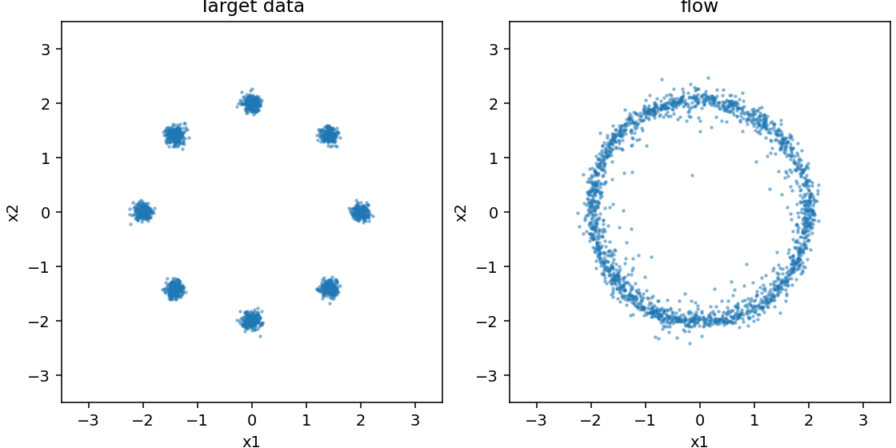
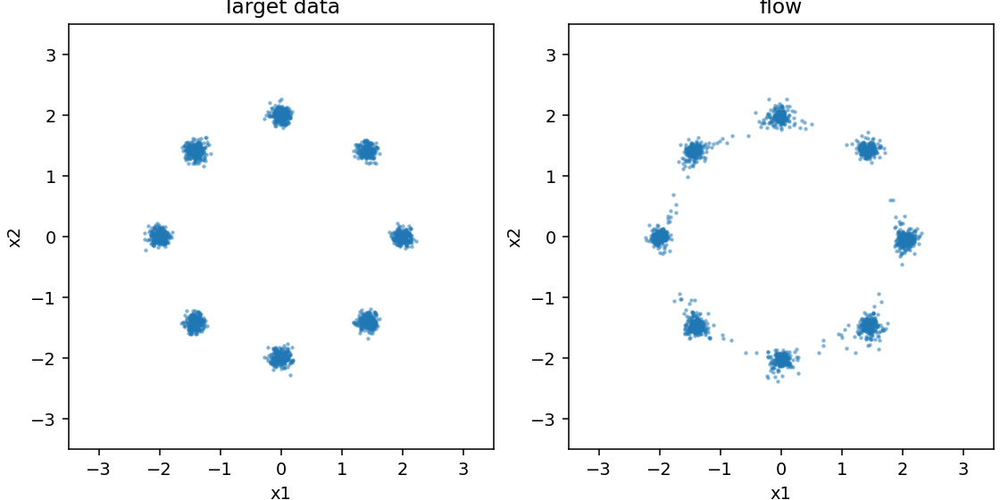

# CPU 实测：能运行、拟合改善、方法优劣是三件事

2026-11-10 在本项目初始 ChatGPT 云环境实测。Linux x86_64，Python 3.12.14、PyTorch 2.6.0+cpu、NumPy 2.1.3、Matplotlib 3.9.3，单CPU线程。网络宽128、Adam学习率0.001、batch256、每次生成2048点，100步采样。完整配置、依赖版本、计时范围保存在 [原始JSON目录](../records/measurements/)，源码/锁文件SHA见 [provenance](../records/measurements/provenance.json)。

## 观察与边界

默认800次训练更新足够验证完整路径，但明显欠拟合。即使覆盖全部8个模式，只有约23%（DDPM）/27%（flow）的生成点进入某个中心半径0.24的圆。5000次更新后比例提升到约92%–93%，仍低于数据本身约98.9%的理论邻域概率。因此不能把“覆盖8模式”写成“学会八高斯”。

下表是三个训练seed（7、19、43）的**均值 [最小值,最大值]**，不是置信区间。两方法相同更新次数不等于相同优化难度。Energy使用各512点的有偏V统计量，越低通常越接近，但不能直接当分布等价检验；三个seed不足以宣布方法胜负。

| 方法 / 更新数 | 邻域内比例 | Energy V统计量 | 训练/评估/采样/指标耗时范围 |
| --- | --- | --- | --- |
| DDPM / 800 | 22.67% [21.63%,23.24%] | 0.04547 [0.02905,0.05557] | 1.62–1.71 秒 |
| Flow / 800 | 27.23% [26.66%,27.98%] | 0.03344 [0.02736,0.04110] | 1.48–1.63 秒 |
| DDPM / 5000 | 92.81% [91.89%,93.51%] | 0.02104 [0.00771,0.04656] | 8.20–8.56 秒 |
| Flow / 5000 | 92.43% [92.38%,92.48%] | 0.01039 [0.00679,0.01376] | 7.93–8.91 秒 |

计时不包含Python启动、包导入、绘图或依赖安装，不是端到端时间保证。各行全部seed的coverage都为8，说明单独使用它会漏掉明显质量差异。默认seed7的target-target energy基线为0.00136，近中心比例为98.68%；这是有限样本参照，不是严格通过阈值。默认DDPM评估MSE为0.98555→0.37989，flow为2.99220→1.86709；两者监督目标不同，不可直接比较数字大小。

对于各分量二维各向同性高斯，落在**自身中心**半径3σ圆内的概率是 `1-exp(-9/2)=0.988891`，并非一维常说的99.7%。最近中心邻域包含自身中心圆，因此两者概念略有不同；本数据中心间距远大于σ，跨圆贡献极小。详见 [评价章](chapters/05-evaluation.md)。

## 看见短训练的局限

以下为flow seed7实际输出，左侧是真实数据、右侧是生成点；统一轴显示全部点。不是精选最佳seed。

800更新：



5000更新：



## 复现实测

先按README安装。从仓库根目录运行以下完整命令。输出目录非空时命令会拒绝覆盖；复跑请选择新的目录前缀，不要直接删已有研究结果。

```bash
for steps in 800 5000; do
  for method in ddpm flow; do
    for seed in 7 19 43; do
      python -m genai_study.experiment --method "$method" --steps "$steps" \
        --seed "$seed" --output "artifacts/reproduce/${method}-${steps}-seed${seed}"
    done
  done
done
```

本轮实际执行了全部12次运行并保存JSON。训练、评估、采样、目标参考和基线各用独立随机流。跨平台/库版本的位级一致性没有保证；在本次环境内两次同配置的CLI数值复现由测试覆盖。时间不应要求复现成相同数字。

## 读者任务

1. 用同一个seed比较800和5000更新：哪些指标改善，哪些仍不足？结合散点图或其文字说明，并用表中的诊断指标支持判断。
2. 查看seed19 DDPM的5000步energy与其他seed的差异：提出可能来自训练、采样和估计器的原因，不只凭单个数字下结论。
3. 以真实样本之间的差异作为参照，并设计更多训练seed/固定评估协议。参考答案：参照能提供有限样本尺度，不能自动分离训练随机性和评估随机性；增加独立训练重复与每个模型多次评估更有信息。

这些结果仅验证二维实验，不证明图像/视频质量、最佳网络结构或论文方法的优劣。

## 固定模型的求解器对照

从800更新seed7的flow checkpoint出发，固定2048个初始噪声（seed123），实际比较10/25/100/200步Euler。相邻方案的配对终点RMS距离为0.05841、0.02408、0.00372；近中心比例为26.76%、27.98%、28.17%、28.12%。最后一项轻微下降说明更细积分不必单调改善目标分布诊断。终点差不是精确解误差，具体记录见 [solver JSON](../records/measurements/solver-study.json)。命令见03章。
