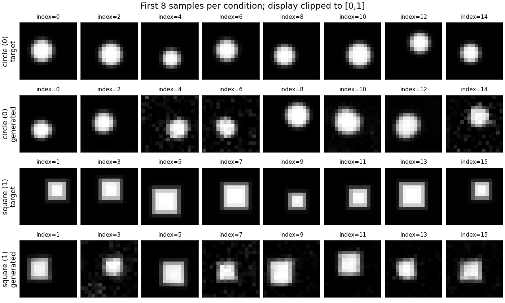

# 小图像实测：条件形状可学习，指标仍有边界

2026-11-10，在发布后恢复的当前云环境重新执行三个训练seed：7、19、43。Linux x86_64，Python3.12.14、PyTorch2.6.0+cpu、单CPU线程；NumPy2.1.3、Matplotlib3.9.3。每次1500更新、batch64、Adam学习率0.001、119,345参数，40步Euler生成128张图（每条件64张）。[原始JSON](../records/measurements/image-flow/)保存全部配置、两个真实数据参照及分组指标，[provenance](../records/measurements/image-flow/provenance.json)固定代码与依赖哈希。

## 预先定义什么算粗略识别

数据是程序绘制的16×16软边圆盘/方形，无外部图像和权重。诊断先裁剪到[0,1]，再比较中心/尺寸网格上的同类模板；最近同类模板MSE≤0.01且最近模板类别匹配，记为“粗几何规则通过”。阈值、模板网格和错误图像反例在训练前定义，见 [07章](chapters/07-image-flow-lab.md) 和测试。

该规则用于发现明显失败，不是人类识别率或自然图像质量分数。每类重复一个原型也可100%通过，所以必须结合类别内位置/前景质量变化、未裁剪数值和图形观察；不能据此声称学到了完整条件分布。

## 三个seed的实际结果

| seed | 留出速度MSE（初始→最终） | 圆盘粗规则通过率 | 方形粗规则通过率 | 训练与评估 / 采样耗时 |
| --- | --- | --- | --- | --- |
| 7 | 1.20465→0.05980 | 96.875% | 95.3125% | 33.03秒 / 0.53秒 |
| 19 | 1.70759→0.06526 | 100% | 98.4375% | 33.76秒 / 0.58秒 |
| 43 | 1.21685→0.04767 | 96.875% | 92.1875% | 33.33秒 / 0.57秒 |

各组真实参考样本的粗规则通过率为100%；独立真实基线数值也保留在JSON中。时间不包含启动/导入、数据参照构造、模板诊断、绘图或写盘，不是端到端延迟保证。三种seed只是描述性重复，不构成总体质量置信区间。

**数值局限没有被图像隐藏**：六个（seed，类别）组合中，原始生成像素的越界比例为32.8%–46.2%，平均绝对裁剪变化为0.0060–0.0101（像素强度单位）。很多背景像素接近0，轻微负数也计作越界；比例高不等于每个越界像素误差都很大，但不能把裁剪后的几何得分当作未经处理的生成分布质量。

**多样性也并非全部匹配**：seed19方形的水平质心标准差为1.171px，真实参照为1.351px；前景质量标准差为7.403，参照为9.182。它的粗通过率很高，仍可能遗漏部分尺寸/位置变化。各类均值、标准差不能证明联合分布相等，也不能在64张图上把每个差值解释成显著缺陷。

## 固定展示规则的样本

下面展示seed7每个条件的**前8张**，不是按质量挑图。每两行分别是真实参考与生成；图像为显示裁剪到[0,1]，上方保留原样本索引。真实与生成并非一一配对重建。



完整128张未经裁剪的数组保存在运行目录的`arrays.npz`，字段为`generated_raw`、`labels`等。记录可复现的小JSON与固定展示图，不把二进制模型或全部生成数组加入Git；按下列命令可重建。

## 读者复现路径

完成README安装后，在仓库根目录运行：

```bash
for seed in 7 19 43; do
  python -m genai_study.image_flow --steps 1500 --seed "$seed" \
    --output "artifacts/image-reproduce/seed${seed}"
done
```

成功运行应生成`metrics.json`、`arrays.npz`、`samples.png`、`loss.png`。输出目录非空时默认拒绝覆盖；重复实验请选择新的目录。此模块没有保存模型checkpoint，不提供严格续训或独立冻结模型采样入口。

建议自测：在同一组结果中，分别解释低MSE、高粗通过率和高像素越界率为什么能够同时出现；再构造“每类别固定原型”验证模板规则的盲点。参考答案：MSE是带噪路径上的平均速度误差，模板规则在裁剪后的终点图像上计算，越界率只统计是否越界而非幅度；三者的对象和归约不同，不能互相代替。

该实验已从零学习图像张量上的条件速度场，但数据只有两个受控几何族。它不证明自然图像、文本语义、视频时序、FID或原论文大规模图像性能。
