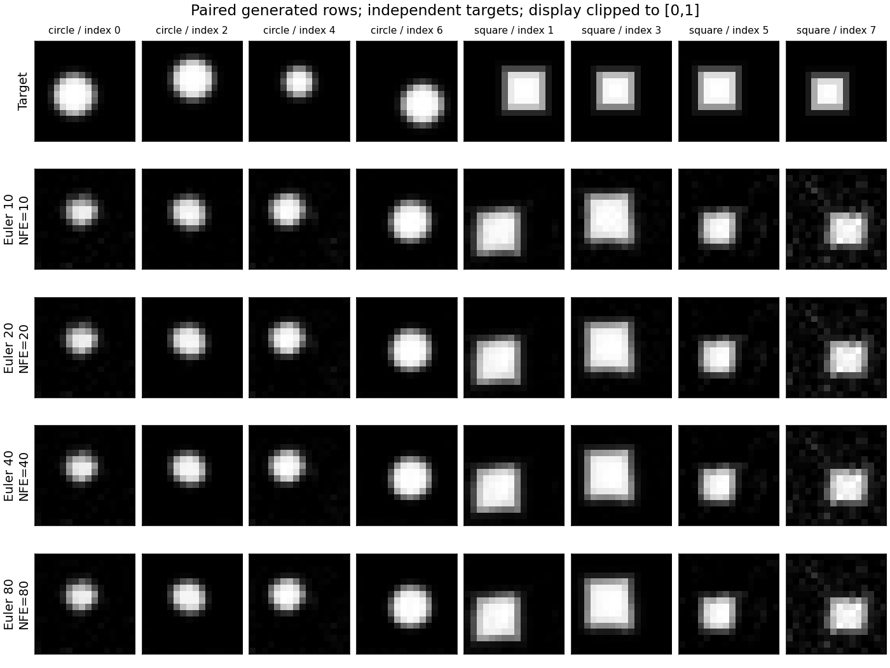

# 小图像实测：条件形状、采样步数与数值诊断

2026-11-10，在发布后恢复的当前云环境重新执行三个训练seed：7、19、43。Linux x86_64，Python3.12.14、PyTorch2.6.0+cpu、单CPU线程；NumPy2.1.3、Matplotlib3.9.3。每次1500更新、batch64、Adam学习率0.001、119,345参数，40步Euler生成128张图（每条件64张）。[原始JSON](../records/measurements/image-flow/)保存全部配置、两个真实数据参照及分组指标，[provenance](../records/measurements/image-flow/provenance.json)固定代码与依赖哈希。

## 预先定义什么算粗略识别

数据是程序绘制的16×16软边圆盘/方形，无外部图像和权重。诊断先裁剪到[0,1]，再比较中心/尺寸网格上的同类模板；最近同类模板MSE≤0.01且最近模板类别匹配，记为“粗几何规则通过”。阈值、模板网格和错误图像反例在训练前定义，见 [07章](chapters/07-image-flow-lab.md) 和测试。

该规则用于检查受控形状的粗几何。每类重复一个原型也可100%通过，因此完整诊断还需结合类别内位置/前景质量变化、未裁剪数值和图形观察。

## 三个seed的实际结果

| seed | 留出速度MSE（初始→最终） | 圆盘粗规则通过率 | 方形粗规则通过率 | 训练与评估 / 采样耗时 |
| --- | --- | --- | --- | --- |
| 7 | 1.20465→0.05980 | 96.875% | 95.3125% | 33.03秒 / 0.53秒 |
| 19 | 1.70759→0.06526 | 100% | 98.4375% | 33.76秒 / 0.58秒 |
| 43 | 1.21685→0.04767 | 96.875% | 92.1875% | 33.33秒 / 0.57秒 |

各组真实参考样本的粗规则通过率为100%；独立真实基线数值也保留在JSON中。耗时分别测量训练与评估、采样两个代码段；启动/导入、数据参照构造、模板诊断、绘图和写盘另外消耗时间。三种seed提供描述性重复，样本规模尚不足以估计总体质量置信区间。

**原始像素与裁剪**：六个（seed，类别）组合中，原始生成像素的越界比例为32.8%–46.2%，平均绝对裁剪变化为0.0060–0.0101（像素强度单位）。很多背景像素接近0，轻微负数也计作越界；越界比例描述发生频率，平均绝对裁剪变化描述幅度，几何得分描述裁剪后图形。这三项需分别解释。

**类别内变化**：seed19方形的水平质心标准差为1.171px，真实参照为1.351px；前景质量标准差为7.403，参照为9.182。这些差异提示进一步检查尺寸/位置变化；每类64张的均值和标准差提供初步诊断，判断分布差异还需更多样本与联合统计。

## 固定展示规则的样本

下面按生成顺序展示seed7每个条件的**前8张**。每两行分别是真实参考与生成；图像为显示裁剪到[0,1]，上方保留原样本索引。真实参考和生成图像独立抽样。


完整128张未经裁剪的数组保存在运行目录的`arrays.npz`，字段为`generated_raw`、`labels`等。记录可复现的小JSON与固定展示图，不把二进制模型或全部生成数组加入Git；按下列命令可重建。

## 读者复现路径

完成README安装后，在仓库根目录运行：

```bash
for seed in 7 19 43; do
  python -m genai_study.image_flow --steps 1500 --seed "$seed" \
    --output "artifacts/image-reproduce/seed${seed}"
done
```

成功运行应生成`metrics.json`、`arrays.npz`、`samples.png`、`loss.png`和推理权重`checkpoint.pt`。输出目录非空时默认拒绝覆盖；重复实验请选择新的目录。checkpoint记录模型参数与训练配置，可用于下节的独立采样；恢复训练还需要优化器、随机流和训练进度状态。

建议自测：在同一组结果中，分别解释低MSE、高粗通过率和高像素越界率为什么能够同时出现；再构造“每类别固定原型”验证模板规则的盲点。参考答案：MSE是带噪路径上的平均速度误差，模板规则在裁剪后的终点图像上计算，越界率只统计是否越界而非幅度；三者的对象和归约不同，不能互相代替。

该实验从零学习图像张量上的条件速度场，覆盖空间网络、类别条件、ODE采样和受控形状诊断。自然图像与视频实践需要进一步引入真实数据、表示学习和相应评价协议。

## 固定模型后，Euler 步数改变了什么

同日补充 checkpoint 功能后，重新训练 seed7、19、43，各1500次更新。三次训练的全部5组数组及7组非耗时指标与上面的历史运行逐元素一致；载入各自 checkpoint、恢复原采样随机种子后，也精确重现了训练命令保存的图像。新训练与评估耗时分别为34.17、34.35、33.50秒。新记录单独保存在 [image-solver-study](../records/measurements/image-solver-study/)，历史记录保留原始版本和耗时。

对每个冻结模型执行下列命令，示例沿用上一节的复现输出目录：

```bash
for seed in 7 19 43; do
  python -m genai_study.image_solver_study \
    --checkpoint "artifacts/image-reproduce/seed${seed}/checkpoint.pt" \
    --steps 10 20 40 80 --samples 128 --seed 123 \
    --output "artifacts/image-solver-reproduce/seed${seed}"
done
```

三组实验共用初始噪声seed123、目标参照seed124、独立目标基线seed125及128个平衡类别标签。同一模型内部只改变Euler步数；每步一次网络求值，NFE等于步数。checkpoint SHA、训练配置、依赖和源码哈希见 [provenance](../records/measurements/image-solver-study/provenance.json) 及各组JSON。

下表是seed7的实际结果。配对RMS为相邻步数终点差在全部`B,C,H,W`元素上的均方根，单位是像素强度；第一行没有前一个方案。裁剪RMS先分别裁剪两个终点，再计算同一归约。

| Euler步数 / NFE | 原始配对RMS | 裁剪配对RMS | 圆盘粗规则通过率 | 方形粗规则通过率 | 单次积分耗时 |
| ---: | ---: | ---: | ---: | ---: | ---: |
| 10 | — | — | 98.4375% | 87.5% | 0.159秒 |
| 20 | 0.014219 | 0.013375 | 100% | 89.0625% | 0.314秒 |
| 40 | 0.009088 | 0.007602 | 100% | 87.5% | 0.628秒 |
| 80 | 0.004124 | 0.003687 | 100% | 87.5% | 1.238秒 |

**步数敏感性与几何拟合。** 三个模型的相邻原始/裁剪RMS都随10→20→40→80细分减小。seed7的方形通过率在20→40步下降，seed19的圆盘通过率在10→20步从98.4375%降到96.875%。模板阈值会把连续形状变化归为离散的通过/失败；积分逐渐稳定时，速度场的训练误差和几何偏差仍然存在。这里记录的是两个有限步近似之间的变化，估计真解误差还需更精细的参考解或解析证据。

**裁剪影响。** `[0,1]`裁剪对标量距离具有非扩张性，因此在同一配对和归约下，裁剪RMS应小于等于原始RMS。三组原始数组经独立float64复算均满足这一性质，与JSON误差小于`1e-7`。seed7的80步输出中，圆盘/方形的原始越界比例仍为49.87%/39.83%，平均绝对裁剪变化为0.00762/0.00851；需要连同几何结果一起读取。

**采样协议与成本。** 本节所有模型统一使用新的采样seed123；上节三次训练命令的采样seed分别为10、22、46，因此两节的40步通过率可不同。耗时只计积分调用，未预热或重复计时，加载、诊断和绘图另计；三模型80步各耗时1.10–1.24秒，测量发生在共享CPU云环境。

下图固定展示每类前4个索引。目标行独立抽样，生成各行在列内共享初始噪声与标签，可以直接观察增加步数时的形状变化。



读者可从输出`arrays.npz`中的`initial`、`labels`、`steps_10`等数组复算表格，或直接运行 [07章练习E](chapters/07-image-flow-lab.md#e-固定模型后更多采样步数带来了什么)。
