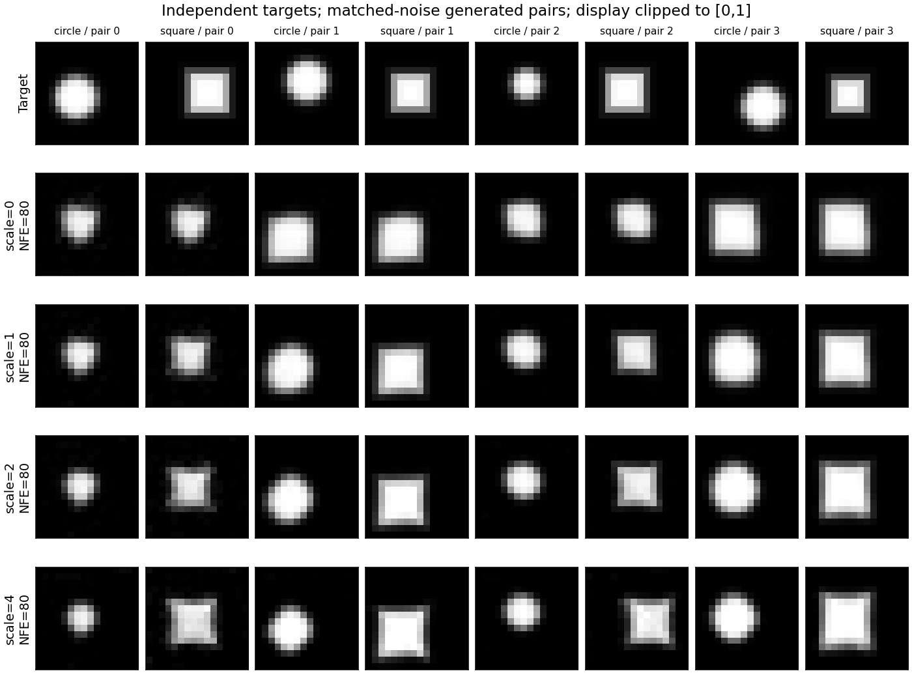

# 小图像CFG实测：条件响应、几何与裁剪

2026-11-10，在当前云实例运行三个训练seed：7、19、43。Python3.12.14、PyTorch2.6.0+cpu、NumPy2.1.3、Matplotlib3.9.3；Linux x86_64、单CPU线程，宿主报告AMD EPYC 9V45。各训练1500更新、batch64、Adam学习率0.001、condition dropout=0.2，沿用119345参数的16×16卷积flow。

[原始训练和采样JSON](../records/measurements/image-guidance/)保存完整结果；[provenance](../records/measurements/image-guidance/provenance.json)记录源码/依赖哈希、硬件与独立复算结果。模型、全部数组和图保存在运行目录；仓库保留小JSON和固定展示图，完整复现命令见下文。

## 固定了哪些变量

每个模型只训练一次，然后冻结权重。所有模型与强度共同使用噪声seed123、真实参照seed124、独立目标基线seed125。64份独立噪声各复制为圆盘/方形请求，共128张输出。强度预先选为0、1、2、4，每组40步Euler、每步两分支，共80 NFE/图。

每组重新从相同初始噪声积分。强度1使用该模型的条件速度场；强度0使用空条件速度场。原始与裁剪RMS均在全部batch/像素上计算，具体定义和字段见 [08章](chapters/08-image-guidance-lab.md)。训练留出损失只衡量速度回归，图形表现另看采样诊断。

## 训练与端点验证

| 训练seed | 条件留出MSE | 空条件留出MSE | 实际空条件训练样本 / 总数 | 训练与评估耗时 |
| ---: | ---: | ---: | ---: | ---: |
| 7 | 0.06051 | 0.06389 | 19114 / 96000 | 34.22秒 |
| 19 | 0.06500 | 0.07306 | 19169 / 96000 | 33.61秒 |
| 43 | 0.05704 | 0.06104 | 19258 / 96000 | 34.12秒 |

三组采样中，强度0的每个圆盘/方形请求对逐元素相同；强度1与直接调用普通条件积分器的终点逐元素相同。将丢弃率设回0，再完整重训seed7，全部5组数组及7组非耗时旧指标也与前版精确相等。新功能保留了07章默认实验的数值路径。

## seed7：条件响应提高时，原始数值也在变化

“类别匹配”是最近几何模板类别与请求一致；“粗规则通过”还要求最近同类模板MSE≤0.01。两者均在裁剪后图像上计算，阈值和固定原型反例沿用07章。表中成对数值依次为圆盘 / 方形。

| 强度 | 类别匹配率 | 粗几何通过率 | 平均绝对裁剪变化 | 同噪声两类别原始RMS | 单次积分耗时 |
| ---: | --- | --- | --- | ---: | ---: |
| 0 | 65.625% / 34.375% | 64.0625% / 32.8125% | 0.01017 / 0.01017 | 0.00000 | 1.243秒 |
| 1 | 96.875% / 95.3125% | 93.75% / 93.75% | 0.01288 / 0.01101 | 0.08675 | 1.341秒 |
| 2 | 100% / 100% | 96.875% / 98.4375% | 0.01620 / 0.01254 | 0.14312 | 1.314秒 |
| 4 | 100% / 100% | 96.875% / 98.4375% | 0.02255 / 0.01626 | 0.21766 | 1.254秒 |

强度0平均类别匹配率为50%，这是本次配对设计的必然结果：每对输出相同，最近模板给出同一类别，而两个请求分别为圆盘与方形，其中恰好一个匹配。该数值不反映空条件模型是否以各一半概率生成两类图形；查看每类最近模板的数量才能分析生成类别比例。

从强度1到4，seed7圆盘原始像素越界比例从58.89%升到70.64%，平均裁剪幅度从0.01288升到0.02255；前景质量标准差从8.636变为7.438，真实参照seed124为8.009。几何得分、原始值域和类别内变化回答不同问题，应同时读取。

## 三个seed的对照：强引导的变化具有方向和任务依赖

| 训练seed / 类别 | 强度1粗通过率 | 强度2粗通过率 | 强度4粗通过率 | 强度1→4平均裁剪变化 |
| --- | ---: | ---: | ---: | --- |
| 7 / 圆盘 | 93.75% | 96.875% | 96.875% | 0.01288→0.02255 |
| 19 / 方形 | 95.3125% | 98.4375% | 93.75% | 0.00848→0.00557 |
| 43 / 圆盘 | 89.0625% | 95.3125% | 90.625% | 0.02150→0.04006 |

三模型的同噪声类别RMS均随0→1→2→4增加，显示条件响应增强。几何通过率与裁剪变化没有统一的单调方向：seed19方形在2→4时粗通过率下降，但裁剪幅度减小；seed43圆盘的粗通过率同样下降，裁剪幅度增加。类别匹配、形状误差阈值和像素值域各有不同的判据。每类64个噪声样本提供描述性对照，进一步推断还需扩大样本和训练重复，并在统计分析中保留噪声配对。

本轮各组积分耗时1.23–1.34秒，测量只包含单次积分调用，未预热或重复计时；模型加载、模板诊断和绘图另计。即使强度为0或1，本次协议也计算两分支；这解释了其80 NFE预算。训练与积分成本都来自共享CPU环境。

## 固定展示与复现

下图按索引展示seed7的前4个噪声对。目标行独立抽样，生成各行共用噪声与标签；显示裁剪到`[0,1]`，原始值保留在NPZ。



完成README安装后，在仓库根目录运行；若已有结果，直接复用，重做时选择新输出目录：

```bash
for seed in 7 19 43; do
  python -m genai_study.image_flow --condition-dropout 0.2 --steps 1500 \
    --seed "$seed" --output "artifacts/cfg-reproduce/train-seed${seed}"
  python -m genai_study.image_guidance_study \
    --checkpoint "artifacts/cfg-reproduce/train-seed${seed}/checkpoint.pt" \
    --scales 0 1 2 4 --sampling-steps 40 --samples 128 --seed 123 \
    --output "artifacts/cfg-reproduce/study-seed${seed}"
done
```

引导输出包含`metrics.json`、`arrays.npz`和`samples.png`。通过`runs[].array_key`读取每个强度的数组，再按08章练习复算。四种RMS字段已由float64独立计算验证，与保存JSON的绝对差小于`1e-7`，裁剪RMS均满足非扩张性。

本实验使用已声明的速度外推规则研究受控图形，原始CFG论文的噪声参数化与本章速度参数化分别说明。08章还给出一个精确高斯反例，展示线性速度组合需要额外概率路径依据才能确定终点密度。
