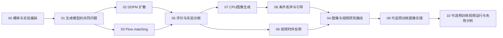

# 学习路线：从分布建模走向图像与视频生成

面向已熟练使用 PyTorch、具有研究经验的 CS 硕士生与博士生。不要求学过生成式 AI。主线是：先明确“模型学的是什么分布”，再理解扩散和流的训练目标，通过小实验检验公式，最后进入高维图像与时间序列生成。

本项目用二维 CPU 实验检验生成算法，再用 16×16 条件卷积图像实验连接空间网络与类别条件，通过程序绘制的视频光点检查时序评价假设。可选的09章完成固定SD1.4自然图像推理，10章运行固定SVD并分析低分辨率视频失败。大规模训练与发布尺寸的视频质量基线仍是后续实践方向。学习路线按能力组织，各阶段通过具体任务检验掌握程度。

## 先修诊断

开始前尝试回答以下四题。不会某一项时先完成第 00 章，不需要先补完整门概率论。

1. 解释条件概率、边缘化和期望；为什么 $\mathbb E[f(X)]$ 一般不等于 $f(\mathbb E[X])$？
2. 对独立标准高斯 $X,E$，求 $aX+bE$ 的均值和协方差。
3. 在 PyTorch 中区分 `model.train()`、`model.eval()`、`torch.no_grad()`，解释广播如何使每个样本使用不同噪声强度。
4. 区分训练损失下降、验证分布拟合改善、生成样本观感改善，给出其中两者不等价的情形。

<details>
<summary>参考答案与补课方向</summary>

1. 非线性函数不能一般地与期望交换。例如 $X=\pm1$ 等概率，则 $\mathbb E[X^2]=1$，而 $(\mathbb E[X])^2=0$。
2. 均值为 0，协方差为 $(a^2+b^2)I$；独立性使交叉协方差为 0。
3. 前两者切换 Dropout/BatchNorm 等层的行为；`no_grad()` 控制自动微分记录，不能代替 `eval()`。标量时间批次应按输入维度展开，例如图像上的 `B,1,1,1`。
4. 记忆训练样本可能降低训练损失却不改善泛化；只生成少数好看样本也可能丢失大量模式。

</details>

## 主线与依赖



图中依赖的文字版：00 → 01 → 02/03 → 05。完成05后，图像实践沿07 → 08推进，视频时序实践进入06；两条实践路线汇入04研究路线，最后可选09预训练图像实践，随后进入10的预训练视频运行与失败分析。

02和03在概念上可以并行阅读，初学者建议先02后03；阅读时分别核对DDPM和flow的时间方向。完成两章后，可选读[扩散与Flow Matching的桥梁](readings/diffusion-flow-bridge.md)，推导噪声、score、去噪器和概率流速度的关系，用解析高斯例检验符号与系数；随后配合09/10核对实际采样坐标。

| 阶段 | 目标与阅读入口 | 实践任务 | 完成判据 |
| --- | --- | --- | --- |
| 00 | [概率、噪声与可复现性](chapters/00-foundations.md) | 手算高斯线性组合；核对数据、噪声和 batch 轴 | 能解释独立性假设、密度单位和随机种子局限 |
| 01 | [生成模型的共同问题](chapters/01-generative-models.md) | 从边缘化推导 ELBO；比较似然、覆盖率与样本质量 | 能说明 VAE/GAN/自回归/流/扩散各自如何训练与采样 |
| 02 | [扩散模型](chapters/02-diffusion.md) | 运行 CPU DDPM；检查正向噪声与反向采样 | 能从 $\alpha_t$ 推出 $\bar\alpha_t$，区分噪声预测和后验采样 |
| 03 | [Flow matching](chapters/03-flow-matching.md) | 运行 CPU flow；改变训练预算；用 solver_study 做积分步数敏感性分析 | 能推导直线路径速度，并解释条件速度与边缘速度的差别 |
| 05 | [评价与实验诊断](chapters/05-evaluation.md) | 对比真实数据、标准高斯和退化生成器的指标；分析多种子结果 | 能区分运行成功、分布拟合与方法优劣证据 |
| 07 | [CPU 图像生成](chapters/07-image-flow-lab.md) | 从零训练条件卷积 flow；冻结 checkpoint 比较采样步数 | 能解释 BCHW、条件通道、原始值域、几何多样性与裁剪影响 |
| 08 | [条件丢弃与引导](chapters/08-image-guidance-lab.md) | 训练空条件分支；固定模型/配对噪声比较引导强度 | 能解释条件丢弃、速度组合、两分支NFE及几何/裁剪的变化 |
| 06 | [视频时序反例](chapters/06-video-temporal-lab.md) | 生成移动光点、乱序帧与静止对照，检查帧分布和时间诊断 | 能用相同帧集合构造不同运动，解释静止为何不能代表正确运动 |
| 04 | [图像与视频研究路线](chapters/04-image-video-roadmap.md) | 设计一个控制变量的预训练模型实验计划 | 能解释潜空间压缩、条件引导、时空建模与评价风险 |
| 09（可选） | [预训练图像实践](chapters/09-pretrained-image-lab.md) | 固定SD1.4模型、噪声与DDIM网格，完成CPU生成与引导对照 | 能核对latent/文本/调用预算，复查成本和具体样本；需独立环境及约5.11GiB权重 |
| 10（可选） | [SVD视频运行与失败分析](chapters/10-pretrained-video-lab.md) | 固定参考图、两随机流和sigma网格，按阶段预算生成全部视频帧 | 能核对帧轴/条件fps/联合调用，复算噪声与播放时间，分析低分辨率失败；另需约8.40GiB权重 |

符号统一见[术语与符号表](notation.md)，高频概念可从[中英术语索引](glossary.md)直接跳到具体章节。每章的练习都给出提示或参考答案；作答时同时说明公式依赖的假设。

## 学习投入的规划参考

以下是**未测量的学习预算建议**，用于安排阅读与练习；程序运行成本另见实验报告：00 约 1–2 小时，01 约 2–4 小时，02 和 03 各约 3–5 小时，05 约 2–3 小时，07 和 08 各约 2–3 小时，06 约 1–2 小时，04 首次通读约 2–3 小时。独立推导、补读论文或深入实验可能显著增加时间；优先按完成判据推进。

09的阅读与练习可另留2–3小时，10可另留2–3小时；这些是学习预算建议。下载和机器运行时间单独按[图像实测](pretrained-image-report.md)与[视频实测](pretrained-video-report.md)规划。10的完整低分辨率请求本机wall约16.8分钟，存在明显内容失败，先阅读报告再决定运行阶段。

## 三种使用方式

**先获得一次运行成功。** 按 [README](../README.md) 安装并运行推荐5000步的flow实验，查看输出，再读00和03。第一次运行先确认环境与输出，再用八簇形状、邻域比例和真实数据参照解释拟合程度。800步结果保留作欠拟合对照。

**系统学习。** 按 00 → 01 → 02 → 03 → 05 → 07 → 08 → 06 → 04 阅读，推导关键公式，执行二维生成、小图像生成/引导和视频时序诊断。至少做一次失败分析：缩短训练、改变采样或引导参数，然后解释退化来自哪一环。

**进入图像/视频研究。** 完成00–03、05、07、08与06后沿04选择一条专题：潜空间表示、条件控制、生成求解器、视频时空建模或评价。先复现一个可运行基线，再提出研究问题；CPU环境可先完成图像引导与视频时序实验，再完成论文对照和实验设计。

## 第一组可执行任务

完成README的安装后，在仓库根目录运行以下尚未完成的实验。若已有`artifacts/first-flow`或`artifacts/first-ddpm`，先查看对应`metrics.json`的`config.steps`；5000步结果可直接重用，800步结果保留作短训练对照。需要新的5000步结果时，把`--output`改成新目录，例如`artifacts/first-flow-5000`，后续checkpoint路径也相应更新。

```bash
python -m genai_study.experiment --method flow --steps 5000 --output artifacts/first-flow
python -m genai_study.experiment --method ddpm --steps 5000 --output artifacts/first-ddpm
```

`--steps`表示优化器更新次数；这里显式选择5000次，省略参数时CLI默认800次。这两条训练命令的默认采样预算为100步。比较方法时还需控制数据、训练与采样预算，并检查收敛和多种子结果。单独改变flow积分步数使用03章的`solver_study`。实际依赖、输出文件、测量记录和可调参数以README与实验命令的`--help`为准。

完成后保存配置与完整输出，写下随机种子、训练预算、采样配置、样本覆盖情况，以及各指标支持的结论和适用条件。随后可运行[DDPM解析对照](ddpm-oracle-report.md)，用已知分布的最优预测器检查采样方差，并解释邻域率与分量离散程度的关系。

## 图像实践与2025系统阅读

按 [07 章](chapters/07-image-flow-lab.md) 的两步路径，先运行 `image_flow` 训练并保存 checkpoint，再运行 `image_solver_study`，在相同权重、噪声与条件下比较 Euler 步数。解释模板通过率、类别内变化与分布覆盖的差别，并对照原始和裁剪像素的配对 RMS 差。随后读 [Wan 2025 阅读卡](readings/wan-video-2025.md)，对照速度目标、空间网络、潜压缩、时序与条件接口；这一阶段的产物是论文证据表和后续权重实验计划。

研究条件控制时，先完成 [08章](chapters/08-image-guidance-lab.md) 的condition dropout训练，再用`image_guidance_study`改变引导强度。学习对照分别固定积分步数或引导强度，避免同时修改多个变量。

在04的条件控制之后，可选读[条件注意力专题](readings/conditioning-attention.md)，先检查Q/K/V的轴、CLIP隐藏态与全局向量、单token和mask置换，再追踪09/10的真实接口。

图像编辑方向接着读 [FLUX.1 Kontext阅读卡](readings/flux-kontext-2025.md)：用CPU检查latent打包与时间反向映射，核对参考图token、guidance蒸馏接口及每步调用数，再为编辑完成度和内容保留设计分组评价。视频方向通过Wan卡对照时空表示与条件接口。

视频训练基础可先读 [SVD与CogVideoX对照](readings/video-training-svd-cogvideox.md)：追踪图像初始化、视频训练与任务微调，独立计算49帧的潜压缩与token数，并说明VP的`v_prediction`和本仓库flow速度各自的定义。

完成04的潜空间与条件接口后，可按 [09章](chapters/09-pretrained-image-lab.md)安装独立环境，核验并缓存SD1.4权重，执行文本到图像和固定噪声引导对照。保存完整样本及成本，核对U-Net调用数、双分支batch与提示词截断；CPU结果见[实测报告](pretrained-image-report.md)。

随后可按[10章](chapters/10-pretrained-video-lab.md)复用可选环境，单独下载SVD，跟踪参考图双条件路径、视频噪声与增强随机流。完整输出和官方API短对照见[视频实测](pretrained-video-report.md)；以真实失败提出控制实验，分别核对程序运行、资源与画面表现。

离散图像生成可沿01的因果分解进入 [ResTok 2026](readings/restok-image-ar-2026.md)：先区分tokenizer和生成器，推导128个索引的9轮分组规则，再用两个相关bit检查组内条件独立的代价。对照09的连续latent、噪声CFG和DDIM，记录两类表示、预测量与成本口径。

视频联合建模沿Wan进入 [LTX-2 2026](readings/ltx2-video-audio-2026.md)：用敲击事件检查音画边缘与联合，展开顺序条件分解，核对sigma时间、音视频token及8+3区间的真实调用数。该卡只需基础CPU环境完成解析检查，完整权重实践另需资源和访问条件。

## 无需训练的视频时序实践

完成05的评价基础后，在同一环境首次运行下列命令。若已生成`artifacts/video-counterexample`，直接复用结果阅读06章和04章；重做时将`--output`改为新目录。

```bash
python -m genai_study.video_diagnostics --output artifacts/video-counterexample
```

程序直接构造移动高斯光点序列及其乱序、静止对照，生成 `metrics.json`、`contact_sheet.png` 和原始帧 `frames.npz`，无需下载数据、权重或训练模型。按 [06 视频时序反例](chapters/06-video-temporal-lab.md) 对照结果：同一组帧乱序后，无视顺序的帧统计可以完全不变，运动却不同；静止序列的帧间变化最小，也未必符合目标运动。记录所用 fps、长度、度量定义和实际结果，再说明这些反例对设计真实视频评价协议的启发。

## 进入研究前的毕业检查

先用[12题课程自测与错题索引](self-assessment.md)检查关键概念连接。每题给出可检查的产物、隐藏提示/答案和回读入口，再结合下面的实践完成情况选择下一步。

- 不看材料独立写出 DDPM 正向边缘分布和本仓库 flow 路径的条件速度。
- 解释为何训练时可以采样随机时间点，而生成时需要沿时间推进。
- 找出一个“训练损失更低但生成更差”的可能原因，并提出可证伪检查。
- 用第 05 章的反例说明单个指标为何不足，明确样本量和评估随机性。
- 运行第 07 章，冻结权重与初始噪声比较采样步数，解释原始/裁剪 RMS 差和几何拟合的关系。
- 运行第08章，说明空条件分支如何训练，验证引导强度0/1的含义，核对两分支计算成本及条件响应。
- 运行第 06 章并解释：为什么相同帧集合不保证正确时序，为什么最小帧差可能只奖励静止。
- 给预训练图像/视频实验写出权重版本、数据许可、推理参数、成本上限和评价方案。完成10时，核对两随机流、条件fps与实际播放时间，并从完整帧和API对照解释已知证据及待验证原因。
- 说明二维、图像和视频实验各自验证的性质，以及迁移到自然图像/视频所需的新证据。
