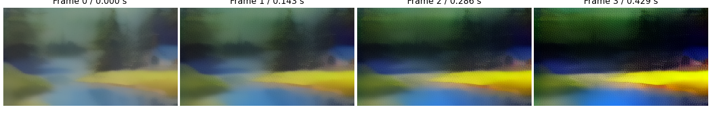
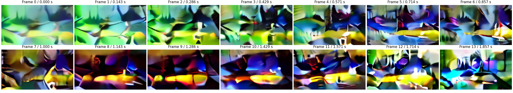
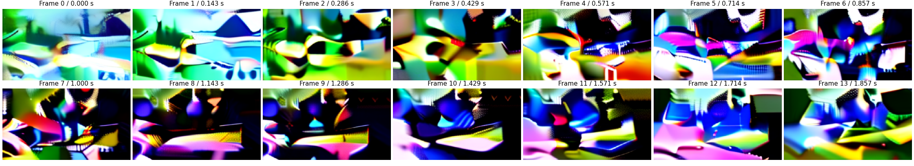

# SVD：固定参考图的CPU短视频实测

**Powered by Stability AI**

原作者SVD在当前CPU实例完成了144×256、14帧、25步推理，完整命令耗时 **1007.30秒（16.79分钟）**，峰值RSS **11.21GiB**。输出存在严重过饱和、闪变与主体形变。这个结果提供了完整运行、资源测量和失败诊断的案例。

四个请求沿用生成前提交的[计划](../records/measurements/pretrained-svd/plan.json)：4帧/2步smoke、14帧/4步校准、14帧/25步完整低分辨率请求、smoke重复。全部成功退出，固定同一张水彩湖岸图、视频seed7与增强seed8；视频初噪声形状随帧数变化，重复的浮点帧与PNG完全一致。查看结果后另做一次直接官方API对照，记录在后文。

## 实验条件与实际输入

日期2026-11-10。Linux x86_64、Python3.12.14、PyTorch2.6.0+cpu，单PyTorch线程；容器内存上限32GiB、CPU配额约4核，主机报告AMD EPYC9V45。独立环境沿用[预训练依赖锁](../requirements-pretrained-lock.txt)，完整软件版本逐请求保存在JSON。网络、缓存和宿主负载会影响时间，模型请求在新进程中依次执行且无预热；期间也进行了文档与轻量浏览器检查。

模型固定为`stabilityai/stable-video-diffusion-img2vid`、revision `9cf024d5bfa8f56622af86c884f26a52f6676f2e`。[11文件清单](../examples/pretrained-svd/manifest.json)共9,018,094,887字节（8.3988GiB），逐文件SHA完整通过。bootstrap下载/校验264.66秒；最终仓库prepare入口再次运行，复用11文件、下载调用0、耗时9.51秒。模型采用[Community2024-07-05许可](../examples/pretrained-svd/LICENSE-model.txt)，归属见[NOTICE](../examples/pretrained-svd/NOTICE)。

参考图在任何SVD生成前选定，为[SD1.4提示探索](sd14-prompt-pilot.md)的`scene/seed43`完整输出，原图SHA以`a262f547`开头。它是水彩场景，湖岸、针叶树与右侧小屋可辨。入口将512×512原图中心裁剪到框`[0,112,512,400]`，再以Lanczos缩放至256×144，保存实际输入：

处理后PNG的SHA为`e76d50ef91a5ece55252b9c867d58927ca8b21a303ee112014491608f79ed962`。分析输出时使用这份参考图核对构图，原始方形图片及裁剪操作均保留身份。

共同设置为CPU float32、144×256、视频seed7、增强seed8、帧轴引导1→2.5、fps输入7（管线内部条件值6）、motion bucket127、增强强度0.02，时间解码chunk等于整段帧数。该尺寸的宽高均为发布配置576×1024的四分之一；4帧smoke还改变了模型训练使用的14帧上下文。具体形状、预测量和操作方法见[10章](chapters/10-pretrained-video-lab.md)。

## 分阶段成本与资源判断

| 请求 | 帧数 / 步数 | 完整推理秒 | 去噪段秒 | 解码及后处理秒 | 程序总秒¹ | 外层命令秒 | 峰值RSS GiB |
| --- | --- | ---: | ---: | ---: | ---: | ---: | ---: |
| smoke | 4 / 2 | 38.37 | 23.24 | 11.19 | 46.54 | 47.14 | 9.54 |
| 校准 | 14 / 4 | 194.41 | 150.76 | 39.58 | 203.15 | 203.80 | 11.29 |
| 完整低分辨率 | 14 / 25 | 998.69 | 954.81 | 40.05 | 1006.73 | 1007.30 | 11.21 |
| smoke重复 | 4 / 2 | 37.85 | 23.39 | 10.59 | 45.96 | 46.53 | 9.59 |

¹程序总时间从推理函数入口起算，包含输入准备、文件校验、加载、推理、PNG/NPY保存及此前的元数据计算，终点位于结果字典的计时字段。RSS紧随其后查询，覆盖进程启动至该点，含导入、加载和中间激活；帧差诊断、输出帧文件与帧数组hash、metrics写入、打印和退出随后执行。完整推理还包含图像条件编码。去噪段从首个U-Net前置hook开始，到末次Euler更新后的callback结束；用于浏览器播放的媒体导出另行执行。

计划为smoke设600秒上限，校准900秒。校准后先写入[资源判断](../records/measurements/pretrained-svd/full-decision.json)：外层203.80秒乘25/4得到保守外推1273.77秒，低于1500秒门槛，峰值低于24GiB，因此启动25步请求，硬上限1800秒。它实际在1007.30秒结束。预算外推放大了加载与编解码固定成本；本页分别保留预算和实际值。

## 短运行的全部帧与观察

4帧/2步：

14帧/4步：

协调AI代码代理查看了全部帧。smoke呈现模糊的原场景色块并逐渐变暗；校准序列出现显著颜色和形状变化，小屋、树木及水岸的身份难以沿时间保持。两者首先用于检查接口与测量资源，这些具体失败现象完整保留。比较它们时需同时考虑帧数和步数的变化。

播放与逐帧文件分别见[smoke MP4](assets/svd-smoke.mp4)、[smoke原帧ZIP](assets/svd-smoke-frames.zip)、[校准MP4](assets/svd-calibration.mp4)、[校准原帧ZIP](assets/svd-calibration-frames.zip)。ZIP包含实际参考图和按索引命名的全部PNG。

## 25步的完整输出与失败分析

完整[MP4](assets/svd-full.mp4)和[全部原帧ZIP](assets/svd-full-frames.zip)保留每一帧。协调AI代码代理查看全序列后观察到：首段仍有局部湖岸/树形轮廓，后续出现大面积高亮、纯黑与饱和色块，建筑和树木难以连续辨认。25步没有恢复参考场景的稳定身份。真实读者评阅尚待开展。

14帧/4步与14帧/25步使用逐元素相同的视频初噪声、参考增强和输入PNG，模型、精度、帧轴引导、解码chunk等保持；改变步数也改变了实际sigma网格。两份结果的后处理浮点通道值恰落在0或1的比例分别为 **8.59%和40.48%**；相邻帧RGB RMS范围分别为 **0.14265–0.44087和0.26846–0.50566**。这些量描述此次输出的边界值和变化幅度，与全帧观察一起解释。浮点帧已经过管线的归一化还原和裁剪，边界比例无法恢复裁剪前的超出幅度。

针对此次失败，追加独立直接调用固定`StableVideoDiffusionPipeline`的4帧/2步实验：读取保存的input.png，独立构造seed7视频噪声和seed8增强generator，使用相同参数，完全省去仓库推理函数与观测hook。结果的全部浮点帧逐元素相同，差异元素0、最大差0，四张PNG也逐字节相同。模型、软件和scheduler身份再次核对，见[直接API对照](../records/measurements/pretrained-svd/direct-comparison.json)。该请求外层47.29秒、推理38.25秒、峰值9.53GiB；RSS在产物保存与比对完成后、报告写入前查询，覆盖进程启动至该点。该请求在查看完整结果后提出，单独记录为诊断。

这些检查确认了所测短配置的封装/官方调用一致性，以及完整请求的固定输入与运行记录。当前实验同时使用大幅降低的空间分辨率和水彩参考图；模型卡的训练配置为14帧、576×1024。低分辨率、输入域、求解器及引导行为是后续可研究的因素，具体成因需要逐项控制实验。下一轮应先在合适资源上建立发布尺寸基线，再分别改变尺寸、输入和采样配置；本轮全部失败样本继续保留。

## 噪声、调用与媒体核验

从保存的参考PNG按`uint8/255 → 2x−1`重建归一化图像，再用独立seed8生成0.02标准差的增强噪声，与VAE编码器hook保存的输入逐元素相同。视频单位初噪声按seed7及实际形状独立重建，也逐元素相同。4帧与14帧两请求的参考增强相同；视频初噪声按各自帧数记录。

smoke实际U-Net输入为`[2,4,8,18,32]`，2次调用、4次视频分支求值；校准为`[2,14,8,18,32]`，4次调用、8次视频分支求值；完整25步记录25次相同联合视频形状的调用、50次视频分支求值。每个分支联合处理全部帧。实际附加条件、逐帧引导、scheduler网格、解码chunk及输入裁剪均与计划一致。原始float32后处理帧、所有PNG hash和8位量化关系已核对。

smoke在新的独立进程完整重复后，视频初噪声、参考增强、全部浮点帧均逐元素相同，input.png与四张输出PNG逐字节相同。两份frames.npy的原始浮点字节SHA均为`6f3d308f2c17ac1faaae7f406abcf99521e90ab01b6fbd84dd13db82fe2b18bd`。重复与直接API对照的图均与首份smoke一致。

FFmpeg7.1.5将全部PNG按7fps编码成H.264 CRF18、yuv420p的MP4；该播放文件采用有损编码，数值核验使用保存的浮点数组和原始PNG。ffprobe逐帧检查时间戳、帧数与帧率：4帧时长4/7秒，14帧时长2秒；14帧首末采样时刻跨度13/7秒。三份不同请求的视频均经FFmpeg完整解码，并在Chromium156通过临时本地HTTP实际播放到结束，分别显示4/14/14个已解码帧，丢帧0。

PNG和MP4描述本次具体输出。没有目标运动真值，帧间RGB差仅记录变化幅度；降低差值可以来自静止重复，运动正确性仍需明确任务与评价协议。实际随机性与媒体核验、外层命令、源码/资产身份见[原始证据目录](../records/measurements/pretrained-svd)。
