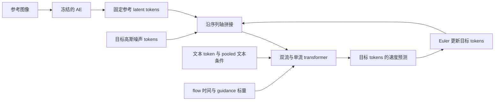

# 2025 阅读卡 · FLUX.1 Kontext：从类别条件走向图像编辑

**先修**：[07 CPU 图像生成](../chapters/07-image-flow-lab.md)、[08 条件丢弃与引导](../chapters/08-image-guidance-lab.md)、[04 图像与视频研究路线](../chapters/04-image-video-roadmap.md)中的潜空间表示；需要能推导直线路径的速度、解释 classifier-free guidance（CFG）的两分支计算。

**目标**：说明参考图像如何进入生成器；将论文的时间与速度约定转换到本仓库；从固定源码判断 guidance 参数和网络调用次数；为多轮编辑设计可检验的评价。

**范围**：定向阅读 2025 年技术报告，并核对一个 Kontext-dev 实现和模型卡快照。本轮实际完成文献、源码与许可核验，以及下文 CPU 形状和解析计算；外部权重推理与质量评测属于后续计划。页码均指固定 PDF 的印刷页码。

## 1. 固定论文、实现与权重说明

| 对象 | 本轮使用的来源 |
| --- | --- |
| 论文 | Black Forest Labs（2025），[FLUX.1 Kontext: Flow Matching for In-Context Image Generation and Editing in Latent Space][paper]，arXiv:2506.15742v2；首发 2025-06-17，v2 修订 2025-06-24，共 19 页。报告要求按集体作者 Black Forest Labs 引用 |
| PDF | [版本化 PDF][pdf]；SHA-256：`86c8acc1ca714fa463f02315d849a81b5d746c4da4ecb50743b9d672311f916b` |
| 官方实现 | [black-forest-labs/flux][code]，commit `802fb4713906133fcbd0d8dc5351620ca4773036`，提交日期 2025-07-31 |
| 单个模型卡 | [black-forest-labs/FLUX.1-Kontext-dev][card]，revision `24e9dedc4ef646698dc8eb4e18ae2cec3c9fea0d`；README SHA-256：`f8047bf6192e1d7d58da378efa1419861eda4c45c1a34b53bbb7e4dd68a72ff7` |
| dev 模型许可 | 同 revision 的 [LICENSE.md][weights-license]，FLUX.1 [dev] Non-Commercial License v1.1.1；SHA-256：`6f7b3d94ddd94380a4dc2d1211ed57883d320dea96f4393b34d4a454041029e1` |

访问日期为 **2026-11-10**。下载 PDF 后以 `pdftotext -layout` 读取；通过 HTTPS 核对固定源码、模型卡和许可。模型仓库 API 的 `lastModified` 为 2026-01-01；因此模型卡反映的是比论文晚的快照。本卡将论文主张与该快照的接口、许可分别定位。

先区分报告中的三个版本（§3，pp.5–6；§4.2，p.8）：

| 版本 | 已核实的描述 | 本卡覆盖程度 |
| --- | --- | --- |
| Kontext pro | Flow Matching 训练后使用 latent adversarial diffusion distillation（LADD）降低推理成本 | 阅读论文；固定 README 将 Pro tier 列为非开放权重服务 |
| Kontext max | 作者称投入更多计算以改善质量；模型卡链接服务端点 | 阅读版本说明 |
| Kontext dev | 12B 参数的 transformer，使用 guidance distillation；论文说明 dev 专注图像到图像训练 | 核对公开采样代码、单个模型卡及权重许可 |

dev 的参数量、许可与采样调用数只用于这一变体。pro/max 的服务说明和 dev 的开放权重是不同的访问方式；本轮没有调用服务。

## 2. 问题与结构：图像怎样成为上下文

论文 §3 Eq.(1) 将任务写作 $p(x\mid y,c)$：目标图像为 $x$，参考图像为 $y$，自然语言指令为 $c$。例如参考图是一只放在桌上的杯子，指令要求改变杯子的颜色；评价同时涉及目标修改是否完成，以及其他内容保持了多少。

系统先用冻结的 autoencoder（AE）编码图像，再在潜空间中生成。§2–3（pp.4–5）、Fig.4 与固定配置共同给出以下路径：



AE 的潜通道数为 16，空间下采样为 8 倍，再将每个 $2\times2$ 潜 patch 打包成 64 维 token。固定 [Kontext 配置][config]使用 19 个双流块与 38 个单流块：双流块分别处理图像、文本的表示，并通过联合注意力交流；单流块进一步处理拼接序列。

图像条件沿 **token 序列轴**附加。目标与参考图可以具有不同分辨率和宽高比。论文 Eq.(2) 使用三维旋转位置编码（RoPE），目标图坐标为 $(0,h,w)$，第 $i$ 张参考图为 $(i,h,w)$。第一个坐标区分图像组，论文称其为“virtual time”；flow 时间另以标量传入网络。固定 [prepare_kontext 与 denoise][sampling]具体使用目标索引 0、参考索引 1，每步保留参考 tokens，仅截取目标部分的预测来更新目标状态。

论文的表示方式可以扩展到多个参考图，但 §3（p.6）明确本工作集中于单张上下文图像；本卡核对的 CLI 也接收一个参考图路径。编辑多轮时，可将上一轮输出作为下一轮参考图，上一轮的偏差也会随之传递。

## 3. 两个迁移时必须重推的接口

### 时间方向与速度符号

令 $x$ 为干净图像的潜变量、$\epsilon\sim\mathcal N(0,I)$。报告 §3 Eq.(3) 的教师模型训练目标为

$$
z_t=(1-t)x+t\epsilon,\qquad
\mathcal L=\mathbb E\left\|v_\theta(z_t,t,y,c)-(\epsilon-x)\right\|^2.
$$

这里 $t=0$ 是数据端，$t=1$ 是噪声端。时间从 logit-normal 分布采样，参数随分辨率调整；初始化来自 FLUX.1 文生图 checkpoint，再使用数百万关系图像对训练（pp.5–6）。完整训练数据清单和从头训练复现并未由本卡核验。

本仓库 03、07、08 的生成时间从 0 噪声走向 1 数据。令 $\tau=1-t$，则

$$
x_\tau=z_{1-\tau}=(1-\tau)\epsilon+\tau x,\qquad
v_{\rm repo}(z,\tau,y,c)=-v_{\rm FLUX}(z,1-\tau,y,c).
$$

负号由链式法则给出。固定 `get_schedule` 从 1 生成到 0，再作随分辨率变化的时间移位；`denoise` 更新为 `img += (t_prev - t_curr) * pred`，其中差值为负。`pred` 承担当前速度场的作用。dev 经蒸馏获得的预测还吸收了教师的引导行为，论文中的原始 Flow Matching 目标与 dev 的蒸馏训练应分别理解。

### guidance distilled 接口与显式两分支 CFG

08 章的采样器显式计算 $v_u$、$v_c$，组合为 $v_u+s(v_c-v_u)$。因此该实现的 $K$ 个 Euler 步需要 $2K$ 次网络求值（NFE）。

Kontext-dev 的模型卡明确写出 **guidance distillation**。[model.py][model] 将 guidance 标量编码后加入时间/文本条件向量；固定 `denoise` 每个区间调用一次 `model(..., guidance=guidance_vec)`。这个官方路径中，$K$ 步对应 **$K$ 次 denoiser 求值**，另需文本编码和 AE 编解码。参考图 tokens 在每次调用中参与计算。

因此，在这个接口里把 guidance 设为 0 或 1，含义由蒸馏训练决定；08 章的无条件/有条件端点恒等式无法直接移植。两个系统数值相同的引导参数，也没有相同效果或成本的保证。

固定 [编辑文档][editing]与 CLI 实际函数签名采用 **30 步、guidance 2.5**。同版 CLI docstring 仍含通用的“4/50 steps”文字，说明默认值时应以实际签名及专门编辑文档为准。

## 4. CPU 可执行检查：token 布局与时间映射

当高宽都可被 16 整除时，一张图的视觉 token 数为

$$
L=\frac H{16}\frac W{16},\qquad D=16\times2\times2=64.
$$

$1024\times1024$ 图像得到 $4096\times64$ 个 token 特征；相同大小的目标与参考图共同形成 **8192 个图像 tokens**，文本 tokens 另计。仅比较图像部分，朴素密集注意力的矩阵元素数由 $L^2$ 增至 $(2L)^2$，即 4 倍。这个计数给出结构成本的增长趋势，实际显存和延迟还取决于注意力实现、文本长度、层数与数据搬运。

在仓库根目录、完成 README 安装后运行；使用已有 NumPy，不下载模型或数据。数组内容只用于检查打包轴，任意数值均可。

<!-- cpu-check: kontext-packing-time -->
```bash
.venv/bin/python - <<'PY'
import numpy as np

# BCHW latent -> B,L,D；与官方 2×2 patch 打包的轴顺序一致。
latent = np.arange(16 * 128 * 128).reshape(1, 16, 128, 128)
tokens = latent.reshape(1, 16, 64, 2, 64, 2).transpose(0, 2, 4, 1, 3, 5)
tokens = tokens.reshape(1, 4096, 64)
restored = tokens.reshape(1, 64, 64, 16, 2, 2).transpose(0, 3, 1, 4, 2, 5)
restored = restored.reshape(latent.shape)
assert np.array_equal(restored, latent)

# 同一空间位置的目标/参考 token 具有不同的图像组坐标。
row, col = 7, 11
target_id, reference_id = (0, row, col), (1, row, col)
assert target_id != reference_id

# 常速度直线路径的单步解析解，分别用 t 和 tau=1-t 积分。
x = np.array([0.2, -0.6])
eps = np.array([1.0, -1.0])
t, dt = 0.75, -0.125
z = (1 - t) * x + t * eps
flux_next = z + dt * (eps - x)
repo_next = z + (-dt) * (x - eps)
analytic = (1 - (t + dt)) * x + (t + dt) * eps
np.testing.assert_allclose(flux_next, repo_next, atol=1e-15, rtol=0)
np.testing.assert_allclose(flux_next, analytic, atol=1e-15, rtol=0)
print(f"latent={latent.shape}; tokens={tokens.shape}; two_images={2 * tokens.shape[1]}")
print("pack/unpack and time-direction checks: PASS")
PY
```

预期输出为 `latent=(1, 16, 128, 128); tokens=(1, 4096, 64); two_images=8192`，随后为 `PASS`。本轮已在仓库 CPU 环境执行通过；这一解析检查验证轴排列和时间变换，模型编辑质量仍需实际推理实验。

## 5. 读效果证据时检查哪些假设

**编辑成功与内容保留分别评价。** KontextBench（§4.1，p.7）含 **1,026 个图像—提示对，来自 108 张基础图像**：局部编辑 416、全局编辑 262、文字编辑 92、风格参考 63、角色参考 193。相同基础图像可对应多条提示；估计对新图像的泛化或构造置信区间时，应考虑按基础图像分组，避免把所有提示对视为独立图像样本。作者说明素材包括个人照片、许可艺术作品、公有领域内容和生成图像；实际复用数据时还需核对每项素材及发布版本。

**指标依赖任务。** §4.2–4.3（pp.8–9）结合多维人工评价和 AuraFace 特征相似度等指标。Fig.12（p.11）讨论加墨镜后人脸相似度下降的情况：指令要求的遮挡本身会影响特征。这提示我们同时检查编辑是否完成、未指定内容是否保留，以及指标对目标修改是否敏感。

**多轮编辑会累积偏差。** §5（p.12）、Fig.15（p.13）展示多次编辑后的伪影、角色一致性下降，以及部分指令未被正确执行；蒸馏也可能引入伪影。评价应保存整条编辑链，记录首次失败轮次，并将“每轮从原图开始”与“以上轮输出继续”区分开。

**延迟结论有配置范围。** 原文报告的秒级响应及 Fig.7 API 延迟来自作者的服务比较，无法据此计算本地 dev 的单卡预算。本卡没有复测论文性能排序；阅读产物是明确的主张、证据位置和下一步实验方案。

与本仓库实验的衔接可归纳为：

| 项目 | 07/08 的 class one-hot 图像实验 | 本卡核对的 Kontext-dev |
| --- | --- | --- |
| 数据与任务 | 程序绘制的16×16两类形状（圆盘/方形）；类别条件生成 | 潜空间中的参考图像加文字编辑 |
| 条件入口 | one-hot/零向量作为卷积网络条件通道 | 固定参考 token 序列、文本条件、guidance embedding |
| 时间方向 | 0 噪声 → 1 数据，目标数据减噪声 | 1 噪声 → 0 数据，原始 FM 目标噪声减数据 |
| 引导成本 | 每步显式两分支，$2K$ NFE | 蒸馏后的单次调用路径，$K$ NFE |
| 当前证据 | [多种子引导实测](../image-guidance-report.md)、解析与数值测试 | 论文、固定源码、形状/符号计算；大模型推理待实施 |

## 6. 许可与运行预算

**代码**：固定仓库的 [LICENSE][code-license] 为 Apache-2.0。**dev 权重及衍生模型**：适用上表的自定义 Non-Commercial License v1.1.1；§2(a,b) 规定非商业用途许可及另行申请商业许可的途径。导言说明单独授予许可的推理代码可遵循该单独许可。**生成输出**：§2(d) 声明 BFL 不主张输出所有权，并允许包括商业在内的用途，受许可中的限制约束；该条明确禁止用输出训练、微调或蒸馏与 FLUX.1 [dev]/Kontext [dev] 竞争的模型。§2(e) 另列内容过滤或输出审核及适用的 AI 标识要求。实际使用需阅读固定完整条款；pro/max 服务还需核对对应服务条款。

**理论存储量**：按作者报告的约 12B 参数，全部以 BF16 两字节保存，transformer 权重约为 $12\times10^9\times2=24$ GB，即约 **22.35 GiB**。这是按四舍五入参数量估算的权重存储；文本编码器、AE、激活、运行时和数据搬运另需资源。模型卡例子使用 CUDA 与 BF16，所读材料未给出可直接引用的最低 GPU 显存配置。

当前 CPU 环境可完成第 4 节和论文证据表。未来 GPU 推理先固定 dev 权重 revision、依赖、输入预处理后的分辨率、步数、guidance、种子和 offload 配置；运行一个样例测量加载、文本/图像编码、采样、解码、峰值显存与总耗时，再据此确定实验预算。此处的 GPU 路径是计划。

## 7. 练习与下一步

1. **条件长度**：目标图为 $1024\times1024$，参考图为 $768\times1024$，假定都已预处理到这些尺寸。视觉 token 总数是多少？参考图是否随着 Euler 更新变化？
2. **时间变换反例**：将第 4 节 `repo_next` 中的速度错误地写成 `eps - x`，解析断言会怎样？说明误差方向。
3. **调用预算**：两个实现都用 30 步，08 和固定 Kontext-dev 路径各有多少次 denoiser 求值？这些数字足以比较运行速度吗？
4. **编辑评价**：设计一组“把杯子改为蓝色”的评价记录，使编辑完成度与背景保留可以分别检查。若同一张原图衍生了十条指令，怎样避免数据划分泄漏？

<details>
<summary>提示与参考答案</summary>

1. $4096+3072=7168$ 个视觉 tokens，文本另计；参考 tokens 固定，更新的是目标部分。原始输入会先经过官方预处理，计算真实成本时应使用预处理后的尺寸。
2. 正的 $\Delta\tau$ 乘以 $\epsilon-x$ 会继续朝噪声方向移动；上述断言失败。正确速度为 $x-\epsilon$，与负的 $\Delta t$ 乘以 $\epsilon-x$ 等价。
3. 分别为 60 和 30。每次求值的网络规模、序列长度、精度、硬件及编解码成本都不同，需要完整测量才能比较速度。
4. 预先标记杯子区域，分别记录杯子颜色/形状、背景与其他物体变化，保存失败样例并辅以人工核验；同一原图的全部衍生提示放在同一个数据划分中。多轮任务再按完整编辑链记录失败发生位置。

</details>

**下一项可直接做的 CPU 任务**：对照固定 `sampling.py`，在一页笔记中标出目标状态、参考条件、文本条件、flow 时间、图像组坐标与 guidance 六项的形状及变化范围，再与 08 的 `guided_velocity` 逐项对照。完成判据是能独立解释时间符号、参考 tokens 的固定性和 NFE 差异。随后读 [Wan 阅读卡](wan-video-2025.md)，比较图像上下文沿序列拼接与视频条件沿通道拼接分别改变了什么。

[paper]: https://arxiv.org/abs/2506.15742v2
[pdf]: https://arxiv.org/pdf/2506.15742v2
[code]: https://github.com/black-forest-labs/flux/tree/802fb4713906133fcbd0d8dc5351620ca4773036
[card]: https://huggingface.co/black-forest-labs/FLUX.1-Kontext-dev/blob/24e9dedc4ef646698dc8eb4e18ae2cec3c9fea0d/README.md
[weights-license]: https://huggingface.co/black-forest-labs/FLUX.1-Kontext-dev/blob/24e9dedc4ef646698dc8eb4e18ae2cec3c9fea0d/LICENSE.md
[code-license]: https://github.com/black-forest-labs/flux/blob/802fb4713906133fcbd0d8dc5351620ca4773036/LICENSE
[config]: https://github.com/black-forest-labs/flux/blob/802fb4713906133fcbd0d8dc5351620ca4773036/src/flux/util.py#L582
[sampling]: https://github.com/black-forest-labs/flux/blob/802fb4713906133fcbd0d8dc5351620ca4773036/src/flux/sampling.py#L210
[model]: https://github.com/black-forest-labs/flux/blob/802fb4713906133fcbd0d8dc5351620ca4773036/src/flux/model.py#L97
[editing]: https://github.com/black-forest-labs/flux/blob/802fb4713906133fcbd0d8dc5351620ca4773036/docs/image-editing.md#L29
