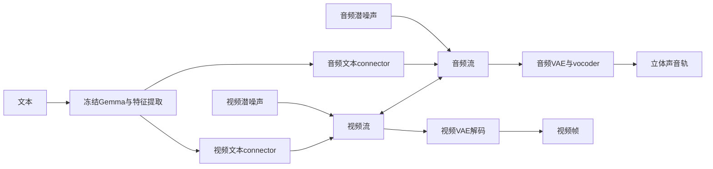

# LTX-2 2026：音画联合生成、条件分解与采样调用

**先修：** [01 概率分解](../chapters/01-generative-models.md)、[03 Flow Matching](../chapters/03-flow-matching.md)、[06 视频时序反例](../chapters/06-video-temporal-lab.md)和[08 条件引导](../chapters/08-image-guidance-lab.md)。[Wan阅读卡](wan-video-2025.md)提供视频latent与条件接口背景。

**学习目标：** 解释音画双流如何交换信息；把噪声时间、视频帧率、音频采样率放在正确坐标下；区分联合分布、链式条件分解和独立生成；核对论文引导公式与具体采样入口的调用数。

**范围与日期：** 2026-11-10。论文[2601.03233v1](https://arxiv.org/abs/2601.03233v1)于**2026-01-06首次公开**，本卡固定首发同期官方代码、LTX-2模型revision及许可，执行小型CPU解析与源码循环检查。视频/音频权重运行和质量评测留给独立资源环境；本文提供一个2026年的专题入口。

## 1. 学习对象：从视频条件扩展到音画联合

用$V$表示整段视频、$A$表示音轨、$c$表示文本，目标是学习$p(V,A\mid c)$。论文第4–5页的模型采用视频、音频两条Transformer流，通过双向跨模态注意力交换信息；同一次联合模型调用返回两种模态的预测。



论文摘要、§3.1与Table 1报告视频流14B、音频流5B，总计19B参数；第11页结论另写13B视频加3B音频。这里使用主体架构与发布文件的19B标识，并保留该文内差异。参数量也需要区分主生成网络、文本编码器、VAE和其它组件。

每个双流block依次进行模态内self-attention、文本cross-attention、音画cross-attention和FFN。视频内部使用三维位置编码，音频内部使用一维时间位置编码；两模态交换时只使用时间轴上的RoPE，跨模态AdaLN结合扩散时间条件调制交互。它为模型提供了对齐机制，实际同步效果仍需视频与音轨共同评估。

论文第6–7页使用冻结Gemma 3的多层表示，经归一化、拼接和学习投影得到条件特征；投影在初期联合训练后冻结。两个模态各有text connector，附加的可学习“thinking tokens”替换padding位置并参与双向注意力。这些token是条件网络内的表示，可检查其位置、形状和对输出的影响。

## 2. 联合生成与顺序生成怎样比较

论文第2页把顺序视频→音频流程描述为会“fail to model the full joint distribution”。这句话需要结合它讨论的具体系统限制理解。对任意合法联合分布，链式法则给出

$$
p(V,A\mid c)=p(V\mid c)\,p(A\mid V,c)
            =p(A\mid c)\,p(V\mid A,c).
$$

只要两个条件模型足够准确，顺序采样同样可以表达目标联合分布。决定表达能力的是条件信息、模型族与训练目标；双流联合去噪则让两种带噪状态在多个步骤中互相更新，提供了另一种架构和控制方式。

与之不同，分别按$p(V\mid c)$和$p(A\mid c)$独立抽样采用条件独立假设，可能丢失共享事件的对应关系。[06章](../chapters/06-video-temporal-lab.md)检验帧边缘与时间联合，[ResTok阅读卡](restok-image-ar-2026.md)检验组内条件独立；这里把同一问题放到两种模态之间。

### CPU反例：边缘相同，配对关系不同

令视频bit表示画面中是否发生一次敲击，音频bit表示对应声音是否出现。目标只允许00与11，各占一半。下面枚举全部四种情况，无需下载权重：

```python
import numpy as np

# 行是视频bit，列是音频bit；此处固定文本条件。
joint = np.array([[0.5, 0.0], [0.0, 0.5]], dtype=np.float64)
video_marginal = joint.sum(axis=1)
audio_marginal = joint.sum(axis=0)
audio_given_video = joint / video_marginal[:, None]
sequential = video_marginal[:, None] * audio_given_video
independent = np.outer(video_marginal, audio_marginal)

np.testing.assert_array_equal(sequential, joint)
np.testing.assert_array_equal(independent, np.full((2, 2), 0.25))
np.testing.assert_array_equal(independent.sum(axis=0), audio_marginal)
np.testing.assert_array_equal(independent.sum(axis=1), video_marginal)
assert np.isclose(sequential.sum(), 1.0)
assert np.isclose(independent.sum(), 1.0)
print({"sequential_mismatch": float(sequential[0, 1] + sequential[1, 0]),
       "independent_mismatch": float(independent[0, 1] + independent[1, 0])})
```

顺序条件模型的错配概率为0，独立模型为0.5，两者单独看视频或音频时的边缘分布完全相同。这证明联合评价需要检查对应关系。实际系统的音画语义一致、事件时间差与嘴型同步可分别定义，结合任务检查，避免用单一音质或画质分数替代。

## 3. 三种时间坐标与两种latent

固定官方`types.py`、patchifier及模型配置提供如下接口：

| 坐标或表示 | 固定来源中的约定 | 读者需要记录的量 |
| --- | --- | --- |
| 扩散噪声坐标$\sigma$ | 1为纯噪声端，0为数据端，采样递减 | 实际sigma网格、预测对象与步进器 |
| 视频帧与播放时间 | 视频条件携带fps，latent位置换算到时间 | 帧数、fps、参考图所在帧与实际文件时长 |
| 音频采样率 | 输入mel处理16 kHz，vocoder输出24 kHz立体声 | 输入/输出采样率与音轨长度 |
| 视频VAE | 时间8倍、空间32×32倍压缩，128潜通道 | 首帧的因果边界及实际潜张量形状 |
| 音频VAE | 16kHz、hop160、时间下采样4，对应25个latent位置/秒 | 时间长度取整、8通道×16个mel位置形成128维token |

这些$\sigma$是线性混合路径的系数。它与SVD阅读卡的加性噪声标准差采用不同路径定义，转换时从公式出发。

以单阶段默认的121帧、512×768、24fps为例：视频潜帧数为$1+(121-1)/8=16$，潜形状为`B,128,16,16,24`。每个潜位置成为一个128维token，共$16\cdot16\cdot24=6144$个视频token。官方音轨长度计算使用$121/24$秒，得到$\operatorname{round}((121/24)\cdot25)=126$个音频token。

首尾视频帧时刻相差$(121-1)/24=5$秒，按每帧占一个显示间隔计的时长为$121/24$秒。音频与视频latent的索引数不同，时间位置由fps、采样率、hop与因果偏移共同决定。源码对两种VAE的首位置均做因果边界校正；不能把“第$i$个视频token”和“第$i$个音频token”直接当成同一时刻。

上述尺寸可以在基础环境用整数与标量独立核对：

```python
frames, height, width, fps = 121, 512, 768, 24.0
latent_frames = 1 + (frames - 1) // 8
video_tokens = latent_frames * (height // 32) * (width // 32)
audio_tokens_per_second = 16000 / 160 / 4
audio_tokens = round((frames / fps) * audio_tokens_per_second)
assert (latent_frames, video_tokens, audio_tokens) == (16, 6144, 126)
assert audio_tokens_per_second == 25
print({"video_tokens": video_tokens, "audio_tokens": audio_tokens,
       "first_last_frame_seconds": (frames - 1) / fps,
       "display_duration_seconds": frames / fps})
```

## 4. 速度目标与Euler采样

论文第14页Figure A1说明使用flow-matching速度回归。首发同期公开微调策略`training_strategies/text_to_video.py`进一步给出具体约定。对视频或音频潜变量$z$，

$$
z_\sigma=(1-\sigma)z+\sigma\epsilon,\qquad
u_{\mathrm{target}}=\epsilon-z.
$$

该微调策略给两种模态使用相同$\sigma$，分别采样噪声。启用音频时，loss为各自平均MSE之和；被设为条件的首帧视频token保持干净、使用时间0，并从视频loss中排除。论文的基础预训练数据/预算与公开微调配置分别记录，后者为这里核验输出参数化的依据。

对未固定为条件的生成token，推理中的`X0Model`把底层速度预测转换成干净潜变量估计：

$$
\widehat z_0=z_\sigma-\sigma u_\theta.
$$

Euler步进器再用$(z_\sigma-\widehat z_0)/\sigma$得到速度，并更新

$$
z_{\sigma'}=z_\sigma+(\sigma'-\sigma)u_\theta,\qquad \sigma'<\sigma.
$$

与本仓库03/07/08的时间约定相比，取$t=1-\sigma$，则路径相同、速度符号相反：$v_{\mathrm{repo}}=z-\epsilon=-u_{\mathrm{target}}$。源码在$\sigma=0$终点停止调用网络，从而避免在终点计算上式的除法。

## 5. 论文的跨模态CFG与公开入口

论文第8页§4.1为单条模态流定义三种条件状态。这里用$c$表示文本、$m$表示另一模态的特征，省略共同的噪声时间和当前latent：

$$
\widehat M
=M(c,m)
+s_{\mathrm{text}}\bigl[M(c,m)-M(\varnothing,m)\bigr]
+s_{\mathrm{modal}}\bigl[M(c,m)-M(c,\varnothing)\bigr].
$$

原文`M(x,t,m)`中的`t`指文本条件；本卡将它改记为$c$，为扩散时间保留独立符号。完全条件项系数为$1+s_{\mathrm{text}}+s_{\mathrm{modal}}$，两项被减去的预测分别去除文本或另一模态。论文报告视频流使用$(3,3)$、音频流使用$(7,3)$。当$s_{\mathrm{modal}}=0$时，换成08章常用CFG形式的强度为$s=1+s_{\mathrm{text}}$。

具体发布入口还需沿源码核对：

- 首发同期`TI2VidOneStagePipeline`调用`guider_denoising_func`。启用文本CFG时，每个区间调用一次正向提示和一次负向提示；两次均返回音画两种预测，`perturbations=None`。该入口实际实现的是文本引导，论文第三种“去除另一模态”的状态未在这条调用路径执行。
- `DistilledPipeline`调用`simple_denoising_func`，每个区间执行一次带文本的联合模型预测。蒸馏模型的条件响应已通过其训练与固定调度进入发布接口。
- 论文公式、首发代码与之后的库封装各有版本。报告NFE时写出实际pipeline、sigma网格、条件状态和每次batch，音画两种输出共同来自一次联合forward。

参考图通过`images`列表进入公开pipeline，元素指定图像路径、目标帧索引和强度。对应视频latent位置作为条件参与去噪；文本增强功能也是可选项。做条件对照时应保存参考图hash、帧索引、强度、原提示和增强后的实际提示。

## 6. 蒸馏两阶段究竟执行几次调用

固定`constants.py`中有两组sigma端点，`DistilledPipeline`两次调用相同的Euler循环：

| 阶段 | sigma端点 | 实际区间 / 联合forward |
| --- | --- | ---: |
| 低分辨率生成 | 1, .99375, .9875, .98125, .975, .909375, .725, .421875, 0 | 8 |
| 空间升采样后细化 | .909375, .725, .421875, 0 | 3 |

源码循环遍历`sigmas[:-1]`，每个区间调用一次`simple_denoising_func`。因此所核验的两阶段蒸馏入口共**11次联合模型forward**。第二阶段先把视频latent在空间上升采样2倍，音频沿用第一阶段latent；两者以第二阶段首个sigma重新加噪后细化。分辨率变化、升采样、编码/解码和文本处理还会增加实际成本。

同版README把优化建议写为“8 steps stage 1, 4 steps stage 2”。常量表的第二阶段有4个端点，实际循环执行3个区间；本文采用源码循环的调用口径。这个差异也说明下载文件名或预设名不足以确定推理成本。

### CPU检查：固定网格、速度符号与解析端点

下面是独立解析例：给定一对干净向量与噪声，使用其精确常量速度。它检查网格区间、$\widehat z_0$转换及递减时间Euler更新。真实模型中的预测误差需要另行测量。

```python
import numpy as np

stage1 = [1.0, .99375, .9875, .98125, .975, .909375, .725, .421875, 0.0]
stage2 = [.909375, .725, .421875, 0.0]
clean = np.array([-2.0, .3, 1.2], dtype=np.float64)
noise = np.array([.7, -1.0, .2], dtype=np.float64)
velocity = noise - clean

def integrate(sigmas):
    current = (1 - sigmas[0]) * clean + sigmas[0] * noise
    calls = 0
    for sigma, following in zip(sigmas[:-1], sigmas[1:]):
        assert sigma > following >= 0
        predicted_clean = current - sigma * velocity
        recovered_velocity = (current - predicted_clean) / sigma
        current = current + (following - sigma) * recovered_velocity
        calls += 1
    np.testing.assert_allclose(current, clean, rtol=0, atol=1e-14)
    return calls

counts = [integrate(stage1), integrate(stage2)]
assert counts == [8, 3] and sum(counts) == 11
repo_velocity = clean - noise
np.testing.assert_array_equal(repo_velocity, -velocity)
print({"stage_calls": counts, "total_joint_calls": sum(counts)})
```

核验时还通过AST从固定官方源码提取原Euler循环、`X0Model`、步进器与简单/引导预测函数，用小型CPU计数替身执行。实得蒸馏8+3=11次联合调用；普通单阶段40区间在CFG=1时40次、CFG=4时80次；普通两阶段首阶段默认40区间、CFG=4，再加第二阶段3区间蒸馏细化，共83次。此处计数排除文本编码器、VAE与升采样器，验证范围为源码控制流和小张量接口。真实权重延迟另测。

这版`CFGGuider.enabled()`的条件是`scale != 1`，与09章Diffusers入口的`guidance_scale > 1`约定不同。两者都需要根据所用实现解释参数0/1以及实际调用量。固定LTX-2入口在相同状态与噪声级别下组合干净预测；组合系数和为1时，由上节的线性关系可知，它与同系数的速度组合等价。

## 7. 评价、资源与许可怎样记录

论文第9–10页比较音画质量、视频指标与速度。尤其是第10页Table 1：在**NVIDIA H100、121帧、720p、单步Euler、CFG=1**下，作者报告LTX-2每步1.22秒、Wan2.2-14B每步22.30秒，约18倍。这个表的测量对象是每个去噪步骤；完整pipeline还包括实际步骤数、引导配置、编码/解码、加载和其它处理。

与06章连接的最小评价协议是：固定提示/参考图、seed、视频fps和音频采样率；分别检查视频内容、声音内容、事件是否配对、声画事件时间差。加入“音轨随机错配”和“音轨平移”的对照，检验评价器能否识别语义错误与时间错误。多说话人还应检查台词与人物对应。论文第10页列举了语言覆盖、多说话人归属以及长时同步漂移等限制。

资源与访问条件按所选发布物记录：

| 固定资产 | 2026-11-10实际核对的状态 |
| --- | --- |
| `Lightricks/LTX-2` revision `64f65d09e0b76c96202b5bc09997673184cf9b5d` | 公开、ungated；模型卡链接后续LTX-2.3，本文仍选择LTX-2发布物 |
| `ltx-2-19b-dev.safetensors` | LFS元数据文件大小43,285,058,242字节，约40.31GiB |
| `ltx-2-19b-dev-fp8.safetensors` | LFS元数据文件大小27,078,716,018字节，约25.22GiB |
| 官方要求的Gemma编码器 | `google/gemma-3-12b-it-qat-q4_0-unquantized`，revision `68f7ee4fbd59087436ada77ed2d62f373fdd4482`；元数据为manual-gated，另有Gemma许可 |
| 当前CPU学习环境 | 32GiB内存上限；本卡执行小向量和源码控制流检查，完整视频推理另行评估设备、精度、组件与访问条件 |

主发布文件大小是可核验的磁盘数量。运行峰值还取决于文本编码器、其它组件、中间激活、加载和量化实现，应按完整推理实际测量。

**许可按版本与资产分别核对。** 首发同期代码commit `7179f0d`的`LICENSE`是2026-01-05的LTX-2 Community License。2026-11-04代码commit `4f521619`的`LICENSE`已为Apache-2.0，同时保留`LICENSE-2`；固定模型卡仍指向后者的Community条款。该文本对年收入至少1000万美元的实体规定单独商业许可条件，并规定分发、用途与输出条款。本文链接并记录这些文本，后续运行采用哪个代码与权重revision，就连同对应许可保存；公开可下载与具体许可条件分别核对。

## 8. 练习与参考答案

**A · 链式法则与模型误差。** 如果视频先生成、音频以视频为条件，为什么实际结果仍可能音画错配？

<details><summary>参考答案</summary>

概率分解本身允许准确联合建模，实际条件模型可能使用了不足的信息、有限网络容量或不匹配的训练/推理分布。视频也可能缺少让目标声音合理出现的事件。应检查条件接口、训练样本的配对和实际生成，并把这些误差与分解形式分别分析。

</details>

**B · 引导系数。** 论文令$s_{\mathrm{text}}=3$、$s_{\mathrm{modal}}=3$时，三种预测的系数是多少？关闭跨模态项后，对应08章的$s$是多少？

<details><summary>参考答案</summary>

完全条件、去文本、去另一模态的系数依次为7、−3、−3，总和1。关闭跨模态项后为$4M(c,m)-3M(\varnothing,m)$，对应$s=4$。还需核对预测对象、共同噪声状态以及具体入口是否执行这些条件状态。

</details>

**C · 两阶段与成本。** 第二阶段在宽、高各升采样2倍，时间长度保持。视频token数、音频token数和调用数如何变化？能据此给出完整加速比吗？

<details><summary>参考答案</summary>

相同patch与潜压缩下，视频token数增加4倍，示例由6144变24576；音频仍为126个token。固定蒸馏程序第二阶段3次联合forward，第一阶段8次。各阶段token长度和其它计算不同，完整延迟需实测。

</details>

**D · 终点计数。** 给定网格`[1,.5,0]`，代码在每个左端点预测一次并推进到下一个端点，网络需要调用几次？为什么无需在0再调用？

<details><summary>参考答案</summary>

两个区间需要两次调用。最后一次更新已经得到0端点的状态；该Euler实现不再从0推进，也避免了$(z-\widehat z_0)/\sigma$在0处分母为零。

</details>

## 9. 固定来源与核验范围

论文页码按PDF页序；原始资料保存在`/tmp/genai-ltx2-scout/`，独立源码提取脚本与结果在`/tmp/genai-ltx2-sampler-review/trace.py`、`trace-results.json`。论文图示用于阅读核对，本卡流程图与教学例子为原创说明。

| 来源 | 固定身份与定位 |
| --- | --- |
| 技术报告 | [2601.03233v1 PDF](https://arxiv.org/pdf/2601.03233v1)，2026-01-06，14页，3,032,343字节；SHA-256 `6499eb067744ab8d2564888f22acc8ec8c11d4e2b50169619d70e7e0886091bf` |
| 首发同期官方代码 | commit `7179f0d0e30bcc2a157ceccc4a507fff4b32f7cf`：[README](https://github.com/Lightricks/LTX-2/blob/7179f0d0e30bcc2a157ceccc4a507fff4b32f7cf/README.md)、[单阶段](https://github.com/Lightricks/LTX-2/blob/7179f0d0e30bcc2a157ceccc4a507fff4b32f7cf/packages/ltx-pipelines/src/ltx_pipelines/ti2vid_one_stage.py)、[蒸馏两阶段](https://github.com/Lightricks/LTX-2/blob/7179f0d0e30bcc2a157ceccc4a507fff4b32f7cf/packages/ltx-pipelines/src/ltx_pipelines/distilled.py)、[sigma常量](https://github.com/Lightricks/LTX-2/blob/7179f0d0e30bcc2a157ceccc4a507fff4b32f7cf/packages/ltx-pipelines/src/ltx_pipelines/utils/constants.py) |
| 目标、尺寸与循环 | 同commit的[公开微调策略](https://github.com/Lightricks/LTX-2/blob/7179f0d0e30bcc2a157ceccc4a507fff4b32f7cf/packages/ltx-trainer/src/ltx_trainer/training_strategies/text_to_video.py)、[latent尺寸](https://github.com/Lightricks/LTX-2/blob/7179f0d0e30bcc2a157ceccc4a507fff4b32f7cf/packages/ltx-core/src/ltx_core/types.py)、[时间patchifier](https://github.com/Lightricks/LTX-2/blob/7179f0d0e30bcc2a157ceccc4a507fff4b32f7cf/packages/ltx-core/src/ltx_core/components/patchifiers.py)、[采样辅助函数](https://github.com/Lightricks/LTX-2/blob/7179f0d0e30bcc2a157ceccc4a507fff4b32f7cf/packages/ltx-pipelines/src/ltx_pipelines/utils/helpers.py) |
| 输出转换与更新 | 同commit的[X0Model](https://github.com/Lightricks/LTX-2/blob/7179f0d0e30bcc2a157ceccc4a507fff4b32f7cf/packages/ltx-core/src/ltx_core/model/transformer/model.py#L443)、[Euler步进器](https://github.com/Lightricks/LTX-2/blob/7179f0d0e30bcc2a157ceccc4a507fff4b32f7cf/packages/ltx-core/src/ltx_core/components/diffusion_steps.py) |
| 具体模型 | revision `64f65d09e0b76c96202b5bc09997673184cf9b5d`：[模型卡](https://huggingface.co/Lightricks/LTX-2/blob/64f65d09e0b76c96202b5bc09997673184cf9b5d/README.md)、[视频VAE](https://huggingface.co/Lightricks/LTX-2/blob/64f65d09e0b76c96202b5bc09997673184cf9b5d/vae/config.json)、[音频VAE](https://huggingface.co/Lightricks/LTX-2/blob/64f65d09e0b76c96202b5bc09997673184cf9b5d/audio_vae/config.json)、[Transformer](https://huggingface.co/Lightricks/LTX-2/blob/64f65d09e0b76c96202b5bc09997673184cf9b5d/transformer/config.json) |
| 许可文本 | [首发同期LICENSE](https://github.com/Lightricks/LTX-2/blob/7179f0d0e30bcc2a157ceccc4a507fff4b32f7cf/LICENSE)；代码commit `4f521619ae0029e8fbb64d555030c2b121a33b4f`的[LICENSE](https://github.com/Lightricks/LTX-2/blob/4f521619ae0029e8fbb64d555030c2b121a33b4f/LICENSE)与[LICENSE-2](https://github.com/Lightricks/LTX-2/blob/4f521619ae0029e8fbb64d555030c2b121a33b4f/LICENSE-2) |

文件SHA-256补充：

```text
同期README       82d834fe2a0662cfd648c6e8c658632b42d8309dd7d8ec0ff0426f4b683bba4d
固定模型卡       8d63508172b847ecb0fc53173f5c013f29178a19f5113d679866243ca4416f0a
同期LICENSE      1d60d351796cf0b5391ed1b599fde007135ed911acea03c4968fa0b346b65f1f
当前LICENSE      cfc7749b96f63bd31c3c42b5c471bf756814053e847c10f3eb003417bc523d30
当前LICENSE-2    c325da090976a313b214bf0d6a1738003b96505c01c46043e80edc200a72c147
采样helpers.py   eb9a1046519fec0382be4c6996f3944a6b359bfee7aa11577678771f03ab1ba3
Euler步进器      4b15c685bff2894885e42d6bbb784d1e14b7592f971fb52dbf0e5fa0e4e20339
X0Model所在文件  81d300d7af3aa9ca7ad692640df90a95f49789007ab909dd3880ad02f843a8d0
```

本卡的CPU证据覆盖概率分解、尺寸、速度符号、解析Euler端点和源码调用控制流。论文的生成质量、语言能力及GPU性能保留为作者报告；后续完整实践需另保存权重清单、依赖锁、许可、真实输出与测量。
