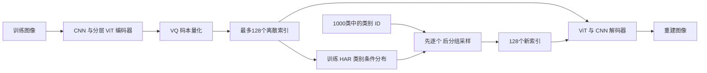

# ResTok 2026：从像素自回归到分层图像 token

**先修：** [01 自回归分解与因果性](../chapters/01-generative-models.md)、[04 潜空间表示](../chapters/04-image-video-roadmap.md)、[05 评价](../chapters/05-evaluation.md)。[09 预训练图像实践](../chapters/09-pretrained-image-lab.md)可提供连续潜空间生成的对照背景。

**学习目标：** 区分图像 tokenizer 与生成模型；解释128个离散 token 怎样通过9轮采样生成；写出分组采样的条件分解；根据原文、发布配置及评价协议判断一个性能数字支持什么结论。

**范围与日期：** 2026-11-10。原论文于 **2026-01-07 首次公开**，本卡固定 [2601.03955v1](https://arxiv.org/abs/2601.03955v1)。采用官方2026-08-18代码提交及两个明确的模型 revision，实际执行CPU解析与配置核对。权重训练、图像生成与运行成本留待独立实践；本文是一个2026专题阅读入口。

## 1. 先把两个模型分开

ResTok（Residual Tokenizer）学习把图像压缩为有层次的离散码；配套的 hierarchical autoregressive（HAR）生成器学习这些码的类别条件分布。固定发布物面向 **ImageNet-1K类别条件、256×256图像**。



论文第3–4页第3.1–3.3节将编码器内的空间特征称为 **image tokens**，用来查询并压缩图像的序列称为 **latent tokens**。后者经向量量化（vector quantization, VQ）映射为离散码本索引，供生成器建模。每个索引选择一个8维码本向量，码本大小为8192；8表示向量维数，索引需要 $`\log_2 8192=13`$ bit。

128个索引的固定长度理论载荷为1664 bit，即208 byte。这个计算只包含索引，模型权重、类别和元数据另计；自编码器通过有损重建压缩图像。生成器的token交叉熵与像素空间似然分别对应不同表示，应分别解释。

与09章对照：SD1.4在连续潜张量上预测噪声并逐步更新，ResTok的HAR生成器输出8192类分布并抽取离散索引。两者都先生成潜表示，再由配套解码器生成像素。这里的条件是类别ID，固定HAR配置为 `model_type=c2i`、`num_classes=1000`。

## 2. Tokenizer怎样组织层次

### 多尺度图像特征与残差初始化

论文使用24层ViT编码器、24层ViT解码器，宽度1024、16个注意力头；图像特征在编码器的四个阶段逐步合并。编码器内的注意力限制粗层读取细层信息，潜token查询编码器的多尺度特征，具体语义对应由训练形成；解码器从量化后的潜token恢复图像特征，再由CNN解码。

潜token分为长度

```math
1,\;1,\;2,\;4,\;8,\;16,\;32,\;64,
```

共八个层次，总数128。残差初始化逐次从图像特征提取一组潜token，再把该组上采样后从当前残差中减去，继续提取下一组。用 $`r_{\ell-1}`$ 表示当前残差、$`P_\ell`$ 表示目标大小的池化、$`U_\ell`$ 表示上采样，附录Algorithm 1及固定代码对应

```math
z_\ell^{(0)}=P_\ell(r_{\ell-1}),\qquad
r_\ell=r_{\ell-1}-U_\ell(z_\ell^{(0)}).
```

这给ViT提供分层初始查询；后续网络训练和VQ共同决定最终表示。残差运算本身不保证不同层语义独立。论文Figure 5把逐步重建和注意力可视化作为其模型中粗到细语义组织的观察。

### 训练目标与嵌套丢弃

论文第4–5页第3.4节、式(1)–(4)列出像素MSE、感知损失、对抗损失，以及与DINOv3-L的表示对齐。编码器最粗图像特征对齐DINO的全局表示，解码器的另一组查询对齐DINO的patch表示。固定实现还加入VQ码本与commitment损失；本卡末尾记录它与论文公式列表的对应范围。

嵌套丢弃（nested dropout）在训练时保留潜序列的前缀，使同一个解码器学习从不同长度重建。论文第13页Table 9给出的保留长度为128、64、32、16、8、4；保留完整128的概率为80%，其余长度的概率分别约为10.32%、5.16%、2.58%、1.29%、0.65%。生成器首次逐token预测的长度也选为4。

作者报告tokenizer训练200个epoch，HAR生成器训练300个epoch，均使用ImageNet-1K训练集的1,281,167张图像、batch256。主表选用tokenizer的750K更新checkpoint；采样参数另经搜索。练习或复现实验需要同时保存tokenizer和生成器身份，不能只记录其中一个模型。

## 3. 128个token为什么只需9轮

固定HAR实现先预测4个token，再生成长度4、8、16、32、64的五组：

| 生成网络调用 | 本次新生成的token数 | 已生成总数 |
| --- | ---: | ---: |
| 1–4 | 每次1 | 1、2、3、4 |
| 5 | 4 | 8 |
| 6 | 8 | 16 |
| 7 | 16 | 32 |
| 8 | 32 | 64 |
| 9 | 64 | 128 |

论文第5页第4节、Figure 4和第12页Figure 8展示训练输入与标签的对应。第一段输入为 `[C,z1,z2,z3]`，预测 `[z1,z2,z3,z4]`。下一段输入为 `[z4,M1,M2,M3]`，预测 `[z5,z6,z7,z8]`；再下一段输入为 `[z5,z6,z7,z8,M4,M5,M6,M7]`，预测 `[z9,…,z16]`。`C` 是类别，`M` 是可学习的占位输入。

分组注意力允许每段读取自身输入段和之前的输入段；当前段的目标token尚未出现在这些输入中。训练使用观测前缀和逐token交叉熵，沿用01章的教师强制。这里将多个目标对应的占位输入放进一次网络调用，在已有前缀上同时预测它们。

令 $`\mathcal G_1=\{5,\ldots,8\}`$、$`\mathcal G_2=\{9,\ldots,16\}`$，依次到最后一组；$`z_{<\mathcal G}`$ 表示该组之前的所有token。固定采样器对每个位置的分类分布分别做multinomial采样，对应

```math
q_\theta(z\mid c)=
\prod_{i=1}^{4}q_\theta(z_i\mid z_{\lt i},c)
\prod_{g=1}^{5}\prod_{i\in\mathcal G_g}
q_\theta(z_i\mid z_{\lt \mathcal G_g},c).
```

后一部分在给定前缀后采用**组内条件独立**。它仍定义归一化分布，同时对组内依赖作了建模约束。学习分层表示的一个目标，是让这种分组仍能保持足够的生成质量。以下反例可以精确说明这一约束。

## 4. CPU检查：步数、索引预算与组内依赖

在基础环境运行下面代码，只需NumPy。把两个目标bit放进同一组，固定前缀后要求它们以相同概率取00或11。完整逐token分解可以先抽一个bit，再复制到第二个；按各自边缘分布独立抽样时，01和10也会出现。

<!-- cpu-check: restok-group-factorization -->
```python
import itertools
import numpy as np

hierarchy_sizes = [1, 1, 2, 4, 8, 16, 32, 64]
outputs_per_call = [1, 1, 1, 1] + hierarchy_sizes[3:]
assert sum(hierarchy_sizes) == sum(outputs_per_call) == 128
assert len(outputs_per_call) == 9
assert list(itertools.accumulate(outputs_per_call)) == [1, 2, 3, 4, 8, 16, 32, 64, 128]
index_bits = 128 * int(np.log2(8192))
assert index_bits == 1664

# 固定前缀后的目标联合分布，顺序为00、01、10、11。
p = np.array([0.5, 0.0, 0.0, 0.5], dtype=np.float64)
p_first = p.reshape(2, 2).sum(axis=1)
p_second = p.reshape(2, 2).sum(axis=0)
q_group = np.outer(p_first, p_second).reshape(-1)
np.testing.assert_allclose(q_group, np.full(4, 0.25))
assert np.isclose(p.sum(), 1) and np.isclose(q_group.sum(), 1)
support = p > 0
entropy = -np.sum(p[support] * np.log(p[support]))
cross_entropy = -np.sum(p[support] * np.log(q_group[support]))
kl = cross_entropy - entropy
np.testing.assert_allclose(kl, np.log(2), atol=1e-14)

print({"tokens": sum(outputs_per_call), "calls": len(outputs_per_call),
       "index_bits": index_bits,
       "group_mismatch_probability": q_group[1] + q_group[2],
       "excess_nll_nat": float(kl)})
```

输出中的额外NLL为 $`\log2\approx0.6931`$ nat，组内错误组合概率为0.5。这个独立构造说明了条件分解的表达差异；实际ResTok是否留下类似依赖，需要在其编码序列上检查条件统计或做受控生成对照。

## 5. CFG、采样概率与成本口径

固定生成器以概率0.1丢弃类别，空类别使用ID1000；它与生成组内的 `M` 占位token分属不同输入。采样对有条件/空类别的**分类logits**进行组合：

```math
\widehat\ell=\ell_u+s(\ell_c-\ell_u).
```

在温度1、未做top-k/top-p截断时，softmax对应当前条件上下文中的

```math
q(k)\propto p_c(k)^s p_u(k)^{1-s}.
```

这个等式来自logits与log概率相差一个按类别共享的常数。对整段序列作同样推断时，还需保留每个前缀各自的归一化因子。第08章组合的是连续速度，第09章组合的是噪声预测，使用参数前应先确认预测对象。

论文Table 6和官方生成命令为750K tokenizer checkpoint选择最大CFG 3.75、起始比例0.25、top-p0.95，温度1。固定代码把起始强度1替换为1.0001，并按9轮的索引比例决定阶跃：前两轮1.0001，后七轮3.75。该路径九轮均将两个类别分支拼成batch，因此单张图像对应9次生成器forward、18次样本分支求值。

各轮的query长度依次是1、1、1、1、4、8、16、32、64，成本随序列与缓存变化。`128/9` 描述串行调用数比例；实际延迟还包含token处理、缓存、解码和硬件效率，需单独测量。配置的 `model.generator.num_steps=128` 在固定脚本中表示输出token预算；实际轮数按token预算和分组规则推导；固定CLI的`--num-steps`则覆盖CFG调度分母。

## 6. 评价：重建、生成与参数搜索各回答什么

下表均为**作者报告的ImageNet 256×256结果**，页码按PDF页序：

| 结果 | 原文定位 | 解释条件 |
| --- | --- | --- |
| ResTok rFID=1.28，HAR gFID=2.34、IS=257.8、precision=.79、recall=.60 | 第5页Table 1 | 128个token；tokenizer约662M、生成器约326M参数；HAR9轮，使用选定checkpoint和采样参数 |
| 相同tokenizer上的vanilla AR gFID=2.18、HAR=2.34 | 第13页Table 10及第14页附录B | vanilla AR128轮、HAR9轮；两种生成器分别训练且使用各自CFG配置，比较包含这些差异 |
| 短训练消融：vanilla AR4.56；无初始NTP组的HAR5.85；有NTP组的HAR5.53 | 第8页Table 5 | 分别128、8、9轮；消融采用较短训练预算并关闭CFG，与主表协议不同 |

固定代码的rFID路径遍历ImageNet验证集的50,000张图像，比较原图与重建图；重建先裁剪到 $`[0,1]`$，再量化到8bit值后提取Inception特征。生成路径均衡采样1000个类别、共50,000张图像，与 `VIRTUAL_imagenet256_labeled.npz` 中的参考统计比较。官方评价说明中的该参考文件还包含用于precision/recall的10,000张图像，参考集身份应随指标记录。

论文Figure 7展示tokenizer继续训练后rFID与gFID可朝不同方向变化，作者最终选择750K更新作为折中。自编码器重建能力、潜码的可预测性和采样器配置共同影响生成结果；单独降低rFID不足以确定最终gFID。

码本边际熵 $`H(C)`$ 是码本使用频率的统计。预测一串token需要理解 $`H(Z_i\mid Z_{<i},c)`$ 等条件量；较低的边际熵也可能来自表示容量下降。因此结合重建、生成和条件依赖来解释码本统计，并按05章固定特征、预处理、样本量与采样参数。

## 7. 论文、代码与依赖中的具体差异

以下差异值得在准备复现时逐项核对：

| 核对项 | 固定来源中的实际内容 |
| --- | --- |
| 池化/合并 | 论文第4页第3.2节和Figure 2称平均池化合并，第6页第5.1节称所有操作使用nearest。固定代码的潜token初始化用area下采样、nearest上采样；图像token合并用nearest。 |
| 残差方向 | 第4页第3.3节正文的相减叙述与第12页Algorithm 1方向不同。固定代码两类残差均为“旧特征减上采样特征”，与Algorithm 1一致。 |
| 表示对齐margin | 论文式(1)–(2)写 $`\delta_{\rm enc}=\delta_{\rm dec}=0.85`$；固定训练YAML的 `cos_margin=0.25` 经实现 `relu(1-cos_margin-cos)` 对应阈值0.75。 |
| VQ训练项 | 论文式(4)列MSE/感知/GAN/表示对齐；固定实现还加码本及commitment项，commitment系数0.25，使用直通梯度；具体总loss需沿训练代码核对。 |
| 安装版本 | 固定README建议 `torch==2.6.0 torchvision==0.17.2`；[PyPI 0.17.2元数据](https://pypi.org/pypi/torchvision/0.17.2/json)声明 `torch==2.2.2`，存在精确版本冲突。后续运行需先建立兼容依赖锁并实际验证。 |

以上证据把论文实验报告和发布实现分别定位，避免把配置文字直接当作已完成的复现。本卡的CPU代码只依赖现有基础环境；未安装外部项目或修改其依赖。

## 8. 练习与参考答案

**A · 更多token。** 保留最初4个逐token步骤，把后续层扩展到128个新token，总长度变成256。按同一分组规则需要几轮？能据此给出延迟加速比吗？

<details><summary>参考答案</summary>

调用输出数为1、1、1、1、4、8、16、32、64、128，共10轮、256个token。串行调用数可直接计算；query长度、KV缓存和解码成本变化，需要实测延迟。该计算为规则外推，所选发布权重配置仍是128token。

</details>

**B · 归一化与表达能力。** 第4节的分组模型总概率仍为1，为什么NLL高于逐token模型？

<details><summary>参考答案</summary>

归一化保证它是有效分布。固定前缀后的组内独立限制使模型把概率分给01和10，目标分布只取00或11，因此交叉熵多出 $`\log2`$。如果表示或前缀已经包含所需的共同随机信息，剩余条件依赖可以更弱；需要针对具体tokenizer验证。

</details>

**C · 相同边际熵。** 两个长度128的二元序列：第一种各bit独立且等概率；第二种先等概率抽一个bit，再复制128次。每个位置的边际熵、整串联合熵分别是多少？

<details><summary>参考答案</summary>

每个位置边际熵都为1 bit；第一种联合熵128 bit，第二种只有1 bit。第二种在首token之后的条件熵为0。码本的边际使用频率相同，序列可预测性仍可相差很大。

</details>

**D · 设计可归因的比较。** 想研究分组长度对生成的影响，应如何组织两组实验？

<details><summary>提示</summary>

固定tokenizer、数据与预处理、生成器容量和训练预算，明确每种因果mask及输入/标签布局。采样时固定类别集合和种子，分别记录温度、CFG和top-p；若为每种方法搜索参数，使用相同搜索预算并另报告固定参数结果。同时测量质量、调用数、query长度、延迟与内存，保存全部样本及失败类型。

</details>

## 9. 固定来源、许可与文件身份

- 论文：[2601.03955v1 PDF](https://arxiv.org/pdf/2601.03955v1)，2026-01-07，14页，9,304,728字节；SHA-256 `0aa6ece1e50725a019f3797fa0690c349f1ae8fdfbd75725872d9747be960316`。
- 官方代码：[Kwai-Kolors/ResTok](https://github.com/Kwai-Kolors/ResTok/tree/7811bf23e8de2bc0f888afff8a836c313ec6bef8)，commit `7811bf23e8de2bc0f888afff8a836c313ec6bef8`（2026-08-18）。[README](https://github.com/Kwai-Kolors/ResTok/blob/7811bf23e8de2bc0f888afff8a836c313ec6bef8/README.md)记录2026-01-31公开代码与权重；它与论文首发日期分别保存。
- 关键实现：[残差与合并](https://github.com/Kwai-Kolors/ResTok/blob/7811bf23e8de2bc0f888afff8a836c313ec6bef8/modeling/modules/blocks.py)、[训练损失](https://github.com/Kwai-Kolors/ResTok/blob/7811bf23e8de2bc0f888afff8a836c313ec6bef8/modeling/modules/losses.py)、[量化器](https://github.com/Kwai-Kolors/ResTok/blob/7811bf23e8de2bc0f888afff8a836c313ec6bef8/modeling/quantizer/quantizer.py)、[HAR输入与mask](https://github.com/Kwai-Kolors/ResTok/blob/7811bf23e8de2bc0f888afff8a836c313ec6bef8/autoregressive/models/gpt_har.py)、[采样与CFG](https://github.com/Kwai-Kolors/ResTok/blob/7811bf23e8de2bc0f888afff8a836c313ec6bef8/autoregressive/models/generate.py)、[训练YAML](https://github.com/Kwai-Kolors/ResTok/blob/7811bf23e8de2bc0f888afff8a836c313ec6bef8/configs/training/ResTok/restok_l_128.yaml)。
- 评价入口：[重建脚本](https://github.com/Kwai-Kolors/ResTok/blob/7811bf23e8de2bc0f888afff8a836c313ec6bef8/scripts/test_restok.py)、[生成脚本](https://github.com/Kwai-Kolors/ResTok/blob/7811bf23e8de2bc0f888afff8a836c313ec6bef8/autoregressive/sample/sample_c2i_ddp_cfg_search.py)、[评价说明](https://github.com/Kwai-Kolors/ResTok/blob/7811bf23e8de2bc0f888afff8a836c313ec6bef8/evaluations/c2i/README.md)。

| 发布组件 | 固定revision及模型卡 | safetensors字节数（Hub元数据） |
| --- | --- | ---: |
| ResTok tokenizer | [xushu-me/restok_l_128.r256_in1k](https://huggingface.co/xushu-me/restok_l_128.r256_in1k/tree/157e3de0c19dca1b96827253363e605fbfb4c2a5)，`157e3de0c19dca1b96827253363e605fbfb4c2a5` | 2,638,894,820 |
| HAR生成器 | [xushu-me/llamagen_l_c2i_restok_l_128.r256_in1k](https://huggingface.co/xushu-me/llamagen_l_c2i_restok_l_128.r256_in1k/tree/0e013ba039625d7f83d0be30296d56ed7d30ac92)，`0e013ba039625d7f83d0be30296d56ed7d30ac92` | 1,305,073,320 |

两份模型卡均标注Apache-2.0，官方代码的[固定LICENSE](https://github.com/Kwai-Kolors/ResTok/blob/7811bf23e8de2bc0f888afff8a836c313ec6bef8/LICENSE)也为Apache-2.0。训练所用ImageNet、DINOv3及其它资产各有独立许可，论文第14页Table 11列出其归属。两权重文件合计3,943,968,140字节；这只描述存储，后续推理还需软件、工作张量与独立峰值内存测量。

实际读取的小文件SHA-256：

```text
官方 README       7fde5e46eb6db2bf3b481d3291361709813d69a0f427e5a0f75abac80ca3bcfc
官方 LICENSE      c71d239df91726fc519c6eb72d318ec65820627232b2f796219e87dcf35d0ab4
tokenizer README  b5d6ca4ede827ad861d4707b9157de6db75c6aae01770528b85ef3c664965753
tokenizer config  1b241fdba25ec5c23acdafe5b0be5f89ebb310852b8ba83fd0c4b17c887546ec
generator README  1b76cb19a8f179548ef0f3b0880488754c8be5f31b7d88af774ab920f5a0537c
generator config  b9573108a996f32a0655438297e72d796728016f309354bf6856b4cfd55f4a5e
```

固定revision的Hub LFS元数据还记录权重SHA-256：tokenizer为`11c7a3ed3194c41983a80e678c366f7ab05a45817ef95f3ea2dd2ccfcd97bb49`，生成器为`7f46194274b78272a72c8ac8e6628ee3a856dac1dfb9af21dbbe53885e449fee`；后续下载时需对实际文件重新计算并比较。

原始PDF与核验文件保存在本轮临时目录 `/tmp/genai-2026-scout/`。本卡运行的解析反例、代码路径核对与论文作者的图像评价分别记录，便于后续开展固定权重实践。
