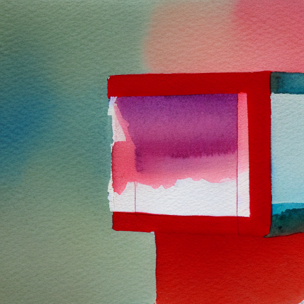
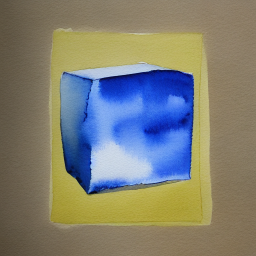
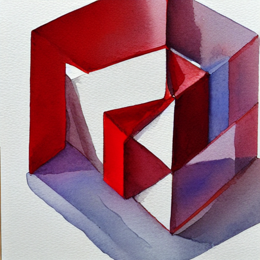
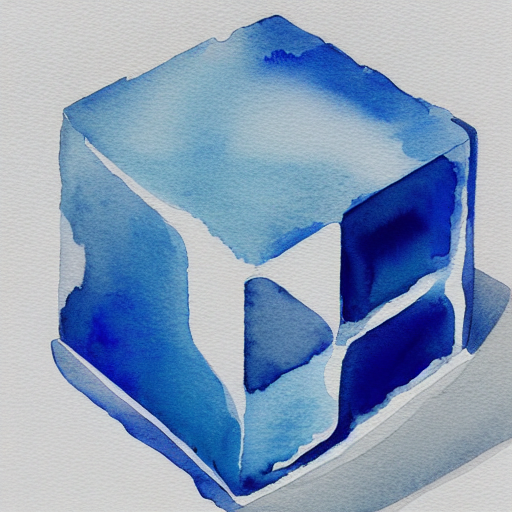
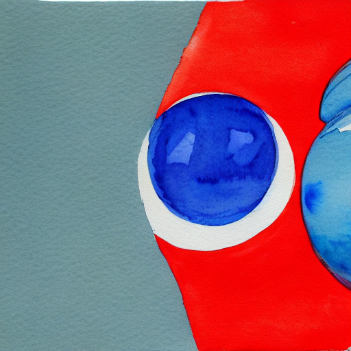
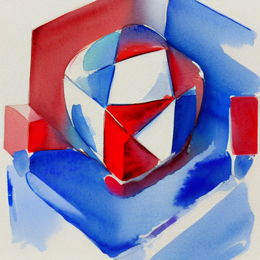
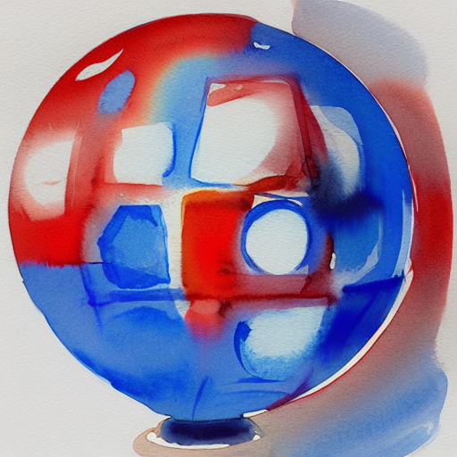

# SD1.4的颜色与左右关系：八个固定请求

本轮将图像评价拆成**对象身份、数量、颜色和几何关系**。先完成[09章](chapters/09-pretrained-image-lab.md)的管线接口，再按下列原图与记录练习逐项观察。四个提示各配两个预先固定的种子，八条完整请求全部运行成功，总耗时37.00分钟；两张单蓝立方体图的主体与颜色获一致确认；两张单红图的身份存在观察分歧，四张关系图均因对象身份条件不足而保留左右不可评。

## 问题与生成前协议

此前[四请求小屋实验](sd14-prompt-pilot.md)覆盖场景与主体出现。本轮问两个更细的问题：单对象颜色替换后，立方体及其目标颜色是否清楚出现？同一对对象的左右描述交换后，图像中的几何关系是否对应变化？

| 提示ID | 完整英文提示 | 含特殊token的长度 |
| --- | --- | ---: |
| `single_red_cube` | `a watercolor painting of a red cube, plain white background` | 13 |
| `single_blue_cube` | `a watercolor painting of a blue cube, plain white background` | 13 |
| `red_cube_left_blue_sphere` | `a watercolor painting of a red cube to the left of a blue sphere, plain white background` | 20 |
| `blue_sphere_left_red_cube` | `a watercolor painting of a blue sphere to the left of a red cube, plain white background` | 20 |

种子为101和211，每个种子下四次请求的初始噪声逐元素相同；两个种子的噪声不同。token均低于CLIP的77位置上限。模型固定为`CompVis/stable-diffusion-v1-4`的`133a221b8aa7292a167afc5127cb63fb5005638b`，CPU float32、512×512、20步DDIM、guidance 7.5、空负提示、eta 0、安全检查器开启、2线程。两线程[计划](../records/measurements/sd14-attributes-followup/plan.json)在首条运行前随`0bc702c`提交推送，完整执行顺序见成本表。

每条命令上限420秒，总预算3600秒，串行执行；首条还须满足wall≤360秒、查询点RSS≤8GiB。技术失败会停止后续，保留全部槽位；图像内容不参与继续执行的决策。本批首条277.02秒/5.36GiB通过门槛，八项均退出0、过滤标记false。全部完成后才一起查看原图。

## 如何记录观察

立方体需要连贯的三维块状体积与面/边；只有方框或棱角色块时保留“模糊”。球体需要可辨圆润体积；平面圆片和裁切碎片按可见证据记录。先判断身份，再给明确对象记录红、蓝、其他或混合/不确定颜色；对象模糊时，颜色记为不可评。

左右关系使用图像坐标，先要求恰好一个清楚的立方体和一个清楚、可唯一定位的球体。此步骤独立于颜色是否正确。可定位时估计可见包围框，横向中心至少相差画宽5%（512像素时25.6像素）且顺序明确，才支持左/右；对象缺失、模糊、重复或严重合并时保留不可评。框来自AI视觉估计。额外对象、背景、水彩风格、裁切及文字另列。

观察由两位AI代理独立完成：协调者了解计划，另一位只接收匿名A–H图像和规则。协调者先保存逐图记录，再读取匿名观察。最终报告保留分歧；无法解决的项目使用不确定状态。原始观察与匿名映射一并保存，真实读者标注列入后续任务。

## 逐项结果与观察分歧

两位观察者都确认，两张单蓝立方体图的主体和蓝色清楚可辨。单红立方体图的身份存在分歧：协调者将两张记为模糊；匿名观察者将整体记为立方体状结构，同时把红/紫/青等混合颜色记为不确定。最终保留身份分歧，这两张均未获一致确认符合单红立方体主项。

| 条件 | 主项确认 | 几何可评 |
| --- | ---: | ---: |
| 单红立方体 | 0/2 | — |
| 单蓝立方体 | 2/2 | — |
| 红立方体在左 | 0/2 | 0/2 |
| 蓝球在左 | 0/2 | 0/2 |

分母均为该条件的两次预定请求；“—”表示提示没有左右关系要求。单红两图的0/2保留不确定状态；seed211尤其呈现开放或切去部分的三维几何结构，观察者对其整体身份判断不同。蓝色两图的背景差异及关系图的逐项判断见下文。

**四张关系图的左右关系都不可评。** 两位观察者均无法确认一个清楚的立方体，因此不满足几何评判的入口条件；seed101两张的右缘蓝色裁切形状，协调者记为模糊候选，匿名观察者记为第二个明确球体，数量分歧也完整保留。所有候选、原始分歧和不可评状态均予保留。

两张seed101关系图都有灰青背景、大片红面与相近位置的蓝色圆润形状；seed211的两张都以红蓝白混合的球状体为主。这些配对适合讨论对象身份、颜色绑定和可评性。提示交换同时改变词序和句法角色；当前结果不足以单独确定某一机制的影响。

主项计数只包含预先声明的对象、颜色及关系要求。白色背景作为次项单独记录：例如蓝立方体seed101虽通过主项，却带有明显黄色框与灰褐底色；seed211为浅色纸面和投影。两位观察者均记录水彩观感，均未观察到文字。上述2/2或0/2是这些固定请求的描述，未据此估计总体成功率、置信区间或模型排名。

全部原始标注见[协调者记录](../records/measurements/sd14-attributes-followup/root-observations.json)、[匿名记录](../records/measurements/sd14-attributes-followup/blind-observations.json)与[合并结果](../records/measurements/sd14-attributes-followup/observations.json)。

## 全部完整原图

单对象颜色配对，seed101：





单对象颜色配对，seed211：





左右关系配对，seed101；先“红立方体在蓝球左边”，后“蓝球在红立方体左边”：




左右关系配对，seed211；提示顺序同上：





八张均为程序保存的512×512原始PNG，文件字节与metrics内SHA相同。全文保留完整画面，供读者检查边缘裁切、额外形状和背景要求。

## 实际成本与环境恢复

2026-11-11恢复实例为Intel Xeon Platinum 8573C，CPU配额4、内存限额32GiB；Python 3.12.14、PyTorch 2.6.0+cpu、Diffusers 0.35.2、Transformers 4.57.6，完整版本见各metrics。每条使用新进程，无模型预热；文件系统缓存、宿主负载未控制，同期有CPU教学核验和文档/浏览器工作。

| 顺序 | 请求 | 推理秒 | 程序内总秒¹ | 外层wall秒 | 查询点RSS GiB |
| --- | --- | ---: | ---: | ---: | ---: |
| 1 | `single_red_cube` / 101 | 260.87 | 275.29 | 277.02 | 5.36 |
| 2 | `single_blue_cube` / 101 | 274.87 | 289.43 | 291.08 | 5.44 |
| 3 | `red_cube_left_blue_sphere` / 101 | 272.56 | 285.93 | 287.92 | 5.42 |
| 4 | `blue_sphere_left_red_cube` / 101 | 245.12 | 259.39 | 261.14 | 5.35 |
| 5 | `blue_sphere_left_red_cube` / 211 | 251.76 | 264.73 | 266.16 | 5.37 |
| 6 | `red_cube_left_blue_sphere` / 211 | 280.06 | 294.08 | 296.07 | 5.35 |
| 7 | `single_blue_cube` / 211 | 252.55 | 266.81 | 268.63 | 5.40 |
| 8 | `single_red_cube` / 211 | 255.24 | 268.86 | 270.44 | 5.36 |

¹程序内总时间从推理函数入口到PNG/NPY保存后的计时查询；推理项包含文本编码、去噪、VAE解码、安全检查与PIL后处理。RSS覆盖进程启动到PNG/NPY保存后的`ru_maxrss`查询，以Linux KiB除以1024²换算GiB；PNG hash、metrics写入、打印与退出随后执行。外层wall由记录器测量完整模型子命令。八命令wall合计2218.46秒，驱动总耗时2220.00秒；每图20次U-Net调用、batch2，即40次单样本分支求值。

这组运行之前还有两个单独保存的阶段：

| 阶段 | 预定请求与实际状态 | 记录的成本/用途 |
| --- | --- | --- |
| 原单线程八请求 | 首条420秒超时，另七条按协议未执行；没有PNG/NPY/metrics | [原始执行与日志](../records/measurements/sd14-attributes-pilot/README.md)，外层420.30秒 |
| 4步线程诊断 | 同提示/seed101，先1线程、后2线程，两条成功 | [诊断记录](../records/measurements/sd14-thread-diagnostic/README.md)，wall118.22/76.69秒；未按图像内容选择线程 |
| 本文两线程八请求 | 单独预声明，八条成功 | 实测37.00分钟；全图统一评阅 |

4步诊断按预定公式外推20步，两线程估计326.59秒，满足≤360秒门槛后才声明新批次；八条估计43.55分钟，实际37.00分钟。诊断同seed的初噪声完全一致，两个PNG有150个RGB标量相差1个8位值。原计划中的4步调用次数曾误填为20/40，第二条执行前追加公开勘误为4/8，实际步数和命令始终为4。原单线程失败、诊断和本批结果分别保留。

两线程批次完成配置、版本、调度器网格、16份模型资产身份和完整文件核验；28个噪声对中12个同seed对相等，16个异seed对不同。本批每请求只执行一次，尚无完整重复结果。生成期间文档分支提交继续推进，run记录保留当时Git HEAD；固定的推理源码、记录器、依赖锁和manifest四项SHA全部保持。

## 复现路径

按[09章](chapters/09-pretrained-image-lab.md)准备可选环境与固定模型缓存。第一条请求的同配置复现命令如下；输出和记录目录需尚未存在，保留已有结果：

```bash
.venv/bin/python -m genai_study.run_record \
  --timeout 420 --output artifacts/run-records/reproduce-attributes/red-101 -- \
  .venv-pretrained/bin/python -u -m genai_study.pretrained_image run \
  --manifest examples/pretrained-sd14/manifest.json \
  --model-dir artifacts/models/sd14 \
  --prompt 'a watercolor painting of a red cube, plain white background' \
  --seed 101 --steps 20 --guidance-scale 7.5 \
  --height 512 --width 512 --threads 2 \
  --output artifacts/reproduce-attributes/red-101
```

一条命令保留420秒超时与失败记录；完整复跑还需沿[冻结计划](../records/measurements/sd14-attributes-followup/plan.json)设置八条全新路径、执行顺序、首条资源门槛和总预算。使用原有有界驱动时，将八条`output`、`record_output`和各自`argv`中的输出路径同步更新，为`--execution`选择新的父目录和文件路径；新计划须保存在仓库可跟踪路径并先提交到当前Git HEAD，驱动会校验计划字节与源码身份。详见测量目录的重做步骤。成本取决于实例，本轮报告提供已观察到的量级。

完整metrics、run JSON、日志、配置/数组核验、AI逐图观察及所有PNG索引见[测量目录](../records/measurements/sd14-attributes-followup/README.md)。模型来源与许可沿用[固定SD1.4资产说明](../SOURCES.md)；本报告的观察规则和教学分析为本项目原创。

## 练习与参考思路

1. 图上同时存在红色区域与蓝色圆形，怎样判断“红立方体在蓝球左边”是否成立？**思路：** 先核对立方体/球体的体积身份和唯一性，再分别记录颜色与左右。立方体身份模糊时保留不可评；不要把一块红色背景直接充当目标对象。
2. 相同seed的左右提示产生相近构图，能否推断模型忽略了位置词？**思路：** 当前提示还交换了词序和句法角色，对象身份与裁切也影响可评性；这些案例可提出假设，进一步研究需预先增加对象/种子、控制句式并纳入独立读者标注。
3. 单条件仅两张图，怎样保存有用的结果？**思路：** 给出两张原图、固定分母、每项状态、观察者分歧和运行成本。先报告明确支持的个案性质，再设计更广的提示分布与重复方案；学习目标包括识别不可评项目。
