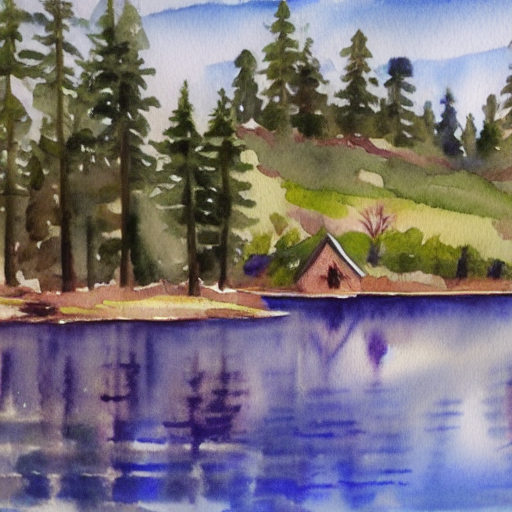
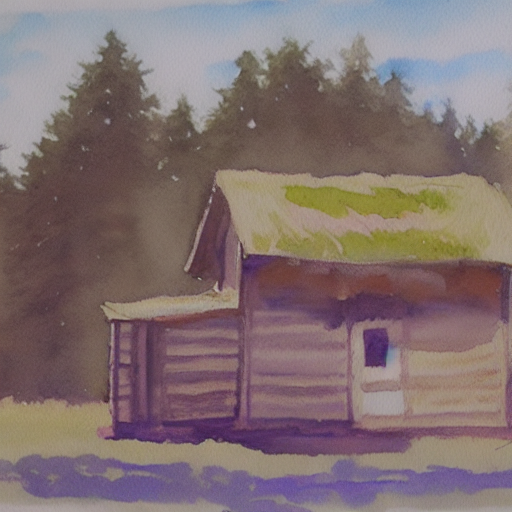
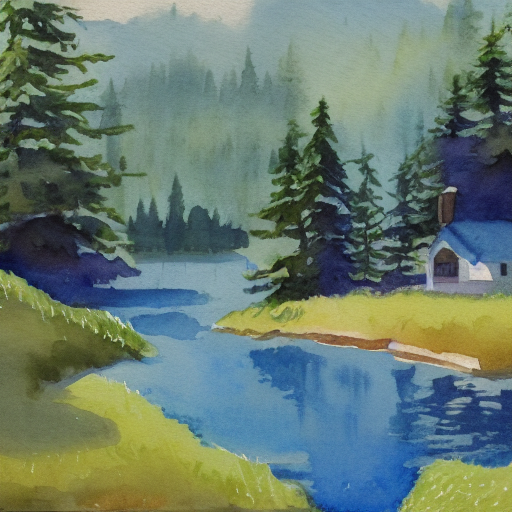
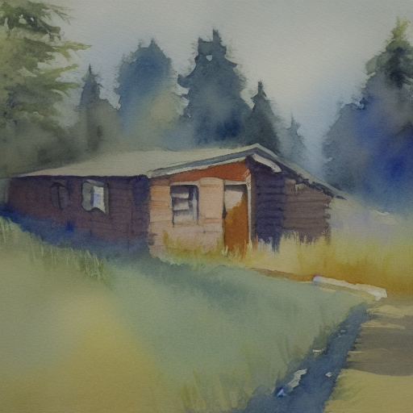

# SD1.4提示与种子：四个预先固定请求的观察

[首次实测](pretrained-image-report.md)中，seed7的湖景提示、较弱引导和前景修订均未出现明确小屋。本轮在生成前提交[实验计划](../records/measurements/sd14-prompt-pilot/plan.json)，比较两种提示、两个新种子；四次请求全部成功，**每种提示的两张图都能辨认出小屋**。这组观察适合练习配对实验、失败分析和结果保存。

## 问题、控制变量与观察规则

两种提示分别为：

- `scene`：`a watercolor painting of a small cabin beside a lake, pine trees, daytime`
- `cabin`：`a watercolor painting of a small cabin, daytime`

短提示删去湖泊和松树，同时改变语义内容、长度与场景关系。实验研究这次具体删减的结果；要归因于某一种文本属性，还需另设控制实验。

种子固定为19、43，每个种子在两个提示下使用逐元素相同的初始噪声。模型、依赖、DDIM网格、float32、512×512、20步、引导7.5、空负提示和单线程全部保持，具体版本见[09章](chapters/09-pretrained-image-lab.md)和原始JSON。提示长度含特殊token分别为17、11，都未触及77位置上限。

执行顺序预先固定为`cabin/19 → scene/19 → scene/43 → cabin/43`，所有图片完成后统一评阅。每请求超时420秒，整个驱动程序预算1800秒；保留成功、过滤与技术失败的原始状态，不替换请求。本次四项均退出0，模型自带检查器均返回过滤标记false。

主要观察“小屋”的定义为：屋顶与墙体形成可辨认的连贯建筑结构时记为**清楚可见**；局部形状可能像建筑、总体身份不确定时记为**模糊**；完整原图中未找到可辨建筑时记为**未观察到**。另记录门窗/木质细节、水彩观感、日间光照、额外边框；湖泊和松树只作为`scene`的提示要求。

观察由两个AI代码代理完成：一位只接收匿名图片ID和观察标准，未获知提示、种子和历史结果；协调代理了解实验计划并检查完整原图。两者对四张图的小屋分类一致。原始逐图记录见[observations.json](../records/measurements/sd14-prompt-pilot/observations.json)；真实读者评价仍待收集。

## 全部图片与配对结果

| 种子 | scene | cabin | 配对观察 |
| --- | --- | --- | --- |
| 19 | 小屋清楚可见，位于湖对岸，画面占比较小 | 小屋清楚可见，占据大部分前景 | 主体都出现，构图和可见细节不同 |
| 43 | 小屋清楚可见，位于右侧水岸，右端出画 | 小屋清楚可见，位于中部，左侧结构延伸到边缘 | 主体都出现，部分建筑仍受取景裁切 |

`scene`、seed19：



`cabin`、seed19：



`scene`、seed43：



`cabin`、seed43：



四张均有水彩晕染与纸纹，光照符合日间，其中`cabin/43`偏阴天或薄雾。未观察到额外装裱边框。两张`scene`均有湖面与松树状针叶树；具体树种仅凭图像难以确定。`scene/19`的小屋较小，门窗及木材细节不确定；`scene/43`门洞和小窗可辨，但木质材料不确定。两张`cabin`的门窗与横向板材纹理更清楚。

主要项目计数为`scene: 2/2`、`cabin: 2/2`。两种提示在这些请求下都完成主体要求，当前样本未显示短提示的小屋出现率优势。前一轮seed7与本轮19/43的差异说明，扩展种子能够暴露单张观察未覆盖的结果；每条件两个新样本支持具体案例描述，更广的成功率与机制解释需要更多预先固定的提示、种子及独立读者评阅。

## 实际成本与复现

2026-11-10，沿用首次实测的CPU环境和独立依赖锁，每条命令新建进程、无模型预热。文件系统缓存、宿主负载未控制；部分运行期间也执行了基础质量检查和文档工作。推理时间包含文本编码、去噪、解码、安全检查和后处理；进程峰值RSS含导入与模型加载，按Linux KiB换算GiB；它在图片与初噪声保存后查询，覆盖进程启动至该点。输出PNG hash、metrics写入、打印和退出随后执行。

| 执行顺序 | 请求 | 推理秒 | 程序总秒¹ | 外层命令秒 | 峰值RSS GiB |
| --- | --- | ---: | ---: | ---: | ---: |
| 1 | cabin / 19 | 259.97 | 266.36 | 266.94 | 5.44 |
| 2 | scene / 19 | 260.07 | 266.31 | 266.89 | 5.37 |
| 3 | scene / 43 | 262.57 | 268.50 | 269.08 | 5.37 |
| 4 | cabin / 43 | 264.56 | 270.61 | 271.21 | 5.34 |

¹程序总时间从推理函数入口起算，终点为产物保存后、RSS查询前的计时字段；外层命令时间另含Python启动、后续元数据处理与退出。四请求驱动程序总耗时1074.13秒，约17.90分钟。每图均记录20次U-Net调用、每次batch2，即40次单样本分支求值。

按09章完成可选环境与权重准备后，下面是第一条请求的复现命令；随后按上表顺序替换`--prompt`、`--seed`和独立输出目录。每条使用420秒上限；总预算到1800秒时停止并记录尚未完成的请求。重做时为全部输出选择新的父目录，保留已有结果。

```bash
timeout 420 .venv-pretrained/bin/python -m genai_study.pretrained_image run \
  --model-dir artifacts/models/sd14 \
  --prompt 'a watercolor painting of a small cabin, daytime' \
  --seed 19 --steps 20 --guidance-scale 7.5 \
  --height 512 --width 512 --threads 1 \
  --output artifacts/reproduce-sd14-pilot/cabin-seed19
```

实际执行的四份完整配置、外层退出码、起始时间、原图hash及校验范围见[测量目录](../records/measurements/sd14-prompt-pilot)。两个同seed噪声对均逐元素相同，两个不同seed噪声不同。文件和源码hash与生成前计划一致，软件与实际scheduler参数一致；内部默认参数名称列表按排序后的名称比较，原始JSON完整保留。上面四张PNG与程序保存的完整输出逐字节相同。

后续[颜色与左右关系实验](sd14-attributes-layout.md)扩展到四提示×两个种子，保留原超时批次、线程成本诊断及八张新图；重点练习对象身份、颜色绑定和几何可评性的拆分。

## 练习与参考思路

1. 为什么本轮结果不足以把“小屋出现”归因于删去湖泊和松树？**思路：** 两个提示在相同新种子下都出现小屋；删减还同时改变多项文本属性。先分析每对结果，再提出能区分解释的下一组请求。
2. 相同初始噪声为什么仍会有不同构图？**思路：** 文本条件进入每次噪声预测，改变后续潜变量轨迹；固定初始状态可以减少一个变化来源，输出随条件变化正是要观察的对象。
3. 四张的小屋都清楚可见，哪些任务仍未通过核验？**思路：** 完整入镜、尺寸关系、精细材质和几何正确性需要各自标准；图像中的松树形态也不提供植物物种鉴定。设计新标准时记录它是在查看这些结果之后提出的。
