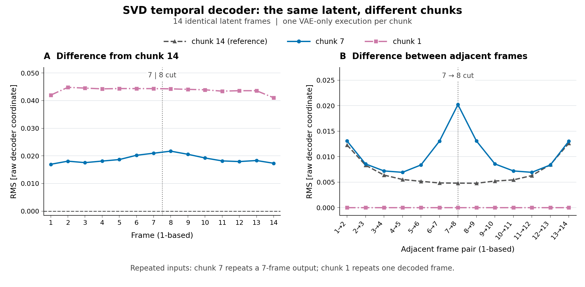

# SVD时间解码：分块怎样改变同一份潜变量

**先修：** [10章的两条latent路径与时间VAE](chapters/10-pretrained-video-lab.md)、[06章的帧差反例](chapters/06-video-temporal-lab.md)。**学习目标：** 追踪分块传入的真实帧数；解释时间卷积与GroupNorm的统计范围；固定latent比较输出和资源。下面的小数组例只需基础CPU环境，真实VAE实验使用可选预训练环境及已缓存的固定权重。

固定同一张参考图的编码后验均值，重复为14帧，分别以14、7、1帧分块调用SVD时间解码器。三次输入latent逐字节相同，解码输出发生变化；单帧分块还产生14张完全相同的帧。这个实验给10章的内存与时间上下文取舍提供了直接测量。

## 1. 只改变解码分块

实验使用[原SVD参考图](assets/svd-input.png)，为256×144的RGB水彩湖岸，PNG SHA为`e76d50ef…ed962`。沿用模型revision `9cf024d5bfa8f56622af86c884f26a52f6676f2e`，仅加载391,017,740字节的时间VAE权重；许可和归属见[资产说明](../examples/pretrained-svd/README.md)。Powered by Stability AI。

在CPU float32下把像素按`pixels/127.5-1`归一化，编码取`latent_dist.mode()`，得到`[1,4,18,32]`的未缩放latent $`L`$。然后构造

```math
z_f=0.18215L,\qquad f=1,\ldots,14.
```

传入原版`StableVideoDiffusionPipeline.decode_latents`的张量形状为`[1,14,4,18,32]`。该方法先逆向缩放，再按chunk逐次调用`vae.decode`，实际`num_frames`分别为`[14]`、`[7,7]`和十四个1；最后拼回原始`[1,3,14,144,256]`输出。三次独立进程的归一化输入、编码mode和scaled latent均逐字节相同。

这组输入是严格重复的参考编码，使用确定性的mode；每个配置只运行一次。它适合隔离解码分块语义，图生视频的去噪、运动生成和质量评价沿用[独立实验协议](pretrained-video-report.md)。旧低分辨率视频失真的成因仍需控制实验。

## 2. 全部三组实际结果

模型、输入、软件与线程数保持，按生成前提交的[计划](../records/measurements/svd-decoder-chunks/plan.json)依次执行chunk14→7→1。原始输出的差值以chunk14为参考，用float64对所有通道、帧和像素的平方差取平均再开方。单位为**原始decoder输出坐标**；这些统计在显示裁剪和8位量化之前计算。

| chunk帧数 | 全局RMS差 | 最大绝对差 |
| --- | ---: | ---: |
| 14 | 0 | 0 |
| 7 | 0.01889143 | 0.31883648 |
| 1 | 0.04375842 | 0.67122684 |

两个分块配置的全部14帧都具有非零RMS差。chunk7输出的前后两个7帧片段逐元素相同，其第7→8帧的相邻RMS为0.02021215；chunk14相同位置为0.00479829。chunk1的14帧逐元素相同，相邻RMS全部为0，原因是每次调用接收同一份单帧latent。



图A按帧比较同一latent在不同分块下的解码差，图B比较相邻输出帧；灰色竖点线标出7与8之间的切口。蓝色圆点为chunk7，粉色方点为chunk1，灰色虚线为chunk14。chunk7的前后七帧段重复，chunk1的各帧重复；曲线由全部原始浮点输出计算。[矢量图](assets/svd-decoder-chunks.svg)及[重绘数据](../records/measurements/svd-decoder-chunks/figure-data.json)可用于放大核对。

本次三组原始数值范围分别约为`[-0.9062,0.6772]`、`[-0.8999,0.6748]`、`[-0.8809,0.7381]`，落在`[-1,1]`内。一般decoder原始输出仍须按实际范围检查。这里的整段结果提供输出差值的参照；帧间变化大小需要结合输入和运动目标解释。

## 3. 成本与运行范围

实测环境为Intel Xeon Platinum 8573C云实例，4 CPU配额、32 GiB内存；每次独立进程设置2个PyTorch计算线程、CPU float32及确定性算法。版本为Python3.12.14、PyTorch2.6.0+cpu、Diffusers0.35.2、NumPy2.1.3、Transformers4.57.6、Pillow13.0.0。

| chunk | 命令秒 | 解码秒 | RSS GiB |
| --- | ---: | ---: | ---: |
| 14 | 73.13 | 64.08 | 2.784 |
| 7 | 46.82 | 39.11 | 1.830 |
| 1 | 40.80 | 33.51 | 0.963 |

完整命令wall由外层记录器从启动子进程至退出测量，包含导入、校验、加载、编码、解码和保存。解码秒仅围绕原版`decode_latents`调用。RSS为Linux进程启动至数组保存、诊断和元数据构建后的高水位，在写metrics、打印和退出前查询。三命令wall之和160.75秒，从首次开始至最后完成共198.12秒；差额包含门槛检查及命令间隔。

每条命令预设300秒超时，总序列1000秒；首条完成后，73.13秒与2.784 GiB通过240秒/12 GiB继续门槛。三条均退出0，原始数组、退出状态及完整日志均保留。这里只观察了一次固定顺序的运行，缓存、进程启动与系统负载影响成本；完整重复和576×1024发布尺寸另需资源验证。

## 4. 一个可手算的时间卷积

考虑固定的单层三点卷积，帧索引从1开始，每次调用在左右各补一个零：

```math
y_f=\frac14x_{f-1}+\frac12x_f+\frac14x_{f+1}.
```

输入`[1,2]`整段输出为`[1,1.25]`，每次只解码一帧则为`[0.5,1]`。同一权重在块边界失去了邻帧贡献。对`[1,…,14]`按7帧分块，第7帧失去$`x_8/4=2`$，第8帧失去$`x_7/4=1.75`$。

<!-- cpu-check: temporal-decoder-chunks -->
```python
import numpy as np

def decode(x):
    p = np.pad(np.asarray(x, dtype=np.float64), (1, 1))
    return (p[:-2] + 2*p[1:-1] + p[2:]) / 4

def chunk_decode(x, size):
    return np.concatenate([decode(x[i:i+size]) for i in range(0, len(x), size)])

x = np.arange(1, 15, dtype=np.float64)
full, split = decode(x), chunk_decode(x, 7)
expected = np.zeros(14)
expected[6:8] = [-2., -1.75]  # 1-based frames 7 and 8.
np.testing.assert_array_equal(split - full, expected)
np.testing.assert_array_equal(decode([1., 2.]), [1., 1.25])
np.testing.assert_array_equal(chunk_decode([1., 2.], 1), [.5, 1.])

constant = np.ones(14)
single = chunk_decode(constant, 1)
np.testing.assert_array_equal(np.diff(single), np.zeros(13))
assert not np.array_equal(single, decode(constant))
print("frames 7/8: full", full[6:8], "chunk7", split[6:8])
print("constant input: full", decode(constant), "chunk1", single)
```

该CPU块已实际运行：第7/8帧从`[7,8]`变为`[5,6.25]`。常数输入的整段输出为`[0.75,1,…,1,0.75]`，chunk1则全部为0.5；零相邻差与整段解码输出差异可以同时出现。独立检查用精确有理数和NumPy验证了12组案例，包括不足一整块的末尾。

## 5. 实际SVD还包含跨帧归一化

固定源码中的时间卷积核为`(3,1,1)`，padding为`(1,0,0)`；每块分别建立时间边界。内部时间残差层还在`[B,C,F,H,W]`上使用GroupNorm。每个通道组的均值与方差覆盖组内通道和`F,H,W`，在eval时仍使用当前输入统计。改变块长会改变这个统计范围。

因此真实decoder的影响可遍及块内多个位置。上面的单层反例精确隔离补零机制；真实实验测量整个解码器改变分块后的输出，实测差值包含卷积与GroupNorm的共同作用。针对单层三点核，可在每块左右多取一帧上下文，再裁回本块输出；完整SVD的多层结构与跨帧统计需要另行分析。

## 6. 复现与练习

基础环境可直接运行本页CPU块。使用现有可选环境和已缓存SVD时，从仓库根目录先执行整段请求，使用全新的输出路径：

```bash
.venv/bin/python -m genai_study.run_record \
  --timeout 300 --output artifacts/svd-chunk-repeat/record-chunk14 -- \
  .venv-pretrained/bin/python -u records/measurements/svd-decoder-chunks/run_probe.py \
  --model-dir artifacts/models/svd --input docs/assets/svd-input.png \
  --chunk-size 14 --output artifacts/svd-chunk-repeat/chunk14
```

查看记录的退出状态、完整wall与metrics的`memory.peak_rss_kib`。首条成功且wall≤240秒、RSS≤12×1024² KiB时，再分别把命令中的三个`14`改为`7`和`1`执行；每次保留新路径，整个序列限制在1000秒内，失败即停止。具体记录位置与独立检查见[证据索引](../records/measurements/svd-decoder-chunks/README.md)。三组全部完成后重算原始差值：

```bash
.venv/bin/python records/measurements/svd-decoder-chunks/compare.py \
  --input-root artifacts/svd-chunk-repeat \
  --output artifacts/svd-chunk-repeat/comparison.json
```

1. **一个三点卷积的chunk2末块只有一帧时，输出长度是多少？** 提示：显式补零后使用valid卷积。答案：保留该末块的一帧；长度7输入共有三个两帧块和一个一帧块，拼接仍为7帧。
2. **单帧解码得到零相邻差，是否足以选择它？** 答案：先说明输入latent和目标。本例每次传入相同latent，自然得到相同输出；还需比较参考解码、帧内容、运动任务和成本。
3. **左右各补一帧真实上下文，可否直接推广到完整SVD？** 答案：单层三点核的感受野半径为1，该构造可精确恢复；完整decoder还有多层时间卷积和覆盖帧轴的GroupNorm，所需上下文与统计处理取决于完整结构。

## 7. 固定来源

- Diffusers0.35.2，commit `b71269675ec1b85193107a691dd35c308e46f0a5`：[分块方法](https://github.com/huggingface/diffusers/blob/b71269675ec1b85193107a691dd35c308e46f0a5/src/diffusers/pipelines/stable_video_diffusion/pipeline_stable_video_diffusion.py#L290-L317)、[时间VAE](https://github.com/huggingface/diffusers/blob/b71269675ec1b85193107a691dd35c308e46f0a5/src/diffusers/models/autoencoders/autoencoder_kl_temporal_decoder.py#L76-L133)、[时间残差与归一化](https://github.com/huggingface/diffusers/blob/b71269675ec1b85193107a691dd35c308e46f0a5/src/diffusers/models/resnet.py#L542-L745)。五份上游文件与安装源码逐字节一致，身份及具体调用见[来源核对](../records/measurements/svd-decoder-chunks/source-audit.md)。
- PyTorch2.6的[GroupNorm定义](https://pytorch.org/docs/2.6/generated/torch.nn.GroupNorm.html)：组内均值、带偏方差估计及训练/eval的输入统计。
- SVD模型、训练范围与版本见[10章](chapters/10-pretrained-video-lab.md)和[模型许可](../examples/pretrained-svd/LICENSE-model.txt)。本页的三点核为原创教学构造，真实VAE实验使用固定发布权重。
