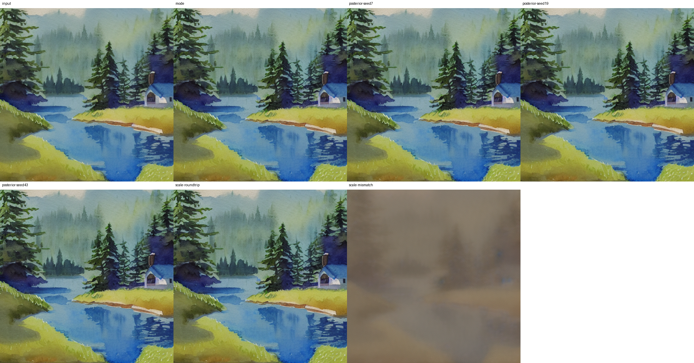

# 潜空间实践：一张图像经过编码与解码后改变了什么？

**先修：** [01章VAE与ELBO](chapters/01-generative-models.md)、[04章潜空间](chapters/04-image-video-roadmap.md#2-潜空间先压缩再生成)，以及[09章的环境与固定权重](chapters/09-pretrained-image-lab.md#5-安装准备权重并生成第一张图)。本实验复用SD1.4的VAE，在CPU上观察编码后验、潜变量缩放和图像重建。

**完成后应能：** 追踪像素与latent的单位和形状，区分后验均值与采样，检查解码前的缩放，并用原始数组解释重建和显示处理的差别。

## 1. 先把表示阶段单独拿出来

潜空间生成分成两项学习任务：自编码器把图像映射到表示并重建；生成网络学习这些表示的分布。09章已经运行“生成latent→解码图像”，这里沿“已有图像→编码latent→解码图像”观察第一项任务。

本轮输入固定为此前保留的[SD1.4水彩图](assets/sd14-pilot-scene-seed43.png)，原始尺寸512×512，文件SHA-256为`a262f5478c234927217e9268e5abeb7f58bcb21a2415366cdbe4f950f26688b9`。它来自同一SD1.4模型的生成结果，实验结论针对这一输入。扩展到自然图像数据集时，需要另行固定图像集合与评价协议。

以RGB的8位整数读入，除以255得到$`x_{\mathrm{RGB}}\in[0,1]`$，再送入

```math
x_{\mathrm{VAE}}=2x_{\mathrm{RGB}}-1.
```

本图保持原尺寸，编码输入为`1×3×512×512`，latent为`1×4×64×64`。输入与latent分别有786432、16384个标量，数量比为48。若输入以uint8保存、latent以float32保存，原始数组字节数之比为12；文件压缩率还取决于编码格式和内容。

## 2. 编码器给出一个条件分布

固定`AutoencoderKL`输出近似后验的均值和对角对数方差：

```math
q_\phi(z\mid x)=\mathcal N\!\left(\mu_\phi(x),\mathop{\mathrm{diag}}\nolimits(\exp\ell_\phi(x))\right).
```

本实现将网络输出的logvar裁剪到$`[-30,20]`$，然后计算$`\sigma=\exp(\ell/2)`$。`posterior.mode()`返回$`\mu`$；`posterior.sample(generator=...)`通过重参数化得到

```math
z=\mu+\sigma\odot\epsilon,\qquad\epsilon\sim\mathcal N(0,I).
```

随机种子控制这里的后验噪声。本轮编码一次，分别用seed7、19、43采样，保持图像、编码参数和解码器相同。程序另用相同种子的独立CPU生成器构造$`\epsilon`$，核对返回的sample与上式一致，并保存参与检查的数组。

latent均值经解码器的结果为$`D(\mu)`$；平均重建则是$`\mathbb E_{q_\phi}[D(Z)]`$。解码器通常非线性，这两个量需要分别计算。例如标量$`Z\sim\mathcal N(1,0.25)`$、$`D(z)=z^2`$时，两者分别为1和1.25。三个后验样本用于观察具体扰动响应。

## 3. 缩放发生在生成网络与VAE之间

这个固定发布配置的缩放系数为$`c_{\mathrm{VAE}}=0.18215`$。本报告的$`z=z_{\mathrm{VAE}}`$是VAE编解码坐标；扩散网络使用缩放坐标$`z_{\mathrm{diff}}=c_{\mathrm{VAE}}z`$，生成后按下式送回解码器：

```math
D(z_{\mathrm{diff}}/c_{\mathrm{VAE}}).
```

直接调用`vae.encode`和`vae.decode`时，由调用方管理这段坐标变换。缩放改变生成模型看到的信号尺度，因此训练噪声强度也要在同一坐标系解释。

本轮在生成前固定六种解码输入，完整协议见[计划](../records/measurements/vae-reconstruction/plan.json)：

| 案例 | 送入解码器的latent | 主要检查 |
| --- | --- | --- |
| mode | $`\mu`$ | 这张图的确定性编码—解码往返 |
| posterior-seed7/19/43 | 各自的$`\mu+\sigma\odot\epsilon`$ | 相同编码分布的三次扰动 |
| scale-roundtrip | $`(c_{\mathrm{VAE}}\mu)/c_{\mathrm{VAE}}`$ | 正确往返变换的浮点残差 |
| scale-mismatch | $`c_{\mathrm{VAE}}\mu`$ | 人为遗漏除以$`c_{\mathrm{VAE}}`$时的具体结果 |

缩放错配案例用于定位接口错误；解释其画面变化时，同时核对输入latent和输出数组。正确往返的两次乘除在有限精度下也可能留下微小差值。

## 4. 原始重建与显示图分别测量

解码器输出$`y`$在VAE坐标中，将其变为未裁剪RGB：$`r=(y+1)/2`$；显示图使用$`\bar r=\mathop{\mathrm{clip}}\nolimits(r,0,1)`$，再量化为8位。对每个案例，分别报告

```math
\mathop{\mathrm{MSE}}\nolimits_{\mathrm{raw}}=\frac1{3HW}\|r-x_{\mathrm{RGB}}\|_2^2,\qquad
\mathop{\mathrm{MSE}}\nolimits_{\mathrm{clip}}=\frac1{3HW}\|\bar r-x_{\mathrm{RGB}}\|_2^2.
```

RMS为对应MSE的平方根，单位沿RGB的$`[0,1]`$坐标解释。越界比例统计$`r<0`$或$`r>1`$的通道值；裁剪RMS为$`\sqrt{\mathop{\mathrm{mean}}\nolimits((r-\bar r)^2)}`$。这些统计基于浮点数组，PNG还包含量化变化。

对区间内的目标$`x_{\mathrm{RGB}}`$，逐坐标投影到$`[0,1]`$总满足$`|\bar r-x_{\mathrm{RGB}}|\leq|r-x_{\mathrm{RGB}}|`$，所以裁剪后MSE必不增加。保留原始数值可以分辨网络重建与显示后处理各自的影响。

这份往返误差也有明确的解释范围。在VAE坐标中令$`x=x_{\mathrm{VAE}}`$、$`E(x)=\mu_\phi(x)`$，给定解码器后，对一张图像的最优latent误差满足

```math
\inf_z\|x-D(z)\|_2^2\leq\|x-D(E(x))\|_2^2.
```

编码器输出是一个可行候选，是否达到最优还需研究。重建误差评价给定图像的往返；生成分布质量还涉及采样覆盖、条件遵循等问题，可对照[05章](chapters/05-evaluation.md)与[ResTok的重建/生成评价](readings/restok-image-ar-2026.md)。

## 5. 运行与结果

复用09章的`.venv-pretrained`与固定模型目录，在仓库根目录运行：

```bash
.venv-pretrained/bin/python -m genai_study.run_record --timeout 300 \
  --output artifacts/run-records/vae-roundtrip -- \
  .venv-pretrained/bin/python -u -m genai_study.vae_study \
  --model-dir artifacts/models/sd14 \
  --input docs/assets/sd14-pilot-scene-seed43.png \
  --output artifacts/vae-roundtrip --seeds 7 19 43 --threads 1
```

入口按原清单校验VAE的配置和334,643,276字节safetensors权重，实际加载这两个文件。使用CPU float32、单线程、`eval()`、`inference_mode()`、确定性算子，保留固定版本默认的`AttnProcessor2_0`，关闭tiling/slicing。输入尺寸保持原状；其它输入须在EXIF转正后各边128–512且为8的倍数。记录目录和实验目录均保护已有结果，重跑时两者一起换成新路径。

输出包括`arrays.npz`中的26个数组、`metrics.json`、输入原文件副本、规范RGB输入、全部六例PNG及完整拼图。`run.json`与`command.log`保存整条命令的状态与wall。原始浮点数组用于重算指标，PNG用于视觉观察。

完成上述固定六案例后，可从仓库根目录独立复算。核验入口显式接收实验目录与记录路径；输出JSON也采用新文件保护：

```bash
.venv-pretrained/bin/python records/measurements/vae-reconstruction/independent-check.py \
  artifacts/vae-roundtrip \
  --record artifacts/run-records/vae-roundtrip/run.json \
  --output artifacts/vae-roundtrip-check.json
```

**实际运行（2026-11-11）：** 原先冻结计划在2026-11-10提交，恢复后以源码`89a64cd`执行。Linux x86_64、Python3.12.14、PyTorch2.6.0+cpu、Diffusers0.35.2；环境配额4个CPU核心/32GiB，实验线程数1。首次整条命令93.77秒、峰值1.64GiB；其中编码6.37秒、六次解码合计81.06秒。指标包含全部案例，无预热。峰值RSS在NPZ与全部PNG保存及数组身份计算后、输出文件hash之前查询，覆盖Linux进程启动至该点，按KiB换算GiB；整条命令的wall由外层记录器测量。

| 案例 | 原始RGB RMS | 裁剪后RGB RMS | 与mode的配对RGB差（RMS） |
| --- | ---: | ---: | ---: |
| mode | 0.02105618 | 0.02105616 | 0 |
| posterior-seed7 | 0.02105596 | 0.02105594 | $`3.04244\times10^{-5}`$ |
| posterior-seed19 | 0.02105593 | 0.02105591 | $`2.98834\times10^{-5}`$ |
| posterior-seed43 | 0.02105904 | 0.02105902 | $`2.98206\times10^{-5}`$ |
| scale-roundtrip | 0.02105618 | 0.02105616 | $`4.91131\times10^{-8}`$ |
| scale-mismatch | 0.16017480 | 0.16017480 | 0.16250402 |

前两列按每个案例与固定输入图的逐像素差计算；最后一列对两份输出数组逐像素作差后取RMS。mode、三个posterior及正确往返各有1个RGB通道值越界，占786432个标量的约0.000127%；错配案例无越界。完整MSE、范围和裁剪幅度见[原始指标](../records/measurements/vae-reconstruction/primary-metrics.json)。



[下载全部七张原尺寸PNG](assets/vae-reconstruction-pngs.zip)。拼图按上排input/mode/seed7/seed19、下排seed43/scale-roundtrip/scale-mismatch排列，最后一个网格留空。

两名AI代理独立查看全部图像：mode保留小屋、针叶树、湖面和整体水彩构图，远处树梢与局部纹理出现细微变化；三个posterior输出在此次视觉检查中难以稳定区分，数组存在上表所示的小差异；缩放错配的低对比灰棕纹理使小屋、树冠和岸线难以辨认。这些观察对应本次固定图像，读者可用全尺寸图自行复查。

本图后验std范围约$`3.06\times10^{-7}`$至0.002026，均值约0.000378；这些是给定输入后16384个latent坐标的统计量。全体训练图像的聚合后验分布另需数据集测量。正确缩放往返的latent最大绝对差$`3.81\times10^{-6}`$，解码后RGB最大绝对差$`9.54\times10^{-7}`$，对应有限精度舍入。

首次wall低于120秒、峰值低于8GiB，满足事前条件后执行完整重复：wall94.85秒、峰值1.65GiB。全部26个数组逐元素相同，NPZ、全部PNG、拼图和输入副本共10个产物逐字节相同；耗时与记录时间分别保留。协调代理另用NumPy、独立CPU随机流和PNG重建核对全部数组hash、六组指标、后验噪声与缩放，详见[独立检查](../records/measurements/vae-reconstruction/independent-check.json)及[重复记录](../records/measurements/vae-reconstruction/repeat-check.json)。

## 6. 练习与参考答案

**A · 追踪形状与字节。** 用512×512 RGB与4×64×64 latent重新计算标量数比；分别按输入uint8、latent float32换算原始字节数。再写出扩散坐标到VAE解码输入的变换。

<details><summary>参考答案</summary>

标量比$`3\times512^2/(4\times64^2)=48`$；原始字节数分别786432与65536，比值12。扩散坐标需除以0.18215再送入这个VAE解码器。PNG、NPZ等文件另有压缩与元数据开销。

</details>

**B · latent均值与图像均值。** 对$`Z\sim\mathcal N(1,0.25)`$和$`D(z)=z^2`$，分别计算$`D(\mathbb EZ)`$与$`\mathbb ED(Z)`$。如果后验噪声改变生成图中的纹理，应怎样设计更充分的观察？

<details><summary>参考答案</summary>

两者为1和$`\mathop{\mathrm{Var}}\nolimits(Z)+(\mathbb EZ)^2=1.25`$。研究图像中的效应时，先固定输入和VAE，预先声明更多seed及纹理观察项，保留全部输出；若要研究数据集行为，还需扩展输入图像并分别统计。

</details>

**C · 裁剪如何影响MSE？** 当目标像素在$`[0,1]`$中时，分别对$`r<0`$、$`0\leq r\leq1`$与$`r>1`$证明裁剪后的平方误差不增加。为什么报告仍保留越界比例？

<details><summary>参考答案</summary>

区间内$`r`$保持；$`r<0`$时最近端点0更接近区间内目标；$`r>1`$时端点1更接近目标。每个坐标的不等式平方后求均值即可。越界比例和裁剪幅度补充说明解码器的原始数值行为，便于比较模型输出与显示处理。

</details>

## 固定来源

- Rombach et al., [LDM，arXiv:2112.10752v2](https://arxiv.org/pdf/2112.10752v2)：§3.1第3–4页的感知压缩，D.1第20页的表示尺度与噪声比，G第29页的KL编码采样与扩散训练缩放。论文讨论一族表示训练设置；本实验的0.18215取自后来的固定SD1.4发布配置。
- [SD1.4 VAE配置](https://huggingface.co/CompVis/stable-diffusion-v1-4/blob/133a221b8aa7292a167afc5127cb63fb5005638b/vae/config.json)：明确给出4通道、网络结构和`scaling_factor=0.18215`。权重及配置身份来自[原有清单](../examples/pretrained-sd14/manifest.json)，适用[CreativeML Open RAIL-M许可](../examples/pretrained-sd14/LICENSE-model.txt)。本实验输入与输出继续保留该来源归属。
- 固定Diffusers0.35.2 commit `b71269675ec1b85193107a691dd35c308e46f0a5`：[AutoencoderKL](https://github.com/huggingface/diffusers/blob/b71269675ec1b85193107a691dd35c308e46f0a5/src/diffusers/models/autoencoders/autoencoder_kl.py)的encode/decode，[对角高斯](https://github.com/huggingface/diffusers/blob/b71269675ec1b85193107a691dd35c308e46f0a5/src/diffusers/models/autoencoders/vae.py)的mode/sample/logvar，以及[SD管线](https://github.com/huggingface/diffusers/blob/b71269675ec1b85193107a691dd35c308e46f0a5/src/diffusers/pipelines/stable_diffusion/pipeline_stable_diffusion.py)中解码前的除法。
- [来源与解析检查记录](../records/measurements/vae-reconstruction/README.md)保存PDF身份、5份固定远端/本地源码的字节对照、原作者LDM实现与小数组验证。单图往返误差、非线性均值与区间投影结论的推导范围分别列出。
